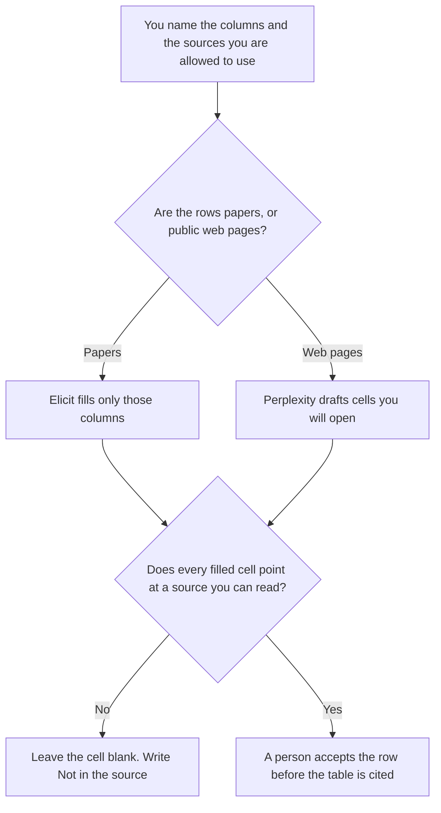

**Use Elicit when the rows are papers and the columns are fields a person already defined. Use Perplexity when the rows are public web sources you will open, and the table is a draft of what those pages say.** The model may fill a cell from a source you can see. It may not invent a finding, a sample size, or a quote. Citations as a habit are [Perplexity vs Elicit for citations](/blog/perplexity-vs-elicit-for-citations-2026/). A map of the literature is [Perplexity vs Elicit for literature maps](/blog/perplexity-vs-elicit-for-literature-maps-2026/).

The bills are [Elicit pricing explained](/blog/elicit-pricing-explained-2026/) and [Perplexity pricing explained](/blog/perplexity-pricing-explained-2026/).

Elicit's prices are from the directory page checked October 16, 2026. Perplexity's Pro and Enterprise figures are from that card, and the personal Pro and Max annual figures were also read on October 24 for the pricing article. Claude's prices are from claude.com/pricing on October 24. Notion's Business price is the October 16 card. Published October 24, 2026. We did not score extraction. You still open the source.

## Which table is in front of you

| The page | Start here | First paid step | The limit |
|---|---|---|---|
| Papers, columns you named | [Elicit](/tools/elicit/) | Plus is $11 a user a month billed annually, $132 a year, and the card lists 5 columns | No finding that is not in the paper |
| Public web sources you will open | [Perplexity](/tools/perplexity/) | Pro is $17 a month billed annually | A citation is not a cell. Open it |
| The column definitions | [Claude](/tools/claude/) | Pro is $17 a month billed annually, or $20 monthly | The columns are yours. A chat does not add one |
| The table the next reviewer opens | [Notion AI](/tools/notion-ai/) | Business is $20 a seat a month | Plus at $10 is not the full AI tier |

A table that looks complete is not evidence. If a column has no support in the source, the cell says Not in the source. It does not estimate a number because the other rows had one.

Elicit Pro is $39 a user a month billed annually, $468 a year, and the October 16 card lists 20 columns and systematic review of 5,000 papers. Plus lists 5 columns. If your table needs a sixth field, Plus is the wrong row. Do not merge two columns to stay on Plus and then pretend the field exists. Scale is $89 a user a month billed annually on that card. The pricing article also records higher annual per-user rates of $49 and $169 that the directory did not assign to a named plan in one sentence. This page does not assign them either. The review is [Elicit review](/blog/elicit-review-2026/).

Perplexity Max is $167 a month billed annually. Enterprise Pro is $40 a user a month, or $400 a year. A table of papers does not require Max. A company record with admin controls is the Enterprise article, not a reason to skip opening sources. The product page is [Perplexity review](/blog/perplexity-review-2026/).

## What a cell is allowed to contain

The column you named, the source id, and the words or number that appear in that source. A paraphrase must be marked as a paraphrase. A quote must be the quote. A missing methods section stays missing. The next sentence of the paper is not permission to fill a column you did not define.

**Elicit Plus** is the paper path when five columns are enough and you need exports and the clinical-trials search the card lists. Basic is free for unlimited search, summaries, and chat, with limited agent and report usage. The extraction table is why people leave Basic.

**Perplexity Pro** is the web path. Premium data such as PitchBook and Statista is on the Pro card. A data source you did not open is not a cell. Monthly prices were not a single number the pricing article would quote. Use the annual figure, then read monthly at checkout.

**Claude Pro** holds the column definitions so two analysts do not invent a sixth column in two different chats.

**Notion Business** is the table the reviewer reopens, with the source link on the row. The invoice is [Notion AI pricing explained](/blog/notion-ai-pricing-explained-2026/).

A prompt that holds the line:

"Fill only the columns I named, from the sources I named. If a cell is not supported, write Not in the source. Do not add a column. Do not infer a sample size."

## What not to delegate

Do not ask which paper "proves" the claim. Do not paste a paywalled PDF into a personal account if your license does not allow it. Do not cite the table because every cell is filled. A person accepts the row. A filled cell can still be wrong.

## FAQ

### How is this different from the citations page?

The citations page is about whether a sentence has a source you can click. This page is a table: named columns, one source per row, a blank when the source is silent. A cited paragraph can still be the wrong shape for the table. Build the columns first.

### How is this different from a literature map?

A map shows how papers relate. A table extracts fields you listed. You can map a set and still have an empty column. You can fill a table and still have no map. Do not use one picture as the other.

### Which one extracts more accurately?

We did not measure that. Elicit fits papers and a column cap you can read on the card. Perplexity fits public web sources you will open. The table is safer when a missing fact stays blank.

### Who may add a column?

The owner of the question. A model that says a column would be useful has proposed a change. It has not made the change. Add the column in the definition, then re-read the rows. Do not let old cells imply the new field was always there.

## Last verified

October 16, 2026 for Elicit, Perplexity's directory card, and Notion. October 24, 2026 for Claude and for the Perplexity annual figures restated in the pricing article. Published October 24, 2026.

**Sources:** [Elicit pricing](https://elicit.com/pricing), [Perplexity pricing](https://www.perplexity.ai/hub/pricing), [Claude pricing](https://claude.com/pricing), [Notion pricing](https://www.notion.com/pricing).

*Published by Andrew for [AI Tools Optimizer](https://aitoolsoptimizer.com).*

[Elicit](/tools/elicit/) is in the [research directory](/tools/category/research-search/). Directory pages may use affiliate links. A purchase through them may earn us a commission at no extra cost to you.
