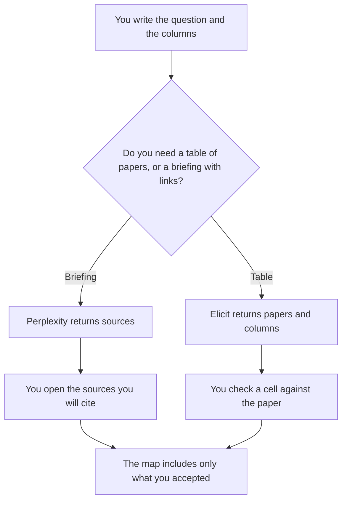

**Use Perplexity when you need a sourced briefing you can click, as the start of a literature map. Use Elicit when the map is a table of papers with columns you defined, such as method, year, and finding.** A map lists papers and the relationship you asked for. It does not add a paper the search did not return, and it does not invent an effect size. A vendor teardown that cites the open web is a different job: [Perplexity vs ChatGPT for RFP teardowns](/blog/perplexity-vs-chatgpt-for-rfp-teardowns-2026/). The retrieval idea under both tools is [what RAG is](/blog/what-is-rag-explained-2026/).

Perplexity and Elicit prices are from directory pages checked October 16, 2026. Claude's prices are from claude.com/pricing on October 24, 2026. Notion's price is from the October 16 card. Published October 24, 2026. We did not score search results. The October 16 Perplexity card lists annual prices and says monthly billing costs more. This article quotes the annual figures that card confirmed.

## Which map you are making

| The question in front of you | Start here | First paid step | The limit |
|---|---|---|---|
| An overview with links you will open | [Perplexity](/tools/perplexity/) | Pro is $17 a month billed annually | Every claim you keep has a source you opened |
| A table of papers and columns | [Elicit](/tools/elicit/) | Plus is $11 a user a month billed annually | A blank cell stays blank |
| The narrative after the table exists | [Claude](/tools/claude/) | Pro is $17 a month billed annually, or $20 monthly | The narrative may not add a paper |
| The page the lab will keep | [Notion AI](/tools/notion-ai/) | Business is $20 a seat a month | Plus at $10 is not the full AI tier |

A literature map is not a systematic review unless you are running that method on purpose. Elicit's October 16 card says Pro includes systematic review screening up to 5,000 papers. That is a different workload from a map of the papers you have already decided to show. If you are not running a review, do not describe the map as one.

## What each seat keeps

**Perplexity Pro** is the briefing seat. Max is $167 a month billed annually on that card. Enterprise Pro is $40 a user a month, $400 a year. The developer API is billed separately, on that card. Open the citation before you copy a sentence into the map. The invoice is [Perplexity pricing explained](/blog/perplexity-pricing-explained-2026/).

**Elicit** Basic is free on the October 16 card, with unlimited search, summaries, and chat with papers, and limited agent and report usage. Plus is $11 a user a month billed annually, $132 a year. Pro is $39, $468 a year. The same card also shows $49 and $169 a month billed annually for some plan options it describes as industry. Read the price you are shown. The invoice is [Elicit pricing explained](/blog/elicit-pricing-explained-2026/).

**Claude Pro** writes the paragraph that introduces a map you have already checked. It does not get to "fill in" a paper you could not open. The review is [Claude review](/blog/claude-review-2026/).

**Notion Business** is a reasonable home for the map if the group already works there. The page cites the table. It does not become a second, looser table. The invoice is [Notion AI pricing explained](/blog/notion-ai-pricing-explained-2026/).

A prompt that holds the line:

"List only papers present in the results I pasted. For each column I named, copy what the source says. If the source does not say it, write Not reported. Do not invent a sample size or an effect."

## What not to delegate

Do not ask either tool to settle a scientific dispute. Do not paste a paywalled PDF into a personal account your institution forbids. Do not promote a briefing into a citation until you have opened the source.

## FAQ

### Which one finds more papers?

We did not measure that. Perplexity fits a sourced overview. Elicit fits columns on papers. The map is done when a reader can get from each cell to a source.

### Is Elicit's free plan enough for a class assignment?

The October 16 card says Basic includes unlimited search, summaries, and chat, with limited agent and report usage. A short map can start there. A systematic review is the Pro line on that card, and it is a method, not a synonym for "several papers."

### Can I mix the two?

Yes, in that order: a briefing to learn the vocabulary, then a table with columns you defined. Do not merge their sentences into one citation. Each claim keeps the source you opened.

### Who decides a paper belongs on the map?

The person who owns the question. A high placement in a result list is not an inclusion decision. Your inclusion rule, if you have one, is a sentence you wrote before you looked at which paper the tool ranked first.

## Last verified

October 16, 2026 for Perplexity, Elicit, and Notion. October 24, 2026 for Claude. Published October 24, 2026.

**Sources:** [Perplexity](https://www.perplexity.ai), [Elicit pricing](https://elicit.com/pricing), [Claude pricing](https://claude.com/pricing), [Notion pricing](https://www.notion.com/pricing).

*Published by Andrew for [AI Tools Optimizer](https://aitoolsoptimizer.com).*

[Elicit](/tools/elicit/) is in the [research and search directory](/tools/category/research-search/). Directory pages may use affiliate links. A purchase through them may earn us a commission at no extra cost to you.
