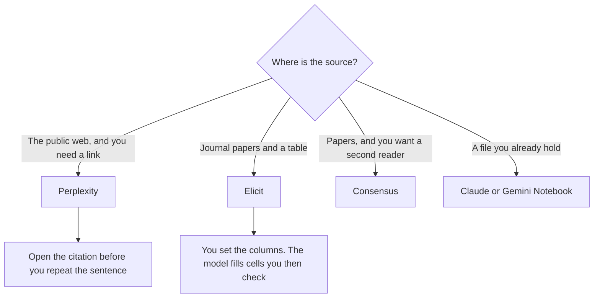

**Use Perplexity when the question lives on the open web and you need citations you can click. Use Elicit when the question is a stack of papers and you need a table, not a paragraph.** They both get called research tools. They do not replace each other. A literature review pasted into a web answer engine will miss the columns. A pricing-page question pasted into Elicit will miss the web.

The web-search three-way is [Perplexity vs ChatGPT vs Gemini](/blog/perplexity-vs-chatgpt-vs-gemini-for-search-2026/). The assistant version of that choice is [ChatGPT vs Perplexity for research](/blog/chatgpt-vs-perplexity-for-research-2026/). Perplexity's bill is [Perplexity pricing explained](/blog/perplexity-pricing-explained-2026/).

Prices are US list prices excluding tax. Perplexity's annual figures are from pricing pages read October 24, 2026. Elicit and Consensus figures are from directory pages checked October 16, 2026. Published October 24, 2026. We did not score citation accuracy.

## Which research you actually have

| The job | Start here | First paid step | The wrong tool |
|---|---|---|---|
| A cited answer from the live web | [Perplexity](/tools/perplexity/) | Pro is $17 a month billed annually | A paper extractor |
| Papers, columns, and a screening table | [Elicit](/tools/elicit/) | Plus is $11 per user a month billed annually | A general chatbot |
| A second opinion that also stays on papers | [Consensus](/tools/consensus/) | Pro is $12 a month billed annually, or $20 monthly | Either of the above, if you wanted this corpus |
| A long PDF you will revise in chat | [Claude](/tools/claude/) | Pro is $20, or $17 billed annually | A search box |
| A notebook that may only use files you uploaded | [Gemini Notebook](/tools/gemini-notebook/) | Free with a Google account. Plus from $4.99 adds room | The open web |
| A weekly packet you will actually read | Either, then a digest | The digest workflow is linked below | A chat log as the archive |

## What the bills are buying

**Perplexity Free** is the trial for cited answers. The help-center table recorded with the pricing explainer lists 3 Pro Searches a day and 1 research query a month. **Pro at $17 a month billed annually** is the plan for model choice, higher limits, files, and Perplexity Computer. **Max at $167 a month billed annually** is what you buy when Computer and Deep Research limits on Pro are the bottleneck you can show. Enterprise Pro is $40 a seat a month, or $400 a year. Monthly personal prices were higher on the page and were not a single number that explainer would quote. Use annual figures, then read checkout.

Elicit's free Basic plan, on the directory page, includes unlimited paper search, summaries, and chat with papers, with limited agent and report usage. **Plus is $11 per user a month billed annually ($132 a year)** for clinical-trials search, exports, 5 columns, and standard agent usage. **Pro is $39 ($468 a year)** for higher usage, systematic review up to 5,000 papers, 20 columns, Routines, and an API. **Scale is $89 ($1,068 a year)** for figure extraction, collaboration, 30 columns, and an admin panel. The directory also records higher per-user rates, such as $49 and $169 billed annually, for some plan options that appear to apply to industry customers. Monthly billing costs more. The product page is [Elicit review](/blog/elicit-review-2026/).

[Consensus](/tools/consensus/) Pro is the paper tool in between a search box and a full extraction table: $12 a month billed annually, or $20 monthly. Free includes unlimited paper searches, 10 Pro messages, and 3 Deep reviews a month, on the directory card. The write-up is [Consensus review](/blog/consensus-review-2026/).

[ChatGPT](/tools/chatgpt/) Plus at $20 can search and can hold a project. It is the right seat when research shares the month with images, custom GPTs, or coding. It is the wrong seat when every claim needs a link you open, which is Perplexity's job, or a column you defined, which is Elicit's. The general map is [ChatGPT vs Gemini vs Claude](/blog/chatgpt-vs-gemini-vs-claude-2026/).

## How not to waste the week

Keep a question log. One question, the tool you used, the link or the paper, and whether you opened it. A week of that log will tell you which subscription earned the renewal. A vibe that "the research felt smart" will not.

For a recurring question, turn the keepers into a digest instead of re-asking. The workflow is [how to build an AI research digest](/blog/how-to-build-an-ai-research-digest-2026/). For a competitor you will check again, the tracker is [how to build a competitor tracker with AI](/blog/how-to-build-a-competitor-tracker-with-ai-2026/). The claim check before any of this reaches a client is [how to fact-check AI writing](/blog/how-to-fact-check-ai-writing-2026/).

Do not ask either tool for a number you have in a dashboard and then treat the answer as the dashboard. Paste the source. A missing source is [a hallucination](/blog/what-is-ai-hallucination-2026/) with a footnote attached.

## FAQ

### Can Elicit replace Perplexity?

Only if you stopped needing the web. Elicit is built around papers and extraction. A newsroom question, a docs page, and a pricing page are Perplexity's side of the table, or a normal search you read yourself.

### Can Perplexity replace Elicit?

Only if you stopped needing a screening table. Perplexity can surface papers and link them. It does not, on the product this directory describes, give you Elicit's column workflow, the 5,000-paper systematic-review line on Pro, or an export shaped like a review. If the deliverable is a table, stay on Elicit and use Perplexity for the background you will cite separately.

### Which one is cheaper?

Elicit Plus at $11 a user annually is the lower research seat. Perplexity Pro at $17 annually is the lower web seat. Those prices buy different objects. Max at $167 and Elicit Scale at $89 are capacity on their own products. Compare them only after the free tiers have failed the same real question.

### What if the sources disagree?

Keep both links. Do not ask a third chat to crown a winner. The disagreement is the finding. Write it down in the digest.

## Last verified

October 24, 2026 for Perplexity Pro at $17 and Max at $167 billed annually. October 16, 2026 for Elicit, Consensus, Claude, ChatGPT, and Gemini Notebook prices named above. Published October 24, 2026.

**Sources:** [Perplexity pricing](https://www.perplexity.ai/pro), [Elicit](https://elicit.com/), [Consensus](https://consensus.app/).

*Published by Andrew for [AI Tools Optimizer](https://aitoolsoptimizer.com).*

[Perplexity](/tools/perplexity/) and [Elicit](/tools/elicit/) are in the [research and search directory](/tools/category/research-search/). Directory pages may use affiliate links. A purchase through them may earn us a commission at no extra cost to you.
