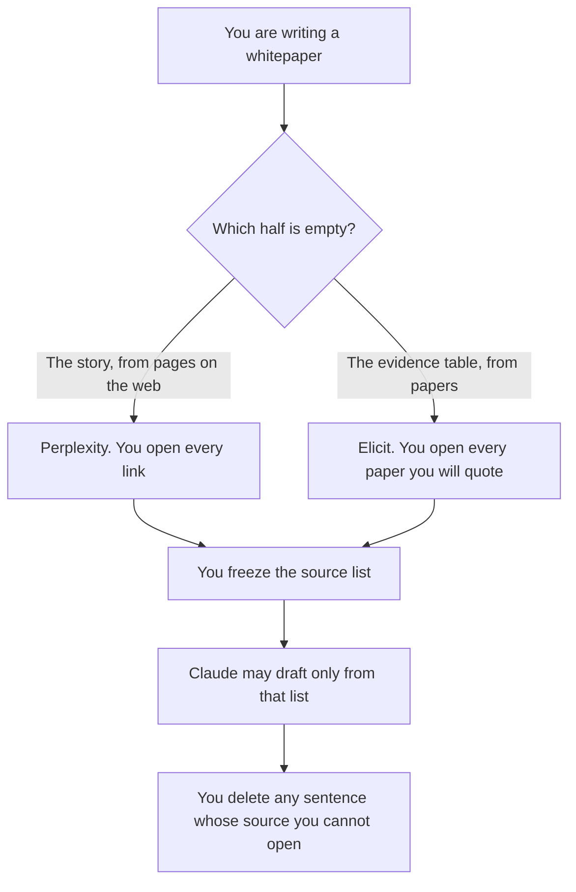

**Use Perplexity when the whitepaper needs a sourced narrative from web pages you will open. Use Elicit when the evidence section must be a table of papers, and every claim in that section has to match a row.** The model may arrange sources you accept. It may not invent a paper, a statistic, or a customer proof point. A citation you cannot open is not a citation.

The link-level choice is [Perplexity vs Elicit for citations](/blog/perplexity-vs-elicit-for-citations-2026/). A literature screen against another assistant is [Perplexity vs Gemini for literature reviews](/blog/perplexity-vs-gemini-for-literature-reviews-2026/). The paper workflow with a second academic tool is [how to research papers with Elicit and Consensus](/blog/how-to-research-with-elicit-and-consensus-2026/). The switch that should block an unsourced sentence is [what AI citation-required mode is](/blog/what-is-ai-citation-required-mode-2026/).

Prices are US list prices excluding tax from directory pages checked October 16, 2026. A live fetch of vendor pricing pages on October 24, 2026 returned HTTP 401, so this page stays on the directory record. Published October 24, 2026. We did not score whitepapers.

## Which half of the whitepaper this is

| The piece you are writing | Start here | First paid step | What you still do |
|---|---|---|---|
| A narrative with web sources | [Perplexity](/tools/perplexity/) | Pro is $17 a month billed annually | Open each page before you keep the sentence |
| A table of papers and extracted fields | [Elicit](/tools/elicit/) | Plus is $11 a user a month billed annually | Read the paper behind any row you will quote |
| A systematic screen of a large set | Elicit Pro | $39 a user a month billed annually, up to 5,000 papers on the directory card | The screen is not the prose |
| The long draft, after the sources are frozen | [Claude](/tools/claude/) | Pro is $20 a month, or $17 billed annually | It may not add a source |
| The page the draft lives on | [Notion AI](/tools/notion-ai/) | Business is $20 a seat a month | The page is not a citation |

Perplexity Max is $167 a month billed annually on the directory card. A whitepaper does not need Max unless you have already hit Pro's limits and can say why. Enterprise Pro is $40 a user a month. The invoice is [Perplexity pricing explained](/blog/perplexity-pricing-explained-2026/).

Elicit's directory card also records higher per-user rates of $49 and $169 a month, billed annually, for some industry options. This page does not guess which of those applies to you. Basic is free, with limited agent and reports. The invoice is [Elicit pricing explained](/blog/elicit-pricing-explained-2026/).

## What the whitepaper is allowed to claim

A claim that points at a source you opened, a number that appears in that source, and a limitation you wrote. A customer logo, a savings figure, and a "studies show" line are claims. If the source list does not contain them, the sentence waits.

**Perplexity Pro** is the web narrative. Export the sources. Read them. A paragraph that cites a page you did not open is a draft, even if the product formatted the footnote.

**Elicit Plus** is the paper table for a modest set: clinical-trial search and exports are on that card, with standard agent usage. **Elicit Pro** is the card that names systematic review up to 5,000 papers, 20 columns, and an API. Use Pro when the method is a screen. Use Plus when you are extracting a small table. Do not quote the industry rate as if it were Plus.

**Claude** writes after the list is frozen. Paste the accepted sources, or the table, and ask for prose that cites only those. **Notion** holds the draft if that is where review happens. Neither product is the literature search.

A prompt that holds the line:

"Draft the evidence section from the rows I pasted. Every sentence must name a row id. If a sentence needs a fact that is not in a row, delete the sentence. Do not add a paper."

## What not to delegate

Do not ask the model for a statistic that will make the argument stronger. Do not treat a vendor's "cited answers" claim as a score. Do not ship a whitepaper the subject-matter owner has not read. The check on a paragraph you already like is [how to fact-check AI writing](/blog/how-to-fact-check-ai-writing-2026/).

## FAQ

### Which one writes a better whitepaper?

We did not measure that. Perplexity fits a web narrative you will verify. Elicit fits a paper table you will verify. The whitepaper is better when the evidence section and the narrative cite the same frozen list.

### Do I need Elicit Pro?

You need Pro if you are screening on the order of the 5,000-paper line on the directory card, or you need the API and routines that card lists. Plus at $11 is the smaller paid step for search, exports, and standard agent usage. Basic can still search.

### How is this different from the citations article?

That page chooses a product for a single citation you must open. This page chooses a product for a long document that has a narrative half and an evidence half. Read both if you are about to publish.

### Can Perplexity replace Elicit for papers?

Use Perplexity for pages on the web. Use Elicit when the unit of evidence is a paper in a set, with columns you defined. A web summary of a paper is not the extraction row.

## Last verified

October 16, 2026 for Perplexity, Elicit, Claude, and Notion. Published October 24, 2026.

**Sources:** [Perplexity](https://www.perplexity.ai/pro), [Elicit pricing](https://elicit.com/pricing), [Claude pricing](https://claude.com/pricing), [Notion pricing](https://www.notion.com/pricing).

*Published by Andrew for [AI Tools Optimizer](https://aitoolsoptimizer.com).*

[Elicit](/tools/elicit/) is in the [research and search directory](/tools/category/research-search/). Directory pages may use affiliate links. A purchase through them may earn us a commission at no extra cost to you.
