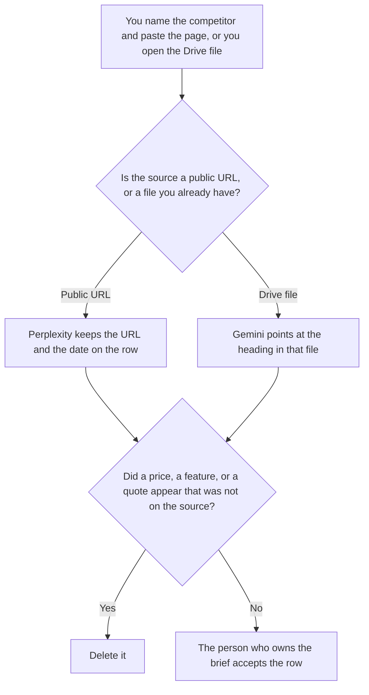

**Use Perplexity when the intel is a row about one named competitor on a public page, and the cell must carry a citation you can open. Use Gemini when the intel is a file already in Drive, such as a win-loss note or a call export a person uploaded.** A row here is a dated fact: the page, the date you opened it, and the sentence you are willing to copy. It is not a strategy essay. A category scan, rather than one competitor, is [Perplexity vs Gemini for market scans](/blog/perplexity-vs-gemini-for-market-scans-2026/). The ChatGPT cut of a competitor brief is [Perplexity vs ChatGPT for competitor briefs](/blog/perplexity-vs-chatgpt-for-competitor-briefs-2026/).

The internal page those rows should feed is [how to write a competitive positioning brief with AI](/blog/how-to-write-a-competitive-positioning-brief-with-ai-2026/). An earnings table, which is a different source, is [Perplexity vs ChatGPT for earnings briefs](/blog/perplexity-vs-chatgpt-for-earnings-briefs-2026/).

Perplexity's Pro price is the October 16 directory card, reconfirmed in the October 24 pricing article. A refetch of the hub pricing URL returned HTTP 403, as that article records, so this page does not add a new Perplexity dollar. Gemini's Pro price is the October 16 directory card recorded in [Gemini pricing explained](/blog/gemini-pricing-explained-2026/). Claude's Pro price is from claude.com/pricing on October 24. Notion is the October 16 card. Published October 24, 2026. We did not score markets. We did not visit a competitor's checkout for you.

## Which intel row you are building

| The row | Start here | First paid step | The limit |
|---|---|---|---|
| A public pricing or feature page, with a URL and the date you opened it | [Perplexity](/tools/perplexity/) | Pro is $17 a month billed annually | No price that was not on that page that day |
| A win-loss note or export already in Drive | [Gemini](/tools/gemini/) | Google AI Pro is $19.99 a month | The row points at a heading in that file. No quote the file does not contain |
| The sentence you will reuse inside the company | [Claude](/tools/claude/) | Pro is $17 a month billed annually, or $20 monthly | The Project holds the sentence. It may not add a weakness |
| The table the next brief will copy | [Notion AI](/tools/notion-ai/) | Business is $20 a seat a month | Plus at $10 is not the full AI tier |

A cell that says a competitor is "more expensive" has added a comparison you did not paste. If you did not open their page, the cell says Page not opened. It does not estimate. A Drive note that says a customer "seemed unhappy" stays in the customer's words if those words are in the file. The model does not upgrade a mood into a win-loss code.

Enterprise Perplexity is a different seat. Enterprise Pro is $40 a user a month, or $400 a year, on the October 16 card recorded in [Perplexity Enterprise pricing explained](/blog/perplexity-enterprise-pricing-explained-2026/). Personal Pro at $17 is the seat for one researcher. Do not quote $17 as the organization price.

## What the row is allowed to contain

The competitor's name, the URL or the file heading, the date, and the sentence you copied. A feature that was not on the page stays out. A price in another currency stays in that currency. This page does not convert euros, pounds, or Canadian dollars into US dollars. If the page showed euros, the cell says euros.

**Perplexity Pro** is the public-page path. The review is [Perplexity review](/blog/perplexity-review-2026/). The invoice is [Perplexity Pro pricing explained](/blog/perplexity-pro-pricing-explained-2026/).

**Gemini Pro** is the Drive-file path. Free Gemini comes with a Google account. AI Plus is $4.99 a month. Pro is the seat this page quotes when the file is the record. The review is [Gemini review](/blog/gemini-review-2026/).

**Claude Pro** holds the sentence the brief will repeat, so a later row does not sharpen it. The review is [Claude review](/blog/claude-review-2026/).

**Notion Business** stores the accepted table, the owner, and the date. The invoice is [Notion AI pricing explained](/blog/notion-ai-pricing-explained-2026/).

A prompt that holds the line:

"Draft the competitive-intel row from the competitor, the URL or file heading, the date, and the sentence I pasted. If a price is missing, write Price not on the page. Do not convert currency. Do not add a weakness."

## What not to delegate

Do not ask which competitor is "winning." Do not fill a blank price from memory. Do not publish the table because the citations look dense. The owner of the brief accepts the row. A linked page is not a strategy.

## FAQ

### How is this different from a market scan?

The market-scan page is a category: several public pages, or several Drive files, about a market. This page is one named competitor, one source, one date. A scan can include a competitor row. A competitor row is not a market. Use that page for the category. Use this page for the named company.

### How is this different from a competitor brief against ChatGPT?

That page chooses Perplexity or ChatGPT for the brief. This page chooses Perplexity or Gemini, and the split is public URL versus a Drive file. Both pages require a source you can open. Do not run a third model to "break the tie" on a price.

### How is this different from an earnings brief?

An earnings brief cites a filing or a transcript a company published about itself. Competitive intel can cite a pricing page, a docs page, or your own win-loss note. An earnings figure stays on the earnings page. Do not paste it here as a competitor's list price unless that page is the source you opened.

### Who may accept the row?

The person who owns the brief. Page not opened stays not opened. A currency you did not convert stays unconverted. A formatted table is not acceptance.

## Last verified

October 16, 2026 for Perplexity and Gemini, with Perplexity's annual Pro figure reconfirmed in the October 24 pricing article. October 24, 2026 for Claude. October 16, 2026 for Notion. Published October 24, 2026.

**Sources:** [Perplexity pricing](https://www.perplexity.ai/hub/pricing), [Gemini subscriptions](https://gemini.google/subscriptions/), [Claude pricing](https://claude.com/pricing), [Notion pricing](https://www.notion.com/pricing).

*Published by Andrew for [AI Tools Optimizer](https://aitoolsoptimizer.com).*

[Perplexity](/tools/perplexity/) is in the [research and search directory](/tools/category/research-search/). Directory pages may use affiliate links. A purchase through them may earn us a commission at no extra cost to you.
