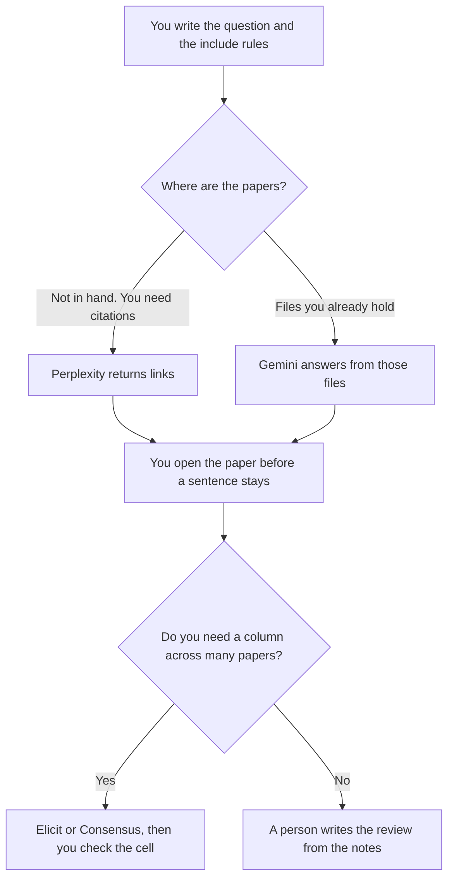

**Use Perplexity when the review starts from a question and every claim needs a citation you can open. Use Gemini when the papers are files you already have, especially in Drive, and the review has to stay inside that packet.** A literature review here is a map of sources: what each paper is for, what it does not show, and the quote or page you checked. It is not a finished journal article, and it is not a search engine's opinion of the field.

The paper-table tools are [Elicit pricing explained](/blog/elicit-pricing-explained-2026/) and [Consensus pricing explained](/blog/consensus-pricing-explained-2026/). The two-tool workflow is [how to research with Elicit and Consensus](/blog/how-to-research-with-elicit-and-consensus-2026/). The split between a cited web answer and a paper tool is [Perplexity vs Elicit for research](/blog/perplexity-vs-elicit-for-research-2026/).

Prices are US list prices excluding tax. Perplexity's annual figures are the ones recorded from a pricing-page read on October 24, 2026 in [Perplexity pricing explained](/blog/perplexity-pricing-explained-2026/). Gemini's prices are the directory record from October 16, 2026. A live fetch of several vendor pricing pages returned HTTP 401 on October 24, 2026. Published October 24, 2026. We did not measure recall or citation accuracy.

## Which seat matches the pile

| The sources you actually have | Start here | What you still do |
|---|---|---|
| A question, and you need links | [Perplexity](/tools/perplexity/) Free | You open the citation before you keep the sentence |
| Cited search most workdays | Perplexity Pro at $17 a month billed annually | Monthly Pro was not a single number we could quote |
| Papers you uploaded, in Google | [Gemini](/tools/gemini/) Free, or Pro at $19.99 a month | The packet is the population |
| A notebook of files you hold | [Gemini Notebook](/tools/gemini-notebook/), free with a Google account | Higher limits follow the Google AI plans. Do not add the multiples |
| A table across many papers | [Elicit](/tools/elicit/) Plus at $11 a user a month billed annually | You still open the source quote |
| A consensus-style pass over papers | [Consensus](/tools/consensus/) Pro at $20 a month, or $144 a year | Deep is $65 a month, or $540 a year |

Perplexity Max is $167 a month billed annually. Buy it when Computer limits on Pro are the bottleneck you can show, not because a literature review sounds serious. Enterprise Pro is $40 a user a month. Gemini Ultra is $99.99 or $199.99. A review of files you have does not require Ultra. Google AI Plus is $4.99. The ladders are the pricing articles above and [Gemini pricing explained](/blog/gemini-pricing-explained-2026/).

## What the note may claim

The question, the include and exclude rules you wrote, and a sentence that points at a paper you opened. It may not invent a sample size, a year, or a finding. If the PDF is not in the packet and the link was not opened, the row says Not opened. A "gap in the literature" is a claim. It needs the search you actually ran, with the date.

**Perplexity Pro** is the paid path when citations and model choice are the weekly habit. The review is [Perplexity review](/blog/perplexity-review-2026/).

**Gemini** is the paid path when the corpus is yours and lives with Google. Notebook is the meter for a packet. The app subscription is a different meter. The review is [Gemini review](/blog/gemini-review-2026/).

**Elicit Pro** at $39 a user a month billed annually is the path when the output is a wide extraction table, up to the systematic-review workflow on that card. Plus at $11 is the smaller extraction seat. The review is [Elicit review](/blog/elicit-review-2026/).

A prompt that holds the line:

"List papers for this question using only sources I pasted or links you will cite. For each paper, include the claim and the location I can check. If you cannot point at a page or a link, write Not opened. Do not describe the state of the field."

## What not to delegate

Do not ask for a definitive review of a field. Do not paste a paywalled PDF into a tool your institution has not approved. Do not let a citation you did not open survive into the draft. The paragraph you publish is yours. A fluent synthesis that mixes two abstracts is the failure mode. The check is [how to fact-check AI writing](/blog/how-to-fact-check-ai-writing-2026/).

## FAQ

### Which one reviews the literature better?

We did not measure that. Pick Perplexity when you are finding sources and need a link on every sentence. Pick Gemini when you already hold the files. Pick Elicit or Consensus when the deliverable is a table of papers. You still open the paper.

### Can Gemini search the open web the way Perplexity does?

Gemini can help from a Google account, and Pro adds the app bundle on the directory card. This page does not treat that as a substitute for a citation-first search. If the sentence needs a link you will keep, use the tool whose answer is built as a citation, and open it.

### What is Education Pro on Perplexity?

Education Pro is $10 a month with SheerID verification, for a student or educator the discount applies to. It is not a secret unlimited plan. Confirm the discount on your account before you budget it.

### How many papers are enough?

The number in your protocol, not a number the model prefers. If you stopped early, say how you stopped. A review that hides the stop rule is a pile of quotes.

## Last verified

October 24, 2026 for the Perplexity annual figures used in the pricing article. October 16, 2026 for Gemini, Elicit, and Consensus directory prices. Published October 24, 2026.

**Sources:** [Perplexity pricing](https://www.perplexity.ai/pro), [Gemini subscriptions](https://gemini.google/subscriptions/), [Elicit pricing](https://elicit.com/pricing), [Consensus pricing](https://consensus.app/pricing/).

*Published by Andrew for [AI Tools Optimizer](https://aitoolsoptimizer.com).*

[Perplexity](/tools/perplexity/) is in the [research and search directory](/tools/category/research-search/). Directory pages may use affiliate links. A purchase through them may earn us a commission at no extra cost to you.
