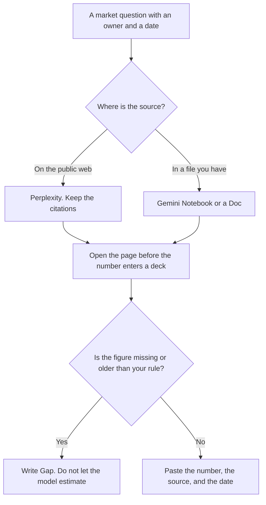

**Use Perplexity when the market question needs citations you can open on the web. Use Gemini when the source is a file you already have, or a brief you will keep in Google Docs.** A market size with no source is a draft sentence, not a finding. We did not score which product is "more accurate." The check is the page you open.

The Perplexity-only workflow is [how to use Perplexity for market research](/blog/how-to-use-perplexity-for-market-research-2026/). Watching a story change over time is a different job: [Perplexity vs ChatGPT for news monitoring](/blog/perplexity-vs-chatgpt-for-news-monitoring-2026/). The habit of opening the source is [what AI grounding is](/blog/what-is-ai-grounding-2026/).

Prices are US list prices excluding tax from directory pages checked October 16, 2026. Published October 24, 2026. We did not audit citation quality. A linked page can still be wrong, outdated, or a vendor's own claim.

## Which question you are asking

| The question | Start here | What you still do |
|---|---|---|
| Who plays in this market, with links | [Perplexity](/tools/perplexity/) Free, then Pro if the weekly limit stops the brief | Open every citation you will paste into a deck |
| You need the premium data sources the Pro card names | Perplexity Pro at $17 a month billed annually | The card lists sources such as PitchBook and Statista. Confirm they appear for your query |
| The source is a PDF, a deck, or a sheet you uploaded | [Gemini Notebook](/tools/gemini-notebook/), free with a Google account | Ask only from those files. Open the passage |
| The brief should become a Doc the team comments on | [Gemini](/tools/gemini/) on that Google account. Plus is $4.99 a month. Pro is $19.99 | The Doc is the record. The chat is not |
| The question is what papers say, not what a market blog says | [Consensus](/tools/consensus/), not this pairwise | Market blogs and peer-reviewed papers are different corpora |

Perplexity Max is $167 a month billed annually. Enterprise Pro is $40 a user a month. A first market brief does not require Max. Buy Max when Computer usage and the credit pool on the card are the constraint you have already hit. The invoice is [Perplexity pricing explained](/blog/perplexity-pricing-explained-2026/).

## What each paid step is for

**Perplexity Pro at $17 a month billed annually** is the working seat for a brief: higher limits, file uploads, model choice, and the premium sources the card names. Monthly billing costs more than the annual figure. The directory lists only prices confirmed on Perplexity's pages, and so does this article. Free is enough to learn the citation habit on a single question.

**Gemini Free** can draft from a paste. Google AI Plus at $4.99 is the small step. Google AI Pro at $19.99 is the row when you want the higher usage tier and Gemini in Docs. A market memo that the team will edit belongs in a Doc, with the sources pasted under each figure. Ultra at $99.99 or $199.99 is a usage tier for heavy Gemini work. A single brief is not that bill.

**Gemini Notebook** is the right Gemini surface when you refuse to let the model leave the files: a packet of annual reports, a folder of call notes, a competitor's published pricing PDF. It is free with a Google account. Higher limits follow Google AI plans. It will not discover a company that is absent from the upload. That discovery is the Perplexity job.

**Consensus** is the wrong default for "how big is this category," and the right default for "what do studies say." Pro there is $12 a month billed annually. Mixing a market-size blog with a literature review in one paragraph is how both numbers become untrustworthy. The invoice is [Consensus pricing explained](/blog/consensus-pricing-explained-2026/).

A prompt that holds the line:

"Answer from the sources you cite. For every number, give the publisher and the date. If sources disagree, show both figures. If you cannot find a figure, write Gap. Do not average gaps into a market size. Do not describe a company I did not name unless the source is in the answer."

The person who puts the number on a slide is [what human-in-the-loop AI is](/blog/what-is-human-in-the-loop-ai-2026/). A clean chart from a missing source is [what an AI hallucination is](/blog/what-is-ai-hallucination-2026/). Whether the cited line actually supports the sentence is [what AI groundedness is](/blog/what-is-ai-groundedness-2026/).

## What not to mix into the brief

Do not paste a customer's private pipeline and ask a consumer account to "size the market" from it. Do not treat a vendor's "we are the leader" page as the market share. Do not let a model convert currencies or inflate a 2022 figure to 2026 with a growth rate it chose. If you have an approved growth assumption, paste it and label it as yours.

A long PDF of filings is a file job. The comparison for that reading is [Gemini vs Claude for long PDFs](/blog/gemini-vs-claude-for-long-pdfs-2026/). Claude Pro is $20 a month, or $17 billed annually, if the team already reviews long documents there. It does not replace the citation step on the open web.

## FAQ

### Which one is better at market research?

We did not rank them. Perplexity is the cited-web path in this directory. Gemini is the file-and-Docs path. The failure mode is the same: a number you did not open.

### Do I need Perplexity Pro for one brief?

Free can answer a scoped question inside the weekly limit. Pro is the step when the limit, the files, or the premium sources on the card are the reason. Max is a later decision.

### Can Gemini replace the sources?

Gemini can draft from sources you provide. It should not be the source. If the Doc has no footnote, the Doc is not done. Notebook citations still need a human click.

### What about a number I will show a buyer?

Put the publisher and the date next to it, or leave it out. A buyer will ask. "The model said" is not a source. The fact-check habit is [how to fact-check AI writing](/blog/how-to-fact-check-ai-writing-2026/).

## Last verified

October 16, 2026 for Perplexity, Gemini, Gemini Notebook, Consensus, and Claude. Published October 24, 2026.

**Sources:** [Perplexity pricing](https://www.perplexity.ai/hub/pricing), [Google AI subscriptions](https://gemini.google/subscriptions/), [Consensus pricing](https://consensus.app/pricing/).

*Published by Andrew for [AI Tools Optimizer](https://aitoolsoptimizer.com).*

[Perplexity](/tools/perplexity/) is in the [research and search directory](/tools/category/research-search/). Directory pages may use affiliate links. A purchase through them may earn us a commission at no extra cost to you.
