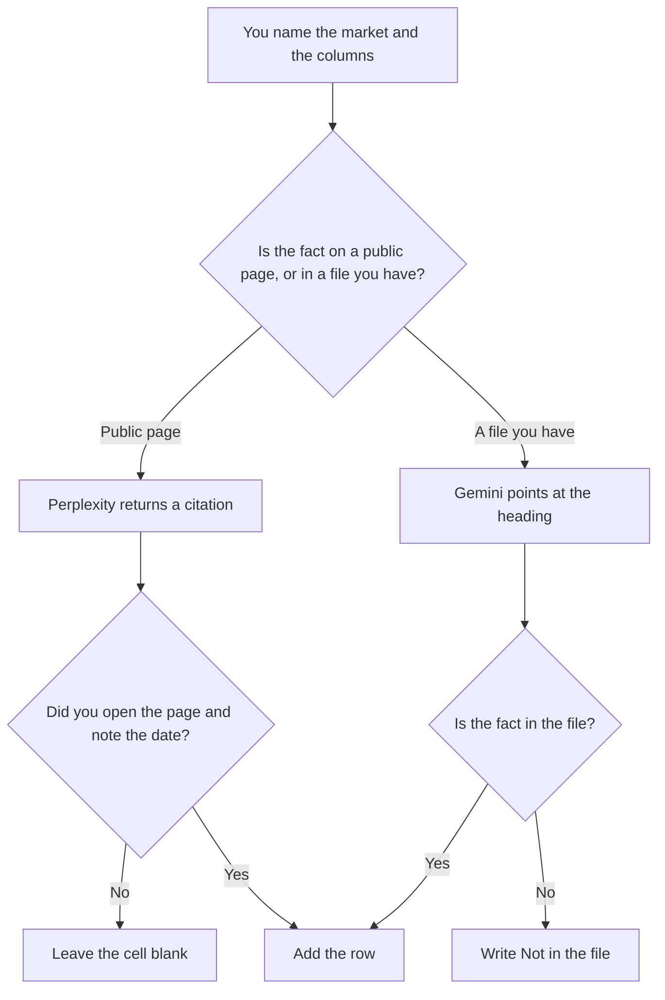

**Use Perplexity when the scan is a table of public pages, and each row must carry a citation you can open. Use Gemini when the scan is over files already in Drive, and the row has to point at a heading in that file.** A scan here is a dated list: the page, the date you opened it, and the fact you are willing to copy. It is not a market essay. The longer research write-up is [Perplexity vs Gemini for market research](/blog/perplexity-vs-gemini-for-market-research-2026/). A competitor list with the same open-the-page rule is [Perplexity vs ChatGPT for competitor scans](/blog/perplexity-vs-chatgpt-for-competitor-scans-2026/).

Perplexity's Pro price is the October 16 directory card. A later refetch of Perplexity's pricing URL returned HTTP 403, as recorded in the competitor-brief article, so this page does not pretend to have a newer sticker. Gemini's Pro price is the October 16 directory card, matching the October 24 subscriptions record in the Notebook pricing article. Claude's Pro price is from claude.com/pricing on October 24. Notion is the October 16 card. Published October 24, 2026. We did not score markets.

## Which scan you are building

| The row | Start here | First paid step | The limit |
|---|---|---|---|
| A public page, with the date you opened it | [Perplexity](/tools/perplexity/) | Pro is $17 a month billed annually | If you did not open the citation, the row stays out |
| A file already in Drive | [Gemini](/tools/gemini/) | Google AI Pro is $19.99 a month | The fact has to be in that file |
| The sentence that must match last month's labels | [Claude](/tools/claude/) | Pro is $17 a month billed annually, or $20 monthly | It formats. It does not browse your scan into existence |
| The table the team reopens | [Notion AI](/tools/notion-ai/) | Business is $20 a seat a month | The table is the record. The chat is not |

A scan that fills every cell is the scan to distrust. Blank cells are the work. The model may not write "likely" into a blank.

Perplexity Free can return citations. Pro is the seat on the October 16 card for higher limits and file tools. The review is [Perplexity review](/blog/perplexity-review-2026/). Gemini Free can read a short paste. Pro is the Docs row. The ladder is [Gemini pricing explained](/blog/gemini-pricing-explained-2026/).

## What a row is allowed to contain

The source name, the URL or the file heading, the date you opened it, and the fact you copied. A column you did not define does not get added because a page mentioned it. The conclusion, if you need one, is a sentence you write after the table. It is not a cell the model completes.

**Perplexity Pro** is the public-web path. Open the page. If the page is a homepage with no date, the row says Date not shown, and you write the date you looked.

**Gemini Pro** is the Drive path. Point at the file. A summary that does not name the heading does not become a row.

**Claude Pro** keeps column names stable across weeks. It does not replace the open-the-page step. The review is [Claude review](/blog/claude-review-2026/).

**Notion Business** stores the table. The invoice is [Notion AI pricing explained](/blog/notion-ai-pricing-explained-2026/).

A prompt that holds the line:

"Build the scan table from the columns I named. If a cell is not on a page I opened or in a file I named, leave it blank. Do not add a column. Do not write a market conclusion."

## What not to delegate

Do not ask who is winning the market. Do not convert a foreign price into USD. Do not treat a citation you did not open as a row. The person who runs the scan accepts the table. A full-looking grid is not a finished scan.

## FAQ

### How is this different from the market research page?

That page is the research narrative: citations, or the file you have, turned into a write-up. This page is the scan: a table of dated rows, and blank cells where the source is silent. The narrative can quote the table. It does not fill the blanks.

### How is this different from a competitor scan?

A competitor scan is a named set of rivals. A market scan is the category you defined, which may include prices, launches, or job posts, under columns you listed. The open-the-page rule is the same. The columns are not.

### Do I need both Perplexity and Gemini?

You need the one that matches where the fact lives. Public pages start in Perplexity. Files you already hold start in Gemini. Merging two drafts is how a date changes in one row and not in its neighbor.

### Who may mark the scan current?

The owner, with the date the rows were opened. A model that says the table is up to date has not opened the pages. Next week's scan is a new date, not a silent overwrite.

## Last verified

October 16, 2026 for Perplexity, Gemini's directory card, and Notion. October 24, 2026 for Claude, and for the Gemini subscription figures recorded in the Notebook pricing article. Published October 24, 2026.

**Sources:** [Perplexity](https://www.perplexity.ai/), [Google AI subscriptions](https://gemini.google/subscriptions/), [Claude pricing](https://claude.com/pricing), [Notion pricing](https://www.notion.com/pricing).

*Published by Andrew for [AI Tools Optimizer](https://aitoolsoptimizer.com).*

[Perplexity](/tools/perplexity/) is in the [research and search directory](/tools/category/research-search/). Directory pages may use affiliate links. A purchase through them may earn us a commission at no extra cost to you.
