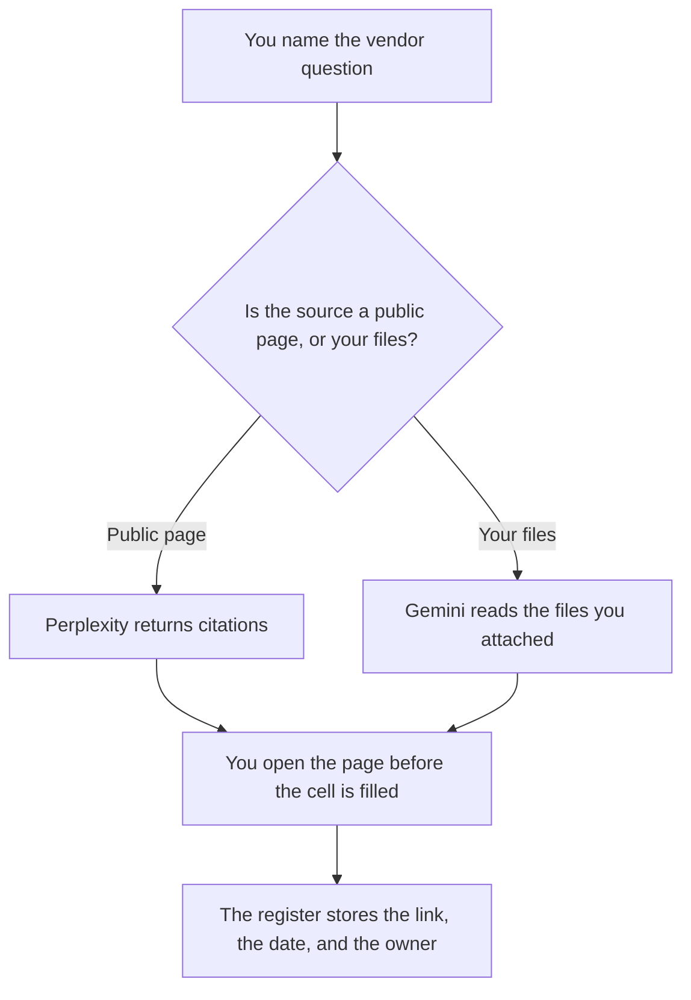

**Use Perplexity when the diligence question needs a public page you can open. Use Gemini when the packet is files you already put in Google Drive.** The model may list what those sources say. It may not invent a SOC report, a price, a customer logo, or a renewal date. If the source does not say it, the cell says Not in source.

The cited competitive page, which is a different packet, is [Perplexity vs ChatGPT for competitive tearsheets](/blog/perplexity-vs-chatgpt-for-competitive-tearsheets-2026/). A weight on one collection, which is not a substitute for opening the page, is [what an AI retrieval boost is](/blog/what-is-ai-retrieval-boost-2026/).

Perplexity, Gemini, and Notion prices are from directory pages checked October 16, 2026. Claude's prices are from claude.com/pricing on October 24. Published October 24, 2026. We did not score vendors, and this page is not legal or security advice.

## Which seat matches the packet

| The question in front of you | Start here | First paid step | The limit |
|---|---|---|---|
| A public claim you must cite | [Perplexity](/tools/perplexity/) | Pro is $17 a month billed annually | Open the citation. Agreement is not a source |
| Files your team already collected | [Gemini](/tools/gemini/) | Google AI Pro is $19.99 a month | The file is the source. The chat does not certify the vendor |
| The register the company will keep | [Notion AI](/tools/notion-ai/) | Business is $20 a seat a month | Plus at $10 is not the full AI tier |
| A long memo from excerpts you paste | [Claude](/tools/claude/) | Pro is $17 a month billed annually, or $20 monthly | No finding that was not in the excerpts |

Perplexity Free is $0 with limited weekly use of top models, on the October 16 card. Pro at $17 a month billed annually is the seat that card ties to higher limits, file uploads, and Model Council. Monthly Pro and Max prices were higher than the annual figures on that check. The card listed only the annual numbers it confirmed. The invoice is [Perplexity pricing explained](/blog/perplexity-pricing-explained-2026/).

Gemini Free is $0. Plus is $4.99. Pro is $19.99, on the same October 16 card. The invoice is [Gemini pricing explained](/blog/gemini-pricing-explained-2026/).

## What the register is allowed to say

The question, the URL or the file name, the date you opened it, the sentence you are willing to quote, and the owner. "They are enterprise ready" is not a finding. A certification is a finding only when the document you opened says so, and you store the date, because certificates expire.

**Perplexity Pro** is the public-page path. Click the citation. If the page is a roundup that does not name the control, write Not in source. A second model that agrees is [what an AI multi-model vote is](/blog/what-is-ai-multi-model-vote-2026/). It is still not the vendor's page.

**Gemini Pro** is the packet path. Attach the PDF or the Doc. Ask for quotes with page or heading labels. A summary that adds "ISO certified" because the filename looked official is the summary you delete.

**Notion Business** is the register if that is where security reviews live. The row points at the file. The chat does not.

**Claude Pro** is the memo after you have excerpts. Paste them. Ask for gaps, which means questions you still cannot answer, not risks the model infers. The review is [Claude review](/blog/claude-review-2026/).

A prompt that holds the line:

"List what this source says about the control I named. Quote the line and the location. If it does not say it, write Not in source. Do not add a certification, a price, or a customer."

## What not to delegate

Do not ask whether to buy. Do not paste a customer's data so the example "matches production." Do not treat a model's training memory as a source. The date on the page is the date you can defend.

## FAQ

### Which one does more careful diligence?

We did not measure that. Perplexity fits a public page with a citation you open. Gemini fits files you already hold. The register is careful when every cell has a location and a date.

### Do I need both?

You need the seat that matches the source. A public security page and a PDF questionnaire are different sources. File both links on one row if you used both. Do not merge the prose into a claim neither source made.

### Can the model compare two vendors?

Only on the questions you listed, and only with a cell per source. A table that says Vendor A is "stronger" has added a judgment. Leave the judgment to the person named as owner.

### Who may mark a review complete?

The owner on the register. A full-looking memo with a Not in source cell is more complete than a memo that filled the cell from memory.

## Last verified

October 24, 2026 for Claude. October 16, 2026 for Perplexity, Gemini, and Notion. Published October 24, 2026.

**Sources:** [Perplexity pricing](https://www.perplexity.ai/pro), [Gemini subscriptions](https://gemini.google/subscriptions), [Notion pricing](https://www.notion.com/pricing), [Claude pricing](https://claude.com/pricing).

*Published by Andrew for [AI Tools Optimizer](https://aitoolsoptimizer.com).*

[Perplexity](/tools/perplexity/) is in the [research and search directory](/tools/category/research-search/). Directory pages may use affiliate links. A purchase through them may earn us a commission at no extra cost to you.
