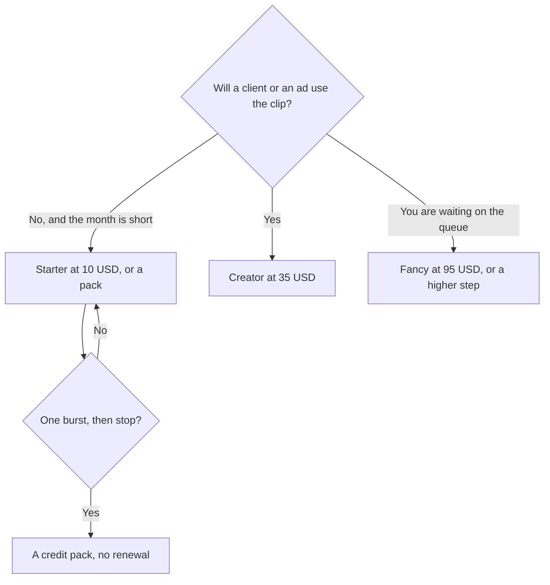

**Pika pricing is a credit allowance and a concurrency cap. The model list is not the paywall.** Starter is $10 a month for 900 credits. Creator is $35 for 3,150 credits and is the first card with a commercial license. Fancy is $95 for 8,550 credits, with higher steps above that. Free is $0 and does not include a monthly grant. You buy packs, or you subscribe.

Those figures were on pika.art/pricing on October 24, 2026, as recorded in the [Pika review](/blog/pika-review-2026/). A refetch for this article returned 401, so the table stays on that read. Yearly billing is labeled −20%. Taxes are whatever checkout adds. Published October 24, 2026.

## The cards

| Plan | Monthly | Credits | Concurrency recorded | License |
|---|---|---|---|---|
| Free | $0 | Packs only | 2 video, 2 image plus audio | All models, no watermark, on the materials read that day |
| Starter | $10 | 900 | 2 video, 8 image plus audio | Commercial license is not on this card |
| Creator | $35 | 3,150 | 8 video, 32 image plus audio | Commercial license |
| Fancy | $95, with steps up to $880 | 8,550 at the $95 step | Unlimited on the card read | Priority queue. Early access from a $440 step |
| Enterprise | Custom | Custom | — | Dedicated support |

Starter's yearly price is printed at **$8 a month**. The −20% label is the column. This article does not pretend every higher yearly cell was printed in front of us. If the label is uniform, Creator's $35 becomes $28 and Fancy's $95 becomes $76. Read the cell at checkout. The slogan is not the invoice.

## Packs versus the subscription

| Pack | Price | Credits | Credits per dollar |
|---|---|---|---|
| Smaller | $25 | 1,500 | 60 |
| Popular | $100 | 6,000 | 60 |
| Larger | $500 | 30,000 | 60 |

The page also says a one-time top-up is 60 credits per $1 on every plan. The three packs match that rate. Starter's 900 credits for $10 are 90 per dollar, which is the better credit price if you will use the month. The pack is the better buy if you need a weekend and you do not want a renewal. Check the pack screen anyway. A sale can move the rate. The subscription is the discount only while you consume it.

Pika's own pack cards translate credits into clips and stills for named models. A $25 pack was described as on the order of a dozen clips or a few hundred images, depending on the model named that day. Those translations move. Watch the debit on one real generation before you forecast a month. Access to every model is not a flat cost per second. A heavier model spends more of the same 900 credits.

## What Fancy is selling besides credits

Concurrency is the other product. Starter's two video slots are a ceiling when a product shot and a b-roll clip need to render together. Creator's eight video slots are why a small team feels the upgrade before they read the license clause. Fancy's unlimited line is about queueing. Credits still fall. Priority and early access are the rest of that card. Early access starts at the $440 step, not at $95. Do not buy the $95 tier and tell a producer you are first in line for a model that lives on a higher step.

Commercial use starts at Creator. Starter can be the right month for a personal test. It is the wrong month for a paid ad or a client file. Read the license the day you subscribe. This article is not that license.

The shelf around Pika is [best AI video generators](/blog/best-ai-video-generators-2026/) and [Runway vs Kling vs Veo](/blog/runway-vs-kling-vs-veo-2026/). [Runway](/tools/runway/) Standard is $12 a month billed annually for 625 credits, or $15 monthly, on the October 16 card. [Kling AI](/tools/kling-ai/) Standard renews at $8.80 after a $6.99 first month. [Luma AI](/tools/luma-ai/) Plus is $30 or $300 a year for 10,000 credits, with no free plan on the page read October 24. The Luma invoice is [Luma AI pricing explained](/blog/luma-ai-pricing-explained-2026/). Own a second generator only when you can name the shot the first one will not make.

## FAQ

### How much is Pika Starter?

$10 a month for 900 credits, or $8 a month on the yearly price printed for that card. Commercial use is not the Starter feature. That line is on Creator at $35.

### Is Pika free?

The account is free. The monthly grant is not. Free runs on packs, with two video slots, and the materials we read said all models and no watermark. A pack is still a purchase.

### Does yearly billing save 20%?

The column is labeled −20%, and Starter's yearly cell prints $8. Confirm Creator and Fancy on the toggle. Quote the cell, not 0.8 times a number you did not see.

### Are credits the same as video seconds?

No rate that stable is recorded here. Model choice changes the debit. Generate one clip you would actually ship, divide the debit into 900 or 3,150, and that quotient is your volume for that model.

## Last verified

October 24, 2026, from pika.art/pricing, as recorded in the Pika review. A later fetch for this article returned 401. October 16, 2026 for Runway and Kling comparison prices. Published October 24, 2026.

**Sources:** [Pika pricing](https://pika.art/pricing), [Runway pricing](https://runwayml.com/pricing).

*Published by Andrew for [AI Tools Optimizer](https://aitoolsoptimizer.com).*

[Pika](/tools/pika/) is in the [video directory](/tools/category/video/). Directory pages may use affiliate links. A purchase through them may earn us a commission at no extra cost to you.
