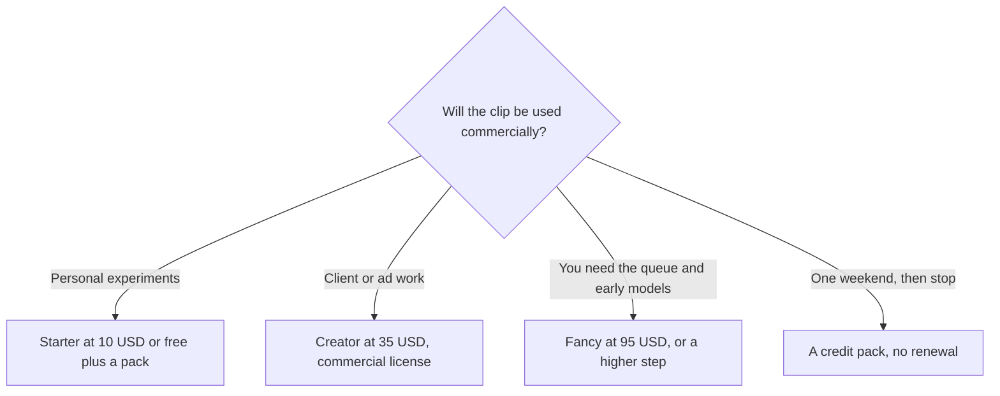

**[Pika](/tools/pika/) is a video and image studio organized as task apps rather than a wall of model names.** Make a product shot, relight a clip, reshoot a scene. The plan decides how many credits you get and how many jobs can run at once. It does not, on the cards we read, decide which models you may touch. On October 24, 2026, pika.art/pricing listed Starter at **$10 a month for 900 credits**, Creator at **$35 for 3,150**, and Fancy at **$95 for 8,550**, with a yearly column marked **−20%**.

We did not score clip quality against [Runway](/tools/runway/) or [Kling](/tools/kling-ai/). The shelf of generators is [best AI video generators](/blog/best-ai-video-generators-2026/) and [Runway vs Kling vs Veo](/blog/runway-vs-kling-vs-veo-2026/). This review is about which Pika card matches the license you need.

## The cards

| Plan | Monthly price | Credits | Concurrency we could read | License note |
|---|---|---|---|---|
| Free | $0 | Packs only, not a monthly grant | 2 video, 2 image plus audio | All models, no watermark on the materials we read |
| Starter | $10 | 900 a month | 2 video, 8 image plus audio | The commercial-license line is not on this card |
| Creator | $35 | 3,150 a month | 8 video, 32 image plus audio | Commercial license |
| Fancy | $95, with higher steps up to $880 | 8,550 at the $95 step | Unlimited on the card we read | Priority queue. Early access to new models from a $440 a month step |

The invoice is [Pika pricing explained](/blog/pika-pricing-explained-2026/).

The yearly column is labeled −20%. Starter's yearly price is printed at **$8 a month**. We are not going to multiply every higher tier in a client quote and pretend Pika printed each yearly cell. Apply the toggle. If the −20% label is uniform, Creator's $35 becomes $28 and Fancy's $95 becomes $76, and you should still read the cell.

Credit packs sit beside the subscription:

| Pack | Price | Credits |
|---|---|---|
| Smaller pack | $25 | 1,500 |
| Popular pack | $100 | 6,000 |
| Larger pack | $500 | 30,000 |

The page also says a one-time top-up is **60 credits per $1** on every plan. At that rate, $10 buys 600 credits, which is less credit than Starter's 900 for the same $10. The subscription is the better credit price if you will use the month. The pack is the better buy if you need a burst and you do not want a renewal. Check the pack screen before you assume 60-per-dollar is the pack price. Packs can be discounted relative to that top-up line. The $25 pack is 1,500 credits, which is 60 per dollar exactly. The $100 pack is also 60 per dollar. The $500 pack is 60 per dollar. So the packs we read match the $1 line. Subscription credits are the discount.

## What the credits are buying

Pika's own examples on the pack cards translate credits into clips and stills for specific models. A $25 pack is described as on the order of a dozen Seedance clips or a few hundred images, depending on the model named on that card. Those translations will move when model prices move. Use them as a shopping aid, then watch the credit debit on a real generation. A plan with "all models" still spends more credits on a heavier model. Access is not the same thing as a flat cost per second.

Concurrency is the other product difference. Starter's two video slots are a ceiling when you are iterating on a product shot and a B-roll clip at the same time. Creator's eight video slots are why a small team feels a difference before they feel the license clause. Fancy's unlimited line, if you are on that card, is about queueing, not about free renders. Credits still fall.

The commercial license is the clause that should decide Creator versus Starter. A $10 plan that you then use in a paid ad is the expensive plan, because the failure mode is the license, not the credit counter. If the work is a personal reel, Starter or a pack is the honest buy. If the work is a client, Creator is the first card that prints the license.

## Where it sits next to other generators

[Luma](/tools/luma-ai/) sells credits in larger monthly blocks, with Plus at $30. [Runway](/tools/runway/) and Kling are reviewed on their own pages. Pika's pitch is the app layer: you pick a task, it picks a model. That is useful when you do not want to maintain a model cheat sheet, and it is less useful when you already know which model you want and you are paying elsewhere for it. Stacking Pika, Luma, and Runway because each demo looked good is the pattern [which AI subscription is worth paying for](/blog/which-ai-subscription-is-worth-paying-for/) warns against.

Watermarks: the free materials we read say no watermark. Confirm that on the export you care about. A "no watermark" line on a pricing page is not a promise about every future model. For a broader look at free exports, see [best free AI video generators without a watermark](/blog/best-free-ai-video-generators-no-watermark-2026/). Treat that guide as a map, then check Pika's current export.

## Who should pay

**Use free plus a pack** for a one-off. **Pay $10** when you want 900 credits every month and the work is not commercial. **Pay $35** when a client, an ad account, or a product page will use the file. **Pay $95 or more** when concurrency and early models are blocking production, not when the tier name sounds faster. **Skip Pika** if your pipeline is already a single generator you understand and the only gap is editing, captions, or a voice. Those are different tools.

Nine hundred credits at Starter is the number to divide into your real shot list. If one finished ad takes a few dozen credits in tests, 900 is a month of variations. If one model burns a large fraction of that on a single try, Creator's 3,150 is the relevant pack, license or not.

## FAQ

### How much is Pika?

Starter is $10 a month for 900 credits. Creator is $35 for 3,150. Fancy starts at $95 for 8,550. Yearly billing is marked −20%, and Starter yearly is shown at $8 a month. Checked October 24, 2026.

### Which plan includes commercial use?

Creator is the first card that lists a commercial license. Do not assume Starter includes it because every model is available.

### Are there packs if I do not want a subscription?

Yes. Packs at $25, $100, and $500 were on the pricing page, at 1,500, 6,000, and 30,000 credits. A top-up line says 60 credits per $1.

### Does a higher plan unlock more models?

The plans we read say all models and apps are on every plan, including free. Higher plans add credits, concurrency, the commercial license, and on Fancy a priority queue.

### What is the $440 line?

Fancy's materials say early access to new models starts at a $440 a month step. That is above the $95 Fancy entry. Read that step before you hear "Fancy" and assume early access is included.

## Last verified

October 24, 2026, from Pika's pricing page. Model names used in pack examples change. The $10, $35, and $95 monthly prices and the commercial-license split are the figures to recheck first.

**Sources:** [Pika pricing](https://pika.art/pricing), [Pika](https://pika.art).

[Pika](/tools/pika/) is in the [video directory](/tools/category/video/). Directory pages may use affiliate links. A purchase through them may earn us a commission at no extra cost to you.
