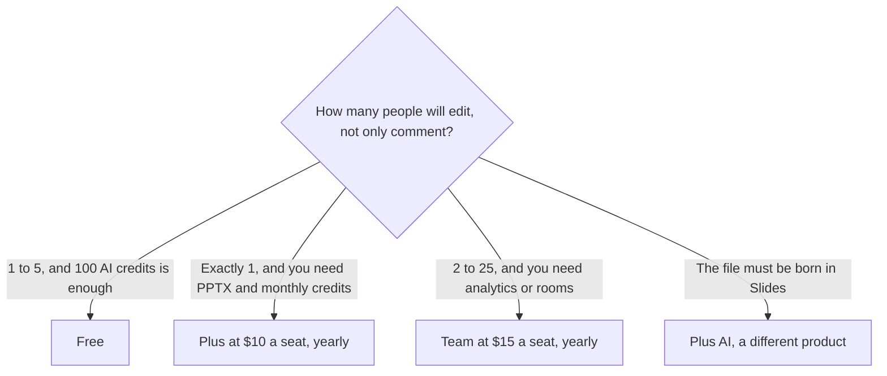

**Pitch pricing is a per-seat editor, and the free plan is a real workspace.** Free is $0 for one to five members, with unlimited presentations, custom templates, and 100 AI credits that do not renew. Plus is $10 a seat a month billed yearly, and it is for one member, with 500 AI credits a month. Team is $15 a seat a month billed yearly for one to 25 members. Business is $20 for up to 200 members. Enterprise is required above 200 members, with a 30-seat minimum. Yearly billing is 17% cheaper than monthly. The directory records the yearly rates and does not print the monthly dollar, so this page does not invent one.

The generated-card alternative is [Gamma pricing explained](/blog/gamma-pricing-explained-2026/). The Smart Slide alternative is [Beautiful.ai pricing explained](/blog/beautiful-ai-pricing-explained-2026/). The pair is [Gamma vs Beautiful.ai](/blog/gamma-vs-beautiful-ai-2026/).

Prices are US list prices excluding tax from Pitch's pricing page and Help Center, checked October 16, 2026. Published October 24, 2026. We did not score slide design.

## The seats

| Plan | Yearly rate | Who can be in it | AI credits and the extra |
|---|---|---|---|
| Free | $0 | 1 to 5 members | 100 one-time credits, unlimited presentations, 2 external guests |
| Plus | $10 a seat a month | 1 member only | 500 credits a month, custom fonts, video uploads, PPTX export, 5 guests |
| Team | $15 a seat a month | 1 to 25 | 25 advanced links, 3 teamspaces, 2 pitch rooms, 25 guests |
| Business | $20 a seat a month | 1 to 200 | Broader sharing and roles |
| Enterprise | Contact sales | Required above 200, minimum 30 seats | Custom |

Pitch charges every member of a paid workspace except commenters. A reviewer who only comments should stay a commenter if you are counting seats. Plus cannot be selected for a workspace with more than one member, on the recorded FAQ. A second editor means Team, not a second Plus.

## The yearly math

Plus for the one person it allows is 12 × $10 = $120 a year. Five Team seats are 5 × $15 × 12 = $900 a year. Ten Team seats are 10 × $15 × 12 = $1,800 a year. Ten Business seats are 10 × $20 × 12 = $2,400 a year. Those figures are the yearly rates. Monthly billing costs 17% more than these, and the pre-discount monthly sticker was not on the card we are willing to quote. Ask checkout.

Free's 100 AI credits do not come back. Plus's 500 credits a month renew and, on the FAQ, are the seat's monthly grant. The directory does not print a separate Team or Business credit allotment, so this page does not guess one. Advanced links, the ones that track visits and time per slide, start on Team. Pitch rooms start on Team. PPTX export without Pitch branding is a paid-plan feature.

## What the other deck tools charge for a different file

[Gamma](/tools/gamma/) Plus is $9 a seat a month, or $108 a year, with 1,000 credits. Free credits do not refresh. Gamma makes cards. Pitch is an editor your team co-edits. [Beautiful.ai](/tools/beautiful-ai/) Pro is $14.50 a month billed annually, or $45 month to month, with unlimited AI generation and PowerPoint export. [Plus AI](/tools/plus-ai/) Basic is $10 a user a month billed annually when the deck has to be born in Google Slides or PowerPoint. The format choice against Gamma is [Plus AI vs Gamma](/blog/plus-ai-vs-gamma-2026/).

A sales one-pager should be true before any of these tools themes it. The workflow is [how to write a sales one-pager with AI](/blog/how-to-write-a-sales-one-pager-with-ai-2026/). A partner deck is [how to write a partner brief with AI](/blog/how-to-write-a-partner-brief-with-ai-2026/) first, and slides second.

## FAQ

### Is Plus a team plan?

No. Plus is one member. The moment a second person needs to edit, you are on Team at $15 a seat a month billed yearly, or you stay on Free if five members and 100 one-time AI credits are enough.

### Do commenters cost a seat?

The directory says Pitch charges all members of a paid workspace except commenters. Set reviewers up as commenters before you multiply $15 by the whole company.

### Is there a free plan?

Yes. Up to five members, unlimited presentations, and 100 AI credits that do not renew. It is not a trial clock. When the credits are gone, the editor remains, and the AI actions that spend credits do not.

### How does the 17% yearly discount work?

Yearly subscriptions are 17% cheaper than monthly, on the Help Center note recorded October 16, 2026. The prices in the table are the yearly rates. If a quote shows a higher monthly figure, that gap is the discount, not a second product.

## Last verified

October 16, 2026 for Pitch, Gamma, Beautiful.ai, and Plus AI. Monthly Pitch stickers were not printed on the card this page quotes. Published October 24, 2026.

**Sources:** [Pitch pricing](https://pitch.com/pricing), [Pitch plans and pricing](https://help.pitch.com/en/articles/13621309-pitch-plans-and-pricing), [Gamma pricing](https://gamma.app/pricing).

*Published by Andrew for [AI Tools Optimizer](https://aitoolsoptimizer.com).*

[Pitch](/tools/pitch/) is in the [presentations directory](/tools/category/presentations/). Directory pages may use affiliate links. A purchase through them may earn us a commission at no extra cost to you.
