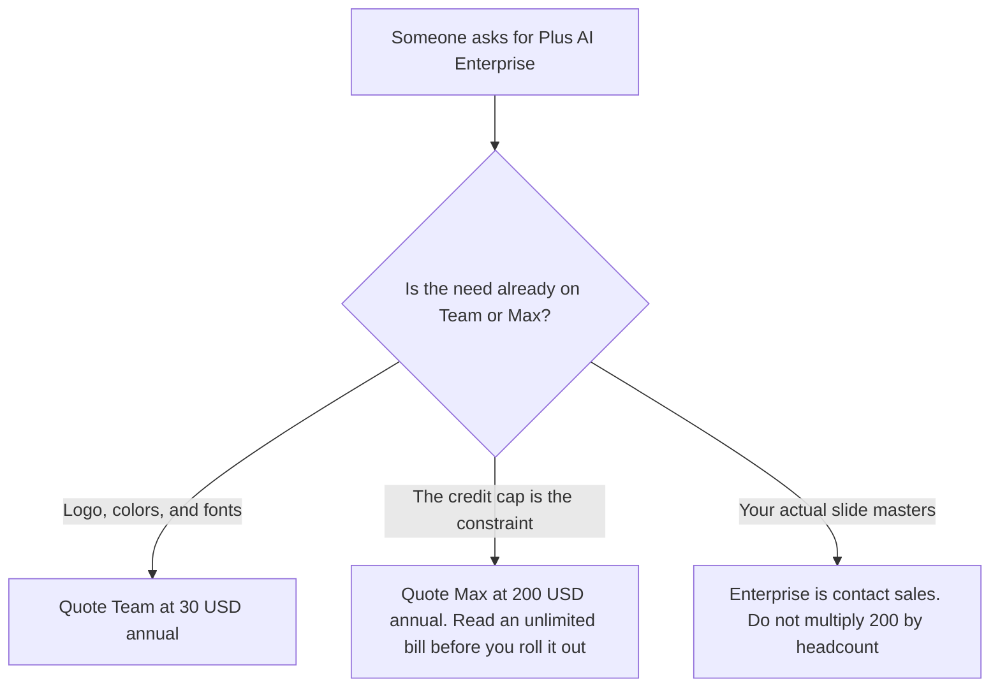

**Plus AI does not print an Enterprise price.** On plusai.com/pricing fetched October 24, 2026, the paid cards stop at Max: $200 a user a month billed annually, or $240 monthly, with unlimited credits. Team is $30 annually or $40 monthly, and that card includes custom branding for logo, colors, and fonts. The FAQ on the same page says custom templates, built from your organization's actual slides and slide masters, are an Enterprise conversation. The full ladder is [Plus AI pricing explained](/blog/plus-ai-pricing-explained-2026/). This page is the Enterprise name.

A card deck whose company row is also unpriced is [Gamma Business pricing explained](/blog/gamma-business-pricing-explained-2026/). The product page is [Plus AI review](/blog/plus-ai-review-2026/). The file-format choice is [Plus AI vs Gamma](/blog/plus-ai-vs-gamma-2026/).

The dollars below are US list prices from that October 24 page. They match the October 16 directory card. Published October 24, 2026. We did not score slides. We did not receive an Enterprise quote. A 7-day trial with 1,000 credits is not an Enterprise seat. The page says only new customers are eligible for the trial.

## What the October 24 page separates

| Plan | Price on the October 24 page | What you may quote as Enterprise |
|---|---|---|
| Basic, for contrast | $10 a user a month billed annually, or $15 monthly. 1,500 credits | Decks inside Slides and PowerPoint. Not branding |
| Pro, for contrast | $20 annually, or $25 monthly. 3,000 credits | Document uploads, long prompts, AI images, the API, and the MCP server. The page says unlimited team members |
| Team, for contrast | $30 annually, or $40 monthly. 6,000 credits | Logo, colors, fonts, shared templates, advanced image models, presets. The FAQ says this is where you try custom branding |
| Max, for contrast | $200 annually, or $240 monthly. Unlimited credits | Priority email support. A credit ceiling removal, not a slide-master contract |
| Enterprise | Not printed | The FAQ: custom templates from your organization's slides and slide masters. A lower block on the page names SSO, user management, white-glove onboarding, and asset libraries |

The page's team block, under "AI slides to make the whole team look good," lists custom templates, asset libraries of existing resource slides and pre-approved images and icons, SSO, user management, and white-glove onboarding. It does not attach a price. The FAQ is more precise about the cliff: custom branding is the Team plan, and custom templates from your real slide masters are the Enterprise ask. If the need is a logo and a color, Team at $30 is the priced seat. If the need is the company's actual master, the page sends you to sales.

Pro and above list unlimited team members, the Presentation API, and an MCP server. Buying Enterprise to get the API pays for a row Pro already lists, at $20 annually, unless the slide masters or the admin lines are the reason. Confirm the "unlimited team members" sentence at checkout before you model a large rollout as one Pro seat. The base article already says that. This page does not turn it into an Enterprise headcount.

SOC 2 Type II is a company sentence on that page: Plus says it has attained SOC 2 Type II, and that sensitive data is encrypted before it is sent, in transit and at rest. Those sentences are not labeled Enterprise-only. Do not tell a buyer that Team is unencrypted, and do not tell them a SOC 2 report arrives only with the custom-template contract. Ask Plus for the report the page says you can request.

Max at $200 is unlimited credits and priority email. It is still a per-user list price. It is not a custom MSA, and the page does not call it Enterprise.

## What a neighboring invoice does, and does not, tell you

**A card deck with an unpriced company row.** [Gamma](/tools/gamma/) Pro is $18 a seat a month, or $216 a year, with the API, on the October 16 card. Business is contact Gamma. Gamma's cards are not your PowerPoint master. The invoice is [Gamma pricing explained](/blog/gamma-pricing-explained-2026/).

**A published Pro seat.** [Beautiful.ai](/tools/beautiful-ai/) Pro is $14.50 a month billed annually on the October 16 record in the Plus AI pricing article. That is not an Enterprise Plus AI dollar. The invoice is [Beautiful.ai pricing explained](/blog/beautiful-ai-pricing-explained-2026/).

**A collaborative room.** [Pitch](/tools/pitch/) Plus is $10 a seat a month billed yearly on that same record. It does not install your slide master into Plus AI. The invoice is [Pitch pricing explained](/blog/pitch-pricing-explained-2026/).

## What not to assume

Do not print an Enterprise price. Do not call Max the enterprise plan. Do not say Team includes your slide masters. The FAQ sends that job to Enterprise. Do not treat the company SOC 2 sentence as a feature that starts at Enterprise. Do not convert a non-USD checkout into $30 or $200.

## FAQ

### How much is Plus AI Enterprise?

The October 24 pricing page does not say. Team at $30 a user a month billed annually, or $40 monthly, is the branded seat with a dollar. Max at $200 annually, or $240 monthly, is unlimited credits. Custom templates from your slide masters are a sales conversation. A quote you receive is the price.

### Does Team include our slide master?

The FAQ says custom branding, logo, colors, and fonts, is the Team plan. It says custom templates that use your organization's actual slides and slide masters are an Enterprise request. Those are different lines on the same page.

### Does Enterprise include SSO?

The team block on the October 24 page lists SSO, user management, and white-glove onboarding next to the custom-template pitch. It does not price them, and it does not print them on the Team card's feature list. Ask Plus which of those lines are in the quote. Do not add them to a Team checkout because the block sits lower on the page.

### Does this page replace the main Plus AI pricing article?

No. That article is the trial through Max, and the annual gap. This article is the contract the FAQ names and does not price: slide masters, and the admin lines in the team block.

## Last verified

October 24, 2026, from Plus AI's pricing page. The seat prices match the October 16 directory card. Published October 24, 2026. No Enterprise quote was received.

**Sources:** [Plus AI pricing](https://plusai.com/pricing/), [Plus AI](https://plusai.com).

*Published by Andrew for [AI Tools Optimizer](https://aitoolsoptimizer.com).*

[Plus AI](/tools/plus-ai/) is in the [presentations directory](/tools/category/presentations/). Directory pages may use affiliate links. A purchase through them may earn us a commission at no extra cost to you.
