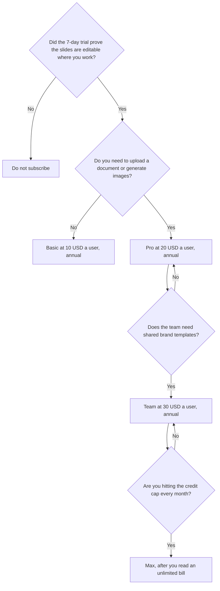

**Plus AI pricing is a per-user credit plan for making and editing slides inside Google Slides and PowerPoint.** There is no permanent free plan. Every paid plan starts with a 7-day trial and 1,000 AI credits, for new customers. Basic is $10 a user a month billed annually, or $15 billed monthly, with 1,500 credits a month. Pro is $20 a user a month annually, or $25 monthly, with 3,000 credits. Team is $30 annually, or $40 monthly, with 6,000 credits. Max is $200 a month billed annually, or $240 monthly, with unlimited credits. Enterprise is a sales conversation.

The product page is [Plus AI review](/blog/plus-ai-review-2026/). The file-format choice against a card deck is [Plus AI vs Gamma](/blog/plus-ai-vs-gamma-2026/). The pitch-meeting version of that choice is [Gamma vs Plus AI for pitch decks](/blog/gamma-vs-plus-ai-for-pitch-decks-2026/).

Prices are US list prices excluding tax from Plus AI's pricing page as recorded in the directory on October 16, 2026. Published October 24, 2026. We did not score slide design. We did not measure how many credits a specific deck spends beyond the range the directory already records.

## The plans

| Plan | Annual, per user per month | Monthly | Credits a month | What the card adds |
|---|---|---|---|---|
| Trial | Included with paid plans | 7 days | 1,000 | New customers. Not a permanent free tier |
| Basic | $10 | $15 | 1,500 | Decks inside Slides and PowerPoint |
| Pro | $20 | $25 | 3,000 | Document uploads, prompts of 100,000+ characters, AI images |
| Team | $30 | $40 | 6,000 | Custom branding, shared templates, advanced image models |
| Max | $200 | $240 | Unlimited | The AI Agent, priority email support |

A year of Basic at the annual rate is 12 × $10 = $120. A year of monthly Basic is 12 × $15 = $180. A year of Pro annual is 12 × $20 = $240. A year of Pro monthly is 12 × $25 = $300. Max annual is 12 × $200 = $2,400. The annual toggle is the discount. It is not a second product.

The directory says tasks typically use 40 to 170 credits depending on complexity. This page does not turn that range into "a deck costs X." Run one real deck during the trial and read the receipt. A 1,500-credit Basic month that holds four careful decks is a different product from a 1,500-credit month of remixing every slide.

The directory also says Pro and above include unlimited team members. That line sits next to a per-user price. Confirm it at checkout before you model a 20-person rollout as one Pro seat. The live card is the one that bills you.

## Four buyers

**Someone who must deliver in Slides or PowerPoint and makes an occasional deck.** Basic, after the trial receipt fits in 1,500 credits. Stay on annual if you will still be making decks in month three. Monthly at $15 is the off-ramp, not the default.

**Someone turning a PDF or a doc into a deck.** Pro. Document uploads and long prompts are the reason, plus image generation. If you only needed the file format, Basic is enough and Pro is a credit upgrade you have not earned yet.

**A team that must stay on a template.** Team, for branding, shared presets, and 6,000 credits. Do not buy Max because the word unlimited feels safer. Buy Max when the Team receipt is the constraint and finance has seen $200 a user.

**A company that wants a paper process.** Enterprise, through sales. Ask for the credit terms and the admin terms in the quote. Do not multiply Max by headcount and call it Enterprise.

## When Plus AI is the wrong invoice

[Gamma](/tools/gamma/) Plus is $9 a seat a month, or $108 a year, when a link is an acceptable leave-behind and you do not need a native Slides file. Free credits do not refresh. The invoice is [Gamma pricing explained](/blog/gamma-pricing-explained-2026/).

[Pitch](/tools/pitch/) Plus is $10 a seat a month billed yearly when the team will co-edit and you want pitch rooms on the Team row at $15. The invoice is [Pitch pricing explained](/blog/pitch-pricing-explained-2026/).

[Beautiful.ai](/tools/beautiful-ai/) Pro is $14.50 a month billed annually, or $45 monthly, when the point is auto-aligning layouts and unlimited AI generation on the paid seat. There is a 14-day trial and no permanent free plan. The invoice is [Beautiful.ai pricing explained](/blog/beautiful-ai-pricing-explained-2026/).

Those are different files. Plus AI's reason to exist is the native Slides or PowerPoint working copy.

## FAQ

### Is there a free plan?

No. New customers get a 7-day trial with 1,000 credits on the paid plans. When the trial ends, you are choosing a price or you are done. The directory says only new customers are eligible for the trial.

### How many credits does one slide use?

The directory's recorded range is 40 to 170 credits a task, depending on complexity. It does not publish a per-slide rate. Read the receipt on your deck. Remixing a slide spends less than regenerating the deck, which is the habit that keeps Basic viable.

### Is Max unlimited generation or unlimited seats?

Unlimited credits, on the card. Seats are still how the plan is described, per user. Confirm both numbers at checkout. Unlimited credits at $200 a user is a large bill if you roll it out because a banner said unlimited.

### Can I stay on monthly?

Yes. Monthly is $15, $25, $40, and $240 for Basic, Pro, Team, and Max. Use monthly if you are not sure the tool will survive a quarter. Switch to annual when the second month's decks were worth filing.

## Last verified

October 16, 2026, from the directory record of Plus AI's pricing page. Gamma, Pitch, and Beautiful.ai use the same October 16 directory check. Published October 24, 2026.

**Sources:** [Plus AI pricing](https://plusai.com/pricing/), [Gamma pricing](https://gamma.app/pricing), [Beautiful.ai pricing](https://www.beautiful.ai/pricing).

*Published by Andrew for [AI Tools Optimizer](https://aitoolsoptimizer.com).*

[Plus AI](/tools/plus-ai/) is in the [presentations directory](/tools/category/presentations/). Directory pages may use affiliate links. A purchase through them may earn us a commission at no extra cost to you.
