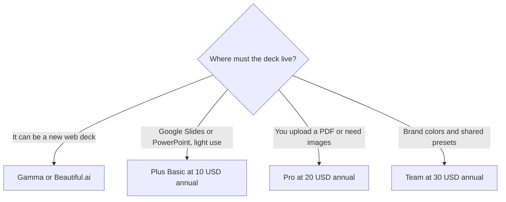

**[Plus AI](/tools/plus-ai/) generates and edits slides inside Google Slides and PowerPoint.** The file stays in the tool your company already opens. On October 24, 2026 the pricing page listed Basic at **$10 per user per month billed annually ($15 monthly)** with **1,500 AI credits**, Pro at **$20 ($25 monthly)** with **3,000 credits**, Team at **$30 ($40 monthly)** with **6,000 credits**, and Max at **$200 ($240 monthly)**. There is no free plan. There is a **7-day trial**.

We did not score decks against a human designer. [Best AI presentation makers](/blog/best-ai-presentation-makers/) and [Gamma vs Canva](/blog/gamma-vs-canva-presentations/) cover the category. Plus is the option for people who are not allowed to leave Slides or PowerPoint.

## The seats

| Plan | Annual, per user / month | Monthly billing | AI credits | The gate that matters |
|---|---|---|---|---|
| Basic | $10 | $15 | 1,500 | Whole decks, single-slide insert, rewrite and remix |
| Pro | $20 | $25 | 3,000 | Document uploads, long prompts, AI images, an MCP server and a presentation API |
| Team | $30 | $40 | 6,000 | Logo, colors, fonts, presets, custom instructions |
| Max | $200 | $240 | Top card | The self-serve ceiling if the credit cap is the problem |

The seat card is [Plus AI pricing explained](/blog/plus-ai-pricing-explained-2026/).

Plus says a task typically uses **40 to 170 credits**, depending on complexity. That range is the only planning number on the page. A 1,500-credit Basic month is somewhere between about 9 and 37 tasks if every task lands in that band. A full deck and a one-slide insert will not cost the same. The first week of the trial is when you learn your real average. Do not annualize Basic because 1,500 looks like a lot of slides on a calculator that assumes 40 credits every time.

The trial is 7 days. Use it on a deck you actually have to give, not on a "make me a presentation about teamwork" prompt. The point of Plus is that the result is a native slide you can keep editing after the AI stops. A toy prompt will not tell you whether your template survived.

## What each step adds

Basic creates presentations in Google Slides and PowerPoint, inserts a single slide in a chosen layout, and rewrites or remixes a slide. That single-slide control is the feature people miss when they compare Plus with a one-shot deck generator. You can fix slide 7 without regenerating the narrative.

Pro adds document uploads (PDF, docx, txt), prompts over 100,000 characters, AI images, an MCP server so ChatGPT or Claude can call Plus, and a presentation API. Unlimited team members are mentioned on the Pro collaboration line. Read that next to the per-user price. "Unlimited team members" does not mean unlimited paid users. It means the plan is built for a team, and each user who needs the subscription is still a user on the invoice. Confirm who consumes a seat before you invite a channel.

Team adds branding: logo, colors, fonts, advanced image models, saved presets, and custom instructions that remember company context. If the deck will be rejected for using the wrong blue, Team is the first card that treats brand as a feature rather than a cleanup task. Max is the card when credit ceilings, not missing features, are why Pro or Team failed. At $200 a user on annual billing, Max is a production seat. It is an odd buy for someone who presents once a quarter.

## Neighbors

[Gamma](/tools/gamma/) makes a deck as its own document. [Beautiful.ai](/tools/beautiful-ai/) is the other design-constrained presenter. [Napkin](/tools/napkin-ai/) turns a paragraph into a diagram you can export into a slide. Plus is the one that assumes the destination is a file your legal or sales team will open in Microsoft or Google. If your company bans new SaaS but allows add-ins, that constraint is the whole review. If your company does not care where the file lives, Gamma's own pricing may be the simpler bill. Read the [Gamma review](/blog/gamma-review-2026/) before you pay for both.

A diagram from Napkin and a deck from Plus can be a sane pair: one tool for the visual, one tool for the narrative in the house template. Two full deck generators are rarely a sane pair.

## Who should pay

**Use the 7-day trial** on a real deck. **Buy Basic annual at $10** when you live in Slides or PowerPoint and 1,500 credits survive a normal month. **Buy Pro** when the source material is a document, not a prompt, or when another assistant should call Plus through MCP. **Buy Team** when brand presets are the difference between a deck that ships and a deck that gets redesigned by someone else. **Buy Max** only after the credit meter, not the feature list, is what stopped you. **Skip Plus** if you are free to publish a Gamma or Canva deck and nobody will ask for a pptx.

Annual versus monthly is $5 a user on Basic, $5 on Pro, $10 on Team, and $40 on Max. The annual discount is meaningful on Max and modest on Basic. If you are unsure, pay $15 for one month. A year of the wrong deck tool is the expensive outcome, not the $5 gap.

## FAQ

### How much does Plus AI cost?

Billed annually, Basic is $10, Pro is $20, Team is $30, and Max is $200 per user per month. Billed monthly, those are $15, $25, $40, and $240. Checked October 24, 2026.

### Is there a free plan?

No. There is a 7-day trial. The trial is the evaluation, not an ongoing allowance.

### How many credits does a slide use?

Plus says tasks usually cost 40 to 170 credits. Basic includes 1,500 a month, Pro 3,000, Team 6,000. Your history will be more accurate than the range.

### Does it work in Google Slides and PowerPoint?

Yes. That is the product's reason to exist. The output is a deck in those tools, not a separate hosted presentation you have to export and repair.

### Can ChatGPT drive Plus?

Pro lists a Plus AI MCP server for ChatGPT, Claude, and similar agents, plus a presentation API. Basic does not list that integration.

## Last verified

October 24, 2026, from Plus AI's pricing page. Credit ranges are the vendor's typical band. Recheck Max's credit line on the card before you buy it for "unlimited," because this check recorded the price and the lower plans' credit counts more clearly than Max's allowance.

**Sources:** [Plus AI pricing](https://plusai.com/pricing/), [Plus AI](https://plusai.com).

[Plus AI](/tools/plus-ai/) is in the [presentations directory](/tools/category/presentations/). Directory pages may use affiliate links. A purchase through them may earn us a commission at no extra cost to you.
