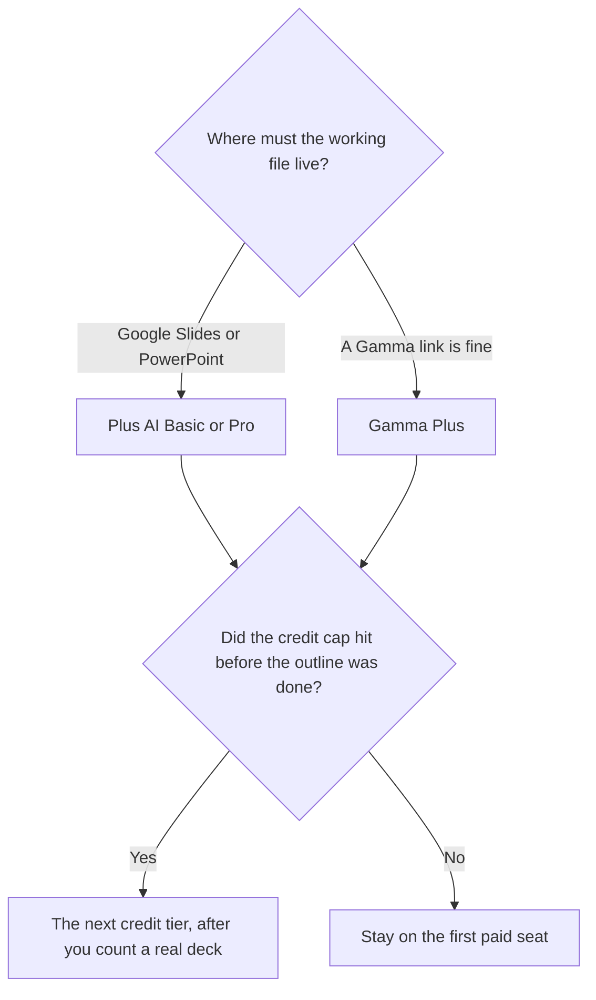

**Use Plus AI when the working copy has to be a Google Slides or PowerPoint file the client already opens. Use Gamma when a link, a doc, or a one-page site is an acceptable deliverable.** Both meter credits. The $9 and $10 stickers are close. The file is not.

The three-way that also includes [Beautiful.ai](/tools/beautiful-ai/) is [Gamma vs Beautiful.ai vs Plus AI](/blog/gamma-vs-beautiful-ai-vs-plus-ai-2026/). This page leaves Beautiful.ai as a neighbor: Smart Slides and a PowerPoint export, with unlimited AI generation on paid seats, at $14.50 a month billed annually or $45 month to month. If that guardrail editor is the real question, read the three-way. This page is the add-in versus the card deck.

Prices are US list prices excluding tax from directory pages checked October 16, 2026. Published October 24, 2026. We did not score slide design.

## Where the deck is born

| | [Plus AI](/tools/plus-ai/) | [Gamma](/tools/gamma/) |
|---|---|---|
| What you get | Slides inside Google Slides or PowerPoint | Cards that work as slides, a doc, or a simple site |
| Try it | A 7-day trial with 1,000 AI credits. No permanent free plan | Credits that do not refresh. You can hold up to 2,000 |
| First paid seat | Basic $10 a user a month billed annually, or $15 monthly, with 1,500 credits | Plus $9 a seat a month, or $108 a year, with 1,000 credits |
| The step most teams mean | Pro $20 a user a month annually, or $25 monthly, with 3,000 credits | Pro $18 a seat a month, or $216 a year, with 4,000 credits and API access |
| A heavier credit tier | Team $30 annually or $40 monthly, 6,000 credits. Max is $200 a month annually, or $240 monthly, for unlimited credits | Ultra $90 a month, monthly only, with 20,000 credits |
| AI meter | Credits | Credits. About 1–3 per card. Images 2–125, by model |

## Plus AI, when the client owns the file

Plus AI is an add-on for Google Slides and a PowerPoint add-in. Basic is the seat if 1,500 credits cover the decks you touch. Pro is the seat that adds image generation and longer document prompts, at $20 a user a month on annual billing. A year of Pro at that rate is 12 × $20 = $240. A year of Basic annual is 12 × $10 = $120.

The directory page says Pro and above include unlimited team members. Confirm that line at checkout. It sits next to a per-user price, and the live card is the one that bills you. All paid plans start with a 7-day trial and 1,000 credits. The review is [Plus AI review](/blog/plus-ai-review-2026/).

Use Plus when legal, a customer, or a partner will edit the file after you send it. A card deck they cannot open in their template is a handoff problem, even if it looked finished in the browser.

## Gamma, when the link is the product

Gamma generates cards from a prompt, notes, or a file. Plus at $9 removes the non-refreshing free-credit limit and includes 1,000 credits a month. A year is $108 if you use the annual figure of $9 × 12. Pro at $18 adds advanced AI and API access. Free is a balance, not a monthly allowance. Do not plan a weekly client rhythm on Free.

The credit arithmetic is [Gamma pricing explained](/blog/gamma-pricing-explained-2026/). The product page is [Gamma review](/blog/gamma-review-2026/). Export exists on the directory card. If the client requires a native slide file as the working copy, start in Plus AI and confirm the file, rather than hoping a card export matches their master.

Gamma against a design suite is a different comparison: [Gamma vs Canva for presentations](/blog/gamma-vs-canva-presentations/). [Canva](/tools/canva/) Pro is $18 a month or $180 a year for one person. [Pitch](/tools/pitch/) Plus is $10 a seat a month billed yearly, with 500 AI credits a seat, when the team builds decks together and credits are secondary.

Beautiful.ai's unlimited generation is the reason some teams leave both of these. Pro there is $14.50 a month billed annually, or $45 if you pay month to month. The ladder is [Beautiful.ai pricing explained](/blog/beautiful-ai-pricing-explained-2026/). Read it when layout guardrails matter more than either credit pool.

## How to choose for a real deck

A sales one-pager that must become slides in the buyer's template belongs in Plus AI, after the words are true. The words are [how to write a sales one-pager with AI](/blog/how-to-write-a-sales-one-pager-with-ai-2026/). A leave-behind you will present from a link can be Gamma. A partner deck has the same file question: [best AI tools for partnerships teams](/blog/best-ai-tools-for-partnerships-teams-2026/).

Count credits on one real deck before you buy Max or Ultra. A 20-card deck at a few credits a card does not require a $200 seat. The shelf around all of these is [best AI presentation makers](/blog/best-ai-presentation-makers/).

## FAQ

### Which is cheaper?

Gamma Plus at $9 a seat a month is the lower first paid price. Plus AI Basic is $10 on annual billing and $15 monthly. The gap is a dollar on the annual monthly rate. The file format is the decision.

### Can Gamma replace PowerPoint?

It can replace the presentation if your audience accepts Gamma's format. It does not replace a master template your client edits every week. That job is Plus AI, or a PowerPoint export you have opened and checked.

### Do both use credits?

Yes. Gamma's directory note is about 1–3 credits a card, with images billed by model. Plus AI lists 1,500 credits on Basic and 3,000 on Pro. Beautiful.ai is the neighbor that advertises unlimited AI generation on paid seats.

### Is there a free plan?

Gamma has a non-refreshing credit balance. Plus AI has a 7-day trial with 1,000 credits and no permanent free plan on the card. Pitch's free plan, up to five members and 100 one-time AI credits, is the durable free seat if the team mostly collaborates and rarely generates.

## Last verified

October 16, 2026 for Plus AI, Gamma, Beautiful.ai, Canva, and Pitch prices named above. Published October 24, 2026.

**Sources:** [Plus AI pricing](https://plusai.com/pricing), [Gamma pricing](https://gamma.app/pricing), [Beautiful.ai pricing](https://www.beautiful.ai/pricing).

*Published by Andrew for [AI Tools Optimizer](https://aitoolsoptimizer.com).*

[Plus AI](/tools/plus-ai/) and [Gamma](/tools/gamma/) are in the [presentations directory](/tools/category/presentations/). Directory pages may use affiliate links. A purchase through them may earn us a commission at no extra cost to you.
