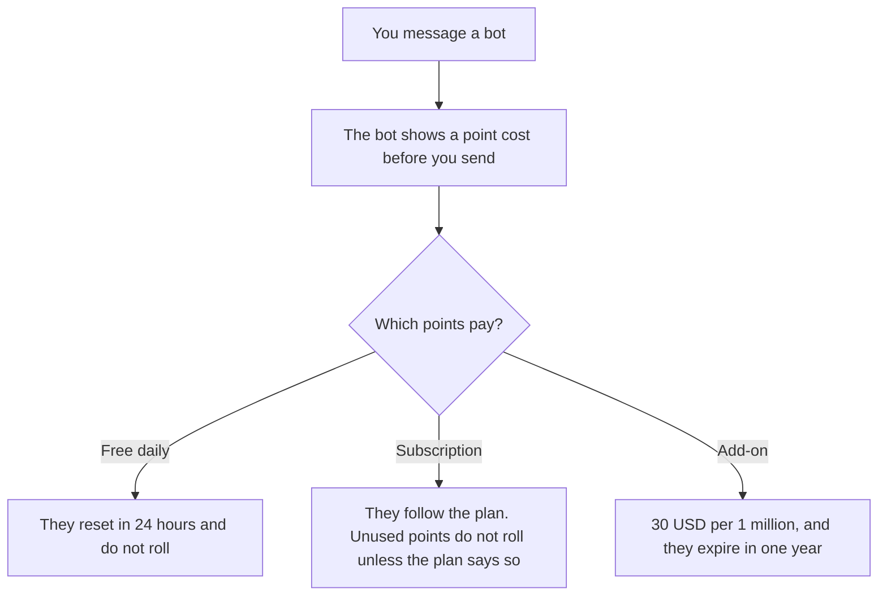

**Poe subscriptions start at $4.99 a month and spend compute points on each bot.** Free users get daily points that reset every 24 hours and do not roll over. Subscribers can buy add-on points at $30 per 1 million. Those add-on points expire one year after purchase. Higher tiers exist in the app. Their prices were not on the official pages recorded October 16, 2026, so this article does not print them.

There is no separate Poe review in this directory. The seat you might buy instead is [ChatGPT review](/blog/chatgpt-review-2026/) or [Claude review](/blog/claude-review-2026/). The unit, when a vendor bills tokens instead of points, is [what AI tokens are](/blog/what-are-ai-tokens-explained-2026/). The counter itself is [what AI token metering is](/blog/what-is-ai-token-metering-2026/).

Prices are US dollars from Poe's Help Center and Terms of Sale as recorded in the directory on October 16, 2026. A fetch of the purchases FAQ on October 24, 2026 returned 401, so the higher tiers stay unconfirmed. Published October 24, 2026. We did not score model quality. Points are not tokens.

## The rows we can print

| Option | Price | What the record says |
|---|---|---|
| Free | $0 | Daily points, reset every 24 hours, no rollover |
| Subscription | From $4.99 a month | Daily and/or monthly compute points. Monthly or annual billing exists |
| Higher tiers | See poe.com | More points. Prices not confirmed on the pages we could read |
| Add-on points | From $30 per 1 million points | Subscribers only. Expire after one year |

Each bot lists its point cost per message, per image, or by text length, on its profile. A cheap bot stretches the allowance. A frontier bot spends it. The directory names GPT-6-Astra, Claude-Opus-5.5, Claude-Fable-5.1, Gemini-4-Argon, and Grok-4.7 among the bots. The list changes. Check the bot, not this paragraph, before you rely on a model name.

## How to read the $4.99

The $4.99 line is an entry price, not a full rate card. It does not say how many points you receive. Until you see the point grant on the plan you are buying, you cannot compute a cost per message. Open the subscription screen, read the grant, and divide only after that. This article refuses the division.

Add-on points at $30 per million are the one unit price we can quote. They are for subscribers. They are not a substitute for knowing the subscription grant. Pre-purchased points expire after one year, so a large top-up for a project you might delay is a dated coupon.

Unused subscription points do not roll over unless the plan says otherwise, on the Terms of Sale note in the directory. Daily free points also do not roll. A quiet Tuesday does not fund a busy Friday. That is the opposite of a credit that lasts the month.

Shared subscriptions let the subscriber invite a limited number of group members to use their points, subject to Poe's terms. The directory does not print the seat count. Read the current limit before you treat $4.99 as a team plan. It is a poor default for a company. ChatGPT Business is $20 per user a month billed annually, with a two-user minimum, when you need an org plan with a published seat price. Claude Pro is $20 a month, or $17 billed annually, for one person's writing seat. Gemini on Google AI Pro is $19.99 a month. Perplexity Pro is $17 a month billed annually when you need citations. Those are different products. Poe's case is many models on one point balance.

## What the points are not

They are not a token invoice you can reconcile to OpenAI or Anthropic. They are not a promise that a named model stays at today's point cost. They are not a higher tier we forgot to type. If the app shows a price above $4.99, that screen is the source. Write it down with the date. Our October 16 record stops at the entry price and the add-on.

An API exists, on the directory card. This page does not print API rates. Read the API card before you build on it.

## FAQ

### Is Poe free?

Yes, with daily points that reset every 24 hours and do not roll over. Subscribers get more points and, on Poe's description, access to the most current bots. Free is enough to compare a short prompt. It is a weak plan for image and video bots, which spend points quickly.

### Why is there no Plus or Pro price?

The pages we could read said subscriptions start at $4.99 and that higher tiers exist. They did not list those prices in text we could record. Check poe.com in the app. Do not budget a number from a screenshot you cannot date.

### Can I buy points without subscribing?

The record says add-on points are for subscribers, from $30 per 1 million, with optional automatic top-ups. A non-subscriber stays on the daily reset.

### Do points convert to tokens?

Not with a ratio this site publishes. Report Poe in points and dollars. Report an API vendor in that vendor's tokens. Mixing the units will not match an invoice.

## Last verified

October 16, 2026, from the directory's record of Poe's Help Center and Terms of Sale. A fetch on October 24, 2026 returned 401. ChatGPT, Claude, Gemini, and Perplexity comparison prices are from the October 16 directory. Published October 24, 2026.

**Sources:** [Poe Purchases FAQs](https://help.poe.com/hc/en-us/articles/19945140063636-Poe-Purchases-FAQs), [Poe FAQs](https://help.poe.com/hc/en-us/articles/19944206309524-Poe-FAQs), [Poe Terms of Sale](https://poe.com/pages/terms-of-sale).

*Published by Andrew for [AI Tools Optimizer](https://aitoolsoptimizer.com).*

[Poe](/tools/poe/) is in the [chatbots and assistants directory](/tools/category/chatbots-assistants/). Directory pages may use affiliate links. A purchase through them may earn us a commission at no extra cost to you.
