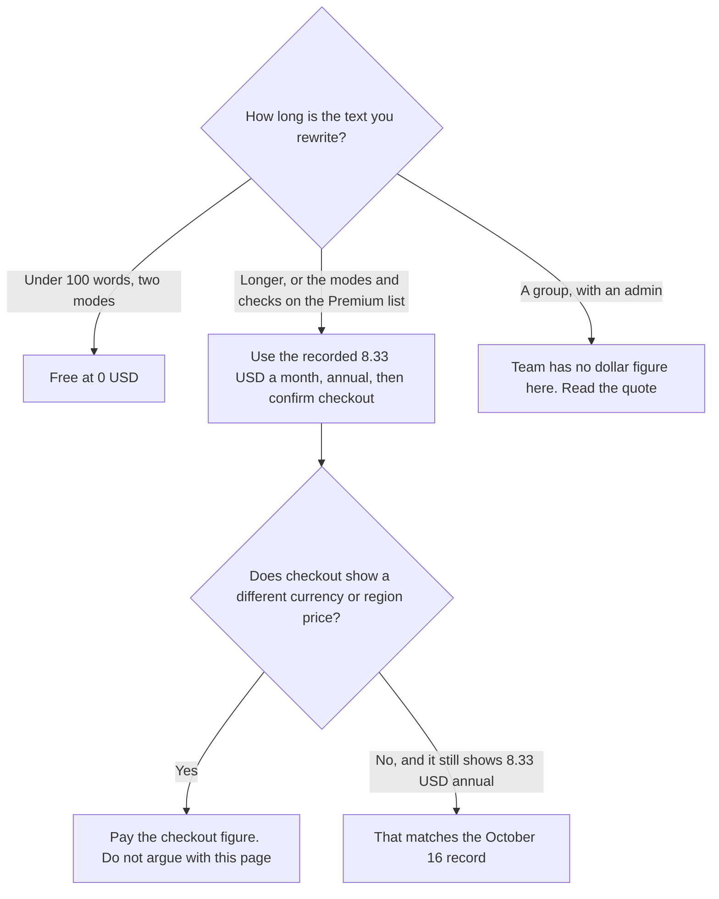

**Budget QuillBot Premium from the last USD figure we could record, and confirm it at checkout.** The directory, checked October 16, 2026, recorded Premium at $8.33 a month billed annually, in USD. Free is $0 and paraphrases up to 100 words in 2 modes. A fetch of the Premium page on October 24, 2026 did not include a dollar amount in the text we could read. The help center article, updated June 10, 2026, says the price depends on region and plan, and that checkout can adjust for local currency. This page does not invent a monthly or quarterly price.

The editing seat people compare it with is [Grammarly pricing explained](/blog/grammarly-pricing-explained-2026/). A general writing chat, which is a different job, is [Grammarly vs ChatGPT for editing](/blog/grammarly-vs-chatgpt-for-editing-2026/). Rewriting your own sentences is the use. Follow your school or employer's rules on AI assistance. This page is not those rules.

Published October 24, 2026. We did not score paraphrase quality. Tax and region can change the charge.

## What we can put in a table

| Plan | Figure we will stand behind | What the directory says it includes | What we will not print |
|---|---|---|---|
| Free | $0 | Paraphrase up to 100 words in 2 modes, basic grammar fixes, basic summaries, limited AI Detector and humanizer access | A claim that 100 words is enough for a paper |
| Premium, annual | $8.33 a month billed annually, recorded October 16, 2026 | Unlimited paraphrasing modes, advanced grammar, full humanizer and AI Detector access, custom summaries, plagiarism prevention | A monthly or quarterly USD price. The live pages did not give us one |
| Team | No public dollar figure on the card | Usage metrics, user management, centralized billing, data control, priority support, on top of Premium | A per-seat guess |

The help center lists three ways to pay: month to month, a quarterly plan, and an annual plan it calls the best value per month. It does not attach dollars. QuillBot's own Premium page, on October 24, described modes and a plagiarism check and said usage limits apply and may vary by surface. Limits that "may vary" are not a number. If your forecast needs the monthly price, open checkout in the US and write down what it shows. Do not back into a monthly price from $8.33.

## What $8.33 is, and is not

It is the annual Premium rate the directory recorded from QuillBot's Premium page and help center on October 16, 2026. It is about $100 a year if you multiply $8.33 by 12. This article does not round that to a different annual charge. If checkout says something else, checkout wins.

It is not [Grammarly](/tools/grammarly/) Pro. Grammarly Pro is $12 a member a month billed annually, or $30 monthly, on the October 16 Grammarly card. Grammarly's job on that card is grammar and tone across apps, with 2,000 AI prompts on Pro. QuillBot's job on its card is paraphrasing modes plus the other tools in the Premium list. Buying both because the prices look small is two subscriptions. Pick the job.

It is not a drafting seat. [ChatGPT](/tools/chatgpt/) Plus is $20 a month. [Claude](/tools/claude/) Pro is $20 a month, or $17 billed annually. Those draft from a brief. QuillBot rewrites text you already wrote. A paraphrase can change the meaning. Read it. A changed meaning in a citation or a policy is your error, not a style choice.

## The Team plan

The directory says Team includes everything in Premium plus usage metrics, a user-management dashboard, centralized billing, data control, and priority support. It does not list a price. A team rollout without a quote is an unknown invoice. Get the quote. Do not multiply $8.33 by seats and call it Team. The card does not say Team is Premium's price.

Student offers exist as a link on the Premium page, according to the directory FAQ. This article does not print a student discount percent, because neither the October 24 help article nor the directory takeaway states one.

## FAQ

### Is QuillBot free?

Yes. Free paraphrases up to 100 words in two modes, with basic grammar fixes. That limit is the reason Premium exists. The October 16 record is the source of the 100-word line.

### How much is Premium?

The figure we recorded on October 16, 2026 is $8.33 USD a month billed annually. On October 24, 2026 the pages we fetched did not show a replacement number, and the help center said price depends on region and currency. Confirm checkout. Do not use a monthly price from this article. We do not have one.

### Do credits or word caps reset?

The Premium page said usage limits apply and may vary by surface. The directory's Premium line says unlimited modes, not an unlimited word count on every surface. Read the limit on the surface you use. This page will not invent a monthly word cap.

### Can I pause instead of canceling?

The Premium page FAQ, fetched October 24, 2026, says you can pause from the account page and will not be billed for that time. That is a billing control. It does not change the annual rate recorded above.

## Last verified

October 16, 2026 for the $8.33 annual figure, the free-plan limits, and the Team feature list, from the directory. October 24, 2026 for a Premium-page fetch and the help center article updated June 10, 2026, neither of which printed a new USD price. Grammarly, ChatGPT, and Claude figures are from the October 16 directory check. Published October 24, 2026.

**Sources:** [QuillBot Premium](https://quillbot.com/premium), [QuillBot help: Premium price](https://help.quillbot.com/hc/en-us/articles/36491424881943-What-is-the-price-of-Quillbot-Premium).

*Published by Andrew for [AI Tools Optimizer](https://aitoolsoptimizer.com).*

[QuillBot](/tools/quillbot/) is in the [writing directory](/tools/category/writing/). Directory pages may use affiliate links. A purchase through them may earn us a commission at no extra cost to you.
