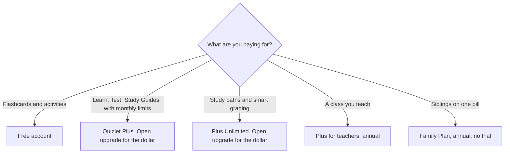

**Quizlet's help center names the plans and does not print a US dollar for any of them.** Free covers flashcards, practice questions, interactive diagrams, and activities. Paid plans are Quizlet Plus, Quizlet Plus Unlimited, Quizlet Plus for teachers, the Family Plan, and group subscriptions. On October 24, 2026, a fetch of quizlet.com/upgrade did not return a price, and a Bright Data fetch of that URL returned HTTP 401. This page does not invent a Plus price. Open the upgrade page for the dollar in your region.

The study-tool shelf is [best AI tools for students](/blog/best-ai-tools-for-students-2026/). A quiz you write for other people, which is a different job, is [how to create training quizzes with AI](/blog/how-to-create-training-quizzes-with-ai-2026/). The tutor priced for families is [Khanmigo pricing explained](/blog/khanmigo-pricing-explained-2026/). The teacher lesson tool is [MagicSchool pricing explained](/blog/magicschool-pricing-explained-2026/).

The directory page checked October 16, 2026 recorded the same plan names and said the upgrade page did not load, so it stored no price. Published October 24, 2026. We did not score study sets.

## What the October 24 help article actually says

| Plan | Billing the article states | What it says you get | Dollar |
|---|---|---|---|
| Free | An account | Flashcards, practice questions, interactive diagrams, activities | $0, described as a free account |
| Quizlet Plus | Monthly or annual, renews automatically | Extended access to Practice Tests, Study Guides, Learn, and Expert Solutions, with monthly usage limits | Not printed |
| Quizlet Plus Unlimited | Monthly or annual, renews automatically | Custom study paths, Progress, smart grading, plus the premium study tools | Not printed |
| Plus for teachers | Annual, renews automatically | Content creation, formative assessment, Study Guides, Learn, Test, Expert Solutions | Not printed |
| Family Plan | Annual, no free trial, renews unless canceled | Shared premium access. Only free Quizlet users can buy or join | Not printed |
| Group subscriptions | One year from the purchase date, does not auto-renew | A class or department at discounted prices | Not printed |

The help article says each individual subscription is good for one year or one month and renews automatically. Group subscriptions last one year and do not auto-renew. Family Plans are billed annually, do not include a free trial, and renew automatically unless canceled. Those are the billing rules we could read. They are not a price.

## What this page will not do

It will not quote a Plus price from memory, from a screenshot we do not have, or from a third-party roundup. The October 16 directory verdict says the same thing: confirm current prices at quizlet.com/upgrade. If checkout shows a regional price, checkout is the price. This site publishes in USD and does not convert a local currency into a dollar the vendor did not print.

**Plus** is the plan for a learner who wants Practice Tests, Study Guides, Learn, and Expert Solutions and can live with monthly limits. **Plus Unlimited** is the plan that adds custom study paths, progress tracking, and smart grading. **Plus for teachers** is the annual plan with formative assessment. **Family** is the shared annual plan with no trial. **Group** is the one-year, non-renewing purchase for a class or department.

A student who needs a tutor that explains a worked solution, rather than a card set, should read the [Khanmigo](/tools/khanmigo/) article before paying Quizlet for a job it did not claim. A teacher who needs lesson-planning AI should read the [MagicSchool](/tools/magicschool/) article. [ChatGPT](/tools/chatgpt/) Plus at $20 a month can draft a practice set from notes you paste. It is not a substitute for a set you have checked, and it is a different bill. The review is [ChatGPT review](/blog/chatgpt-review-2026/).

## What not to assume

Do not tell a student Plus is "about" any number. Do not assume the teacher plan is monthly. The article says it is annual. Do not assume a Family Plan has a trial. The article says it does not. Do not assume a group purchase renews. The article says it does not.

## FAQ

### How much does Quizlet Plus cost?

We could not read a dollar on October 24, 2026. The help center describes Plus and links out for pricing. The upgrade page did not return a price in our fetch. Use quizlet.com/upgrade.

### Is Quizlet free?

Yes, for flashcards, practice questions, diagrams, and activities, on the help article. Learn, Test, Study Guides, and Expert Solutions are the reason the paid plans exist. The article describes those as the subscription benefits.

### Does Plus Unlimited remove the monthly limits?

The article says Plus has monthly usage limits and that Plus Unlimited adds custom study paths, progress, and smart grading, with a fuller study experience. It does not print a usage table. Read the upgrade page for the limit that applies to the plan you select.

### Do subscriptions renew?

Individual plans renew automatically, monthly or yearly, on the help article. Teacher plans renew annually. Family Plans renew unless canceled. Group subscriptions do not auto-renew.

## Last verified

October 24, 2026, from the Quizlet Help Center article "Subscribing to Quizlet." No plan price was printed there. quizlet.com/upgrade did not return a price in the same day's fetch. The directory page checked October 16, 2026 agrees that prices were unconfirmed. Published October 24, 2026.

**Sources:** [Subscribing to Quizlet](https://help.quizlet.com/hc/en-us/articles/360041181691-Subscribing-to-Quizlet), [Quizlet upgrade](https://quizlet.com/upgrade).

*Published by Andrew for [AI Tools Optimizer](https://aitoolsoptimizer.com).*

[Quizlet](/tools/quizlet/) is in the [education directory](/tools/category/education/). Directory pages may use affiliate links. A purchase through them may earn us a commission at no extra cost to you.
