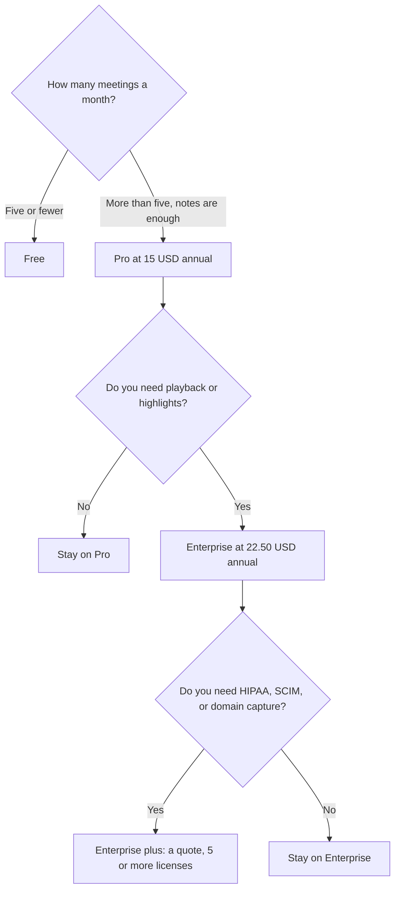

**Read AI Pro is $15 per user per month billed annually, or $19.75 billed monthly, with unlimited transcripts.** Free is $0 and includes 5 meeting transcripts a month. Enterprise is $22.50 annually or $29.75 monthly and adds audio and video playback. Enterprise+ is a sales conversation: HIPAA, SAML and SCIM, domain capture, and custom retention, with a 5-license minimum on the card we recorded.

The product page is [Read AI review](/blog/read-ai-review-2026/). A bot-free alternative's bill is [Granola pricing explained](/blog/granola-pricing-explained-2026/). The notes habit is [how to summarize meetings with AI](/blog/how-to-summarize-meetings-with-ai-2026/).

Prices are US dollars from Read AI's plans page as recorded in the directory on October 16, 2026. A fetch of that page on October 24, 2026 returned 401, so this article does not refresh the table. Published October 24, 2026. We did not score transcript accuracy. Tell attendees when a bot joins.

## What each plan meters

| Plan | Annual, per user / month | Monthly | What changes |
|---|---|---|---|
| Free | $0 | $0 | 5 transcripts a month, unlimited enterprise search, summaries, a meeting coach, 20+ languages |
| Pro | $15 | $19.75 | Unlimited transcripts, 100 file upload credits, premium integrations |
| Enterprise | $22.50 | $29.75 | Audio and video playback, video highlights, 200 upload credits |
| Enterprise+ | Talk to sales | — | HIPAA, SAML and SCIM, domain capture, custom retention, 300 upload credits; 5+ licenses |

All paid plans, on the card, include unlimited meeting reports, unlimited storage, and workspace access. Search on Free is listed as unlimited. The cap on Free is the transcript count, not the search box.

## How to read the $15

Five meetings on Free cost $0. The sixth transcript is the reason to buy Pro. At $19.75 monthly, a quarter of Pro is $59.25 before you touch the annual toggle. At $15 annual, a year for one user is $180. The annual figure is the one to budget if you will keep the seat. Monthly is the trial you might cancel.

Pro's premium integrations on the card include Notion, Salesforce, HubSpot, Jira, Confluence, Zapier, and webhooks. Free has basic integrations. If the meeting note must land in the CRM, Pro is the tier that lists those connectors. The CRM seat is a second invoice. [HubSpot](/tools/hubspot/) has a free CRM. Its Starter figure was a limited-time offer on the October 16 card. That promo is not a Read price.

Playback is the Enterprise line. If you only need the summary, paying $22.50 to watch the video is optional. If a dispute will require the recording, Enterprise is the plan that lists playback. Enterprise+ is where the directory puts HIPAA. This page does not describe a BAA. Read the agreement.

## Nearby meters

**Fathom** Premium is $16 a month billed annually, or $20 monthly. Team is $15 a user annually with a two-user minimum. The free tier includes unlimited recordings, on the directory card. The invoice is [Fathom pricing explained](/blog/fathom-pricing-explained-2026/).

**Fireflies** Pro is $10 a user a month billed annually, or $18 monthly. Business is $19 annually. [Fireflies pricing explained](/blog/fireflies-pricing-explained-2026/).

**Otter** Pro is $8.33 a user a month billed annually, or $16.99 monthly, with 1,200 minutes. Free is 300 minutes. [Otter pricing explained](/blog/otter-ai-pricing-explained-2026/).

**Granola** Business is $14 a user a month and does not send a bot into the call. Free keeps 30 days of history. Pick it when the room should not see a bot. Pick Read when you want search across meetings, email, and messages, which is the product's pitch on the directory card.

A seat is not a recording policy. The notice you give attendees is yours. A summary that adds a decision nobody made is [what an AI hallucination is](/blog/what-is-ai-hallucination-2026/).

## FAQ

### Is Read AI free?

Yes, for 5 transcripts a month, plus the search and summaries the Free row lists. There is no credit card on that description. The sixth meeting is the upgrade.

### Does Pro include video playback?

The directory puts audio and video playback and video highlights on Enterprise. Pro is the unlimited transcript and the premium integrations. Do not budget Pro and expect the player.

### What is Enterprise+ for?

The card lists HIPAA, SAML and SCIM, domain capture, custom retention, and 300 upload credits, with a minimum of 5 licenses and a sales conversation. There is no public dollar. Ask for the quote. Do not copy the $29.75 Enterprise monthly figure onto Enterprise+.

### Do upload credits roll over?

The card lists 100, 200, and 300 file upload credits by tier. It does not describe rollover. Treat them as a monthly allowance until the plan page you are signing says otherwise.

## Last verified

October 16, 2026, from the directory's record of read.ai plans. A fetch on October 24, 2026 returned 401. Fathom, Fireflies, Otter, Granola, and HubSpot figures are from the same October 16 check. Published October 24, 2026.

**Sources:** [Read AI plans and pricing](https://www.read.ai/plans-pricing), [Read AI](https://www.read.ai).

*Published by Andrew for [AI Tools Optimizer](https://aitoolsoptimizer.com).*

[Read AI](/tools/read-ai/) is in the [meetings and transcription directory](/tools/category/meetings-transcription/). Directory pages may use affiliate links. A purchase through them may earn us a commission at no extra cost to you.
