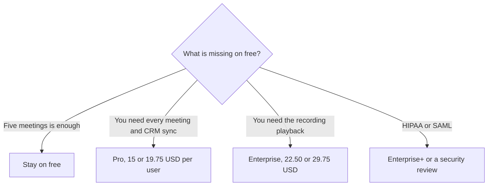

**[Read AI](/tools/read-ai/) records meetings, writes summaries, and searches across the meetings, email, and messages you connect.** On October 24, 2026 the plans page showed an **Annual −25%** control. Each paid card printed two USD prices per user per month. Pro showed **$15** and **$19.75**. Enterprise showed **$22.50** and **$29.75**. Enterprise+ showed **$29.75** and **$39.75**. Free is **$0** for **5 meeting transcripts a month**, with no card. The smaller number on each card is about 25% below the larger one, which matches the annual label. Read the toggle you are on. We are quoting both figures because the page renders both.

We did not score transcript accuracy. [Best AI meeting notetakers](/blog/best-ai-meeting-notetakers/) and [best free AI note takers](/blog/best-free-ai-note-takers-2026/) compare the category. [Otter](/tools/otter-ai/), [Fireflies](/tools/fireflies-ai/), and [Fathom](/tools/fathom/) are the neighbors in the directory.

## The plans

| Plan | Lower figure | Higher figure | Meetings | What you gain |
|---|---|---|---|---|
| Free | $0 | $0 | 5 transcripts a month | Search, summaries for meetings and messages, a meeting coach, basic integrations, topic readouts, 20+ languages, desktop and mobile apps |
| Pro | $15 | $19.75 | Unlimited transcripts | Priority processing, 100 file-upload credits a month, premium integrations including Notion, Salesforce, HubSpot, Jira, Confluence, Zapier, and webhooks |
| Enterprise | $22.50 | $29.75 | Unlimited transcripts | Audio and video playback, video highlights, 200 file-upload credits, premium support. Meeting length listed at 8 hours versus 4 on Free and Pro |
| Enterprise+ | $29.75 | $39.75 | Unlimited transcripts | HIPAA, SAML and SCIM, domain capture, custom retention, 300 file-upload credits, workspace onboarding |

Paid plans list unlimited meeting reports, unlimited storage, and workspace access. The page also says "30 meetings measured per month" on the plan blocks we read. That phrase sits next to plans that also say unlimited transcripts. Do not collapse those into one sentence. If a quota and an "unlimited" line both appear, ask Read which one governs your workspace before you promise a sales team there is no cap. We are not going to pretend the page said only one thing.

## What you are paying for

Free is a real plan: five transcripts, search, summaries, a coach, and the apps. It is the right plan for someone who wants notes from a handful of calls and already has a recorder elsewhere. It is the wrong plan for a team that meets all day. Five transcripts disappear in a Monday.

Pro removes the transcript cap and adds the integrations that make the notes leave Read: Salesforce, HubSpot, Jira, Notion, Confluence, Zapier, webhooks. If the notes never need to land in another system, you are paying for unlimited transcripts and priority processing. If they do, Pro is the first card that lists those connectors. One hundred file-upload credits are for material that was not a live meeting. A team that uploads every old Zoom recording will learn what that credit means quickly. Watch it in the first month.

Enterprise is the playback plan. Audio, video, and highlights are the features, plus a longer maximum meeting and more upload credits. If your compliance story is "we need the recording, not only the summary," Enterprise is the card. If a summary is enough, paying the gap from Pro to Enterprise buys a player you will not open. Enterprise+ is the security plan: HIPAA, SAML, SCIM, domain capture, retention. That is a purchase for a security review, not for a nicer summary. The [Fireflies review](/blog/fireflies-ai-review-2026/) and the [Otter review](/blog/otter-ai-review-2026/) are the other transcripts to price beside this one. Fathom's free tier is the one people use as the control. Pick one system of record for the meeting. Two bots in the same call is a tax on everyone invited.

## A team of eight, as arithmetic

Eight Pro users at the lower figure are **$120 a month**. At the higher figure they are **$158**. Eight Enterprise users are **$180** or **$238**. The annual label is 25% off, and the two figures on Pro ($15 is 24% under $19.75) land close to that label without being a perfect quarter. Use the checkout number. A year of eight Pro seats at $15 is **$1,440**. A year at $19.75 is **$1,896**. The gap is the discount, if the lower number is in fact the annual rate your toggle selected. Confirm it. The math is close enough to trust the label and not close enough to invent a third price.

[Which AI subscription is worth paying for](/blog/which-ai-subscription-is-worth-paying-for/) applies cleanly here. A meeting tool charges every person whose calendar it joins. Invite the people who need the archive. A listener who only reads a recap may not need a seat, and Read's own FAQ asks whether you can manage billing without a license for yourself. Read that answer on the day you buy. Seat minimums change.

## Who should pay

**Stay on free** at five meetings a month. **Buy Pro** when the cap or the CRM connector is the blocker. **Buy Enterprise** when you need playback and highlights, or meetings longer than four hours. **Buy Enterprise+** when a customer contract requires HIPAA or your IdP requires SAML. **Skip a second notetaker** if Fireflies, Otter, or Fathom already has the archive. Search across email is Read's extra. Pay for it when you will use that search, not because the bot joined cleanly.

## FAQ

### How much does Read AI cost?

Free is $0 for five transcripts a month. Pro shows $15 and $19.75 per user per month. Enterprise shows $22.50 and $29.75. Enterprise+ shows $29.75 and $39.75. The page labels annual billing at 25% off. Checked October 24, 2026.

### Which number is annual?

The smaller figure on each card is about a quarter below the larger one, matching the Annual −25% control. The page renders both. Select the toggle and read the checkout total before you repeat a number.

### Is there a free plan?

Yes. Five meeting transcripts a month, no card, plus search and basic integrations. Paid plans are what add unlimited transcripts and the premium connectors.

### Does Enterprise include video?

The Enterprise card lists audio and video playback and video highlights. Free and Pro, on the comparison we read, are the transcript and summary plans. Meeting length goes to 8 hours on Enterprise and is 4 hours on Free and Pro.

### Can we mix Pro and Enterprise seats?

Read's FAQ asks this directly. Check the current answer in the product, because mixing seat types is an admin rule, not something to assume from a blog.

## Last verified

October 24, 2026, from Read's plans and pricing page. The dual prices are intentional in this writeup. If Read simplifies the card to one number, use that number and retire the pair.

**Sources:** [Read plans and pricing](https://www.read.ai/plans-pricing), [Read AI](https://www.read.ai).

[Read AI](/tools/read-ai/) is in the [meetings directory](/tools/category/meetings-transcription/). Directory pages may use affiliate links. A purchase through them may earn us a commission at no extra cost to you.
