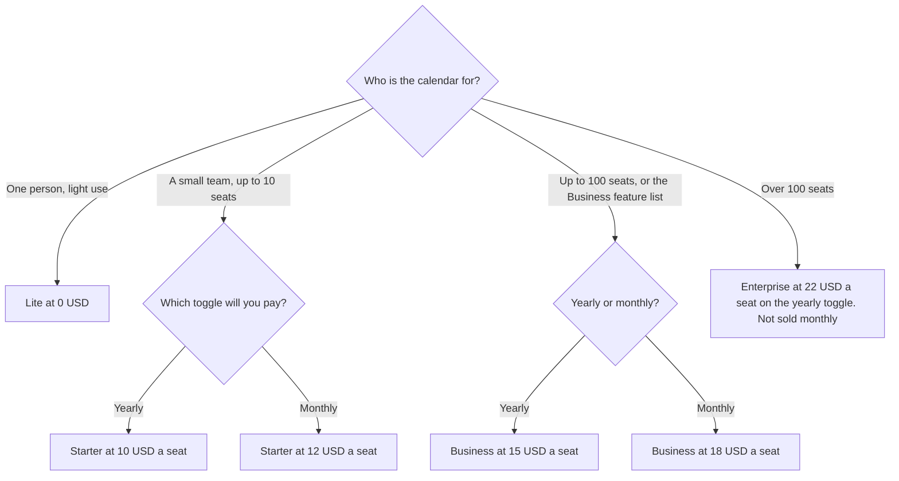

**Budget Reclaim on the billing toggle you will actually check out.** On the pricing page fetched October 24, 2026, the yearly toggle shows Starter at $10 per seat per month, Business at $15, and Enterprise at $22. The monthly toggle shows Starter at $12 per seat per month and Business at $18. Enterprise is marked unavailable on monthly plans. Lite is free. The page labels yearly "SAVE 20%." The FAQ on the same page says annual billing is a 29% discount versus monthly. Ten divided by twelve is neither 20% nor 29%. Do not invent a third discount to reconcile them. Pay the toggle you select.

The other calendar invoice is [Motion pricing explained](/blog/motion-pricing-explained-2026/). Notes from the meetings Reclaim schedules are a different product. The bot-free option is on the Granola card below. A task tracker with its own AI add-on is [Notion AI vs ClickUp for docs](/blog/notion-ai-vs-clickup-for-docs-2026/) if the work already lives in one of those.

Prices below are US dollar figures from reclaim.ai/pricing, fetched October 24, 2026. Published October 24, 2026. We did not score how much time the product saves. The page prints productivity percentages in a calculator. Those are the vendor's calculator, not a measurement we ran.

## The two toggles

| Plan | Yearly toggle | Monthly toggle | What the yearly column states |
|---|---|---|---|
| Lite | Free | Free | 5 AI agents, Focus Time, Habits, Buffer Time, Smart Meetings, Meeting Quality, 1 user, 1 week scheduling range, 1 calendar sync, 1 scheduling link, limited integrations |
| Starter | $10 per seat a month | $12 per seat a month | 10 AI agents per seat, up to 10 seats, 8 week scheduling range, 3 calendar syncs |
| Business | $15 per seat a month | $18 per seat a month | 100 AI agents per seat, up to 100 seats, 12 week scheduling range |
| Enterprise | $22 per seat a month | Unavailable on monthly plans | Over 100 seats. Monthly text on the page lists SSO, SCIM, and unlimited AI agents per seat on the Enterprise feature list |

The directory checked October 16, 2026 recorded Starter at $10 and Business at $15, and said yearly billing saves 20%. That matches the yearly toggle and the "SAVE 20%" label. It did not record the $12 and $18 monthly figures, or Enterprise at $22. Those come from the October 24 fetch. The directory also recorded a 14-day Business trial. The October 24 page extract did not restate a trial. Confirm a trial at signup. Do not put 14 days in a forecast from this article alone.

## The promo line that is already dated

The page still displays a launch promo: attendee users "100% free through July 31st," plus paid packs of extra attendee users. Today is October 24, 2026. July 31 is in the past relative to this publication date. Do not budget free attendee users from that sentence. If the page still shows it, ask support whether any attendee-user charge applies before you assume the pack prices, which differ between the yearly and monthly blocks. This article does not repeat those pack prices as a current rate. The date on the promo makes them a question, not a plan.

Student, nonprofit, and startup discounts are also on the page: 50% for 12 months for students, educators, and faculty, and 20% for three years for qualified nonprofits and startups. A switching offer says 20% for six months from Clockwise, Motion, or Calendly. "Qualified" is their decision. Do not subtract 20% in a spreadsheet until the account shows the discount.

## When the other product is the bill

**Motion** Pro AI is $19 per seat a month with 7,500 AI credits, on the October 16 card. Business AI is $29. There is a free trial and no free plan on that card. Annual billing saves 33%, according to Motion's page as the directory recorded it. Motion schedules tasks inside its own product. Reclaim sits on Google Calendar or Outlook, which is the directory's description. The $10 Reclaim seat and the $19 Motion seat are different products. Pick the calendar you will actually open.

**Granola** Business is $14 a user a month if the gap is meeting notes without a bot. Reclaim does not become a notetaker because it found the hour.

**ClickUp** Brain² starts at $9 a user a month, on top of a ClickUp plan. Unlimited is $7 a user a month billed yearly. That is a tracker. Use it when the work lives there. Do not add it to Reclaim and expect one schedule.

## FAQ

### Is Reclaim free?

Lite is free, for one user, with 5 AI agents and the limits in the table. A team that needs more seats is on Starter or above. The FAQ says Lite is available for any single user at no cost.

### Why are there two Starter prices?

The yearly toggle shows $10 and the monthly toggle shows $12. The page calls the gap both 20% and, in the FAQ, 29%. Those cannot all be the arithmetic. Budget $10 if you will be billed yearly and $12 if you will be billed monthly, then read the invoice.

### Is Enterprise $22?

On the yearly toggle, yes, per seat per month, as fetched October 24, 2026. The monthly toggle says Enterprise is unavailable on monthly plans. Features listed under the monthly Enterprise block include SSO and SCIM. Confirm which of those you need before you compare $22 with Business at $15.

### Does a seat include every calendar?

The directory says Reclaim works with Google Calendar and Outlook. The pricing page's feature lists talk about calendar sync counts: one on Lite, three on Starter. A sync count is not a second product. If you have more calendars than the plan allows, that is the upgrade, not a prompt.

## Last verified

October 24, 2026, from reclaim.ai/pricing. The October 16 directory matches the yearly $10 and $15 figures and the 20% label, not the FAQ's 29% line. Motion, Granola, and ClickUp figures are from the October 16 directory check. Published October 24, 2026.

**Sources:** [Reclaim.ai pricing](https://reclaim.ai/pricing), [Reclaim.ai](https://reclaim.ai).

*Published by Andrew for [AI Tools Optimizer](https://aitoolsoptimizer.com).*

[Reclaim.ai](/tools/reclaim-ai/) is in the [productivity and notes directory](/tools/category/productivity-notes/). Directory pages may use affiliate links. A purchase through them may earn us a commission at no extra cost to you.
