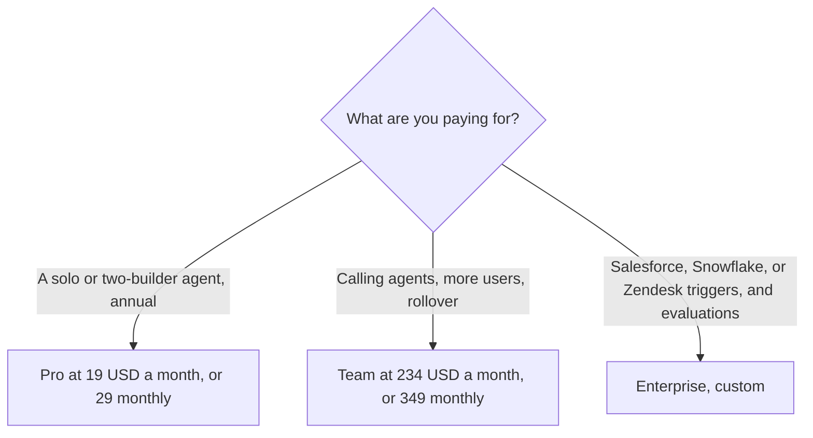

**Relevance AI Pro is $19 a month billed annually, or $29 month to month, with 2,500 Actions a month and $20 a month in Vendor Credits. Team is $234 a month billed annually, or $349 month to month, with 7,000 Actions a month and $70 a month in Vendor Credits.** Enterprise is custom. The free plan is retired for new signups and existing accounts, on the directory record checked October 16, 2026. A live fetch of the pricing docs on October 24, 2026 returned HTTP 401, so this page stays on that record.

The product page is [Relevance AI](/tools/relevance-ai/). A workflow bill with a task meter is [Zapier pricing explained](/blog/zapier-pricing-explained-2026/). An agent bill with a credit pool is [Lindy pricing explained](/blog/lindy-pricing-explained-2026/). A GTM data bill, which is a different meter, is [Clay pricing explained](/blog/clay-pricing-explained-2026/).

Published October 24, 2026. We did not score agents. Annual billing saves 33% on the directory card. The arithmetic below is that claim checked against the two pairs, not a third discount.

## The two paid cards

| Plan | Annual | Monthly | Actions | Vendor Credits | Users on the directory card |
|---|---|---|---|---|---|
| Pro | $19 a month | $29 a month | 2,500 a month, 30,000 a year | $20 a month, $240 a year | 2 build users, 1 project |
| Team | $234 a month | $349 a month | 7,000 a month, 84,000 a year | $70 a month, $840 a year, with rollover | 5 build users, 45 end users, 5 projects |
| Enterprise | Custom | Custom | Custom | Custom | Unlimited, on that card |

A year of Pro at the monthly rate is 12 × $29 = $348. A year at the annual rate is 12 × $19 = $228. The difference is $120, which is about 34% off the monthly run rate. A year of Team at the monthly rate is 12 × $349 = $4,188. A year at the annual rate is 12 × $234 = $2,808. The difference is $1,380, which is about 33%. The directory's "annual billing saves 33%" matches Team closely and Pro in the same neighborhood. Quote the pair you will actually be billed. Do not stack another 33% on top.

The directory says every plan can use any LLM with credits or bring your own API keys. Vendor Credits are the included third-party spend. BYOK does not make Actions free. Actions are the platform meter. Credits are the vendor meter. A budget that names only the $19 seat will miss both.

## What Team adds, and what it costs

The jump from Pro annual to Team annual is $234 − $19 = $215 a month, before you count Actions. The directory says Team adds unused-credit rollover, the larger user counts, shared projects, calling and meeting agents, and A/B testing. Enterprise is where it puts Salesforce, Snowflake, and Zendesk triggers, plus agent evaluations. Do not buy Team to get a trigger that the card places on Enterprise.

**Zapier Professional** at $19.99 a month billed annually is a similar sticker to Relevance Pro and a different product: tasks between apps, not a multi-agent workforce. **Lindy** Team starts at $49.99 a month for 5,000 credits, on the directory card. A Lindy credit and a Relevance Action are not convertible. **Clay** Launch starts at $167 a month billed annually. Clay is the enrichment bill. Relevance is the agent bill. A GTM team can need both, and should not describe them as one line item.

## What not to assume

Do not quote Pro at $19 if you are paying monthly. $19 is the annual per-month figure. Do not plan on a free tier. The directory says it is retired. Do not treat 2,500 Actions as "about 2,500 agent replies" until you have run a real workflow and counted. The page says usage varies, in the sense that you must measure yours. Do not assume image, voice, or calling usage sits inside the $19. Calling agents are on Team, on the directory card.

## FAQ

### How much does Relevance AI cost?

On the October 16, 2026 directory record, Pro is $19 a month billed annually or $29 monthly. Team is $234 a month billed annually or $349 monthly. Enterprise is custom. The free plan is retired.

### What is an Action?

The directory's unit for agent work on the platform. Pro includes 2,500 a month. Team includes 7,000 a month. Vendor Credits are the separate pool for third-party model and tool usage. Bring-your-own-keys changes who bills the model. It does not remove the Action meter.

### Is the annual price 33% off?

The directory says annual billing saves 33%. The Pro pair is about 34% versus twelve monthly payments. The Team pair is about 33%. Those are comparisons of the listed pairs. Checkout is the price if a promotion differs.

### Do I need Team to start?

Pro is the first paid card, with two build users and one project. Team is the card with calling and meeting agents, rollover, and the larger user counts. If you do not need those, price Pro and measure Actions before you jump $215 a month.

## Last verified

October 16, 2026, from the Relevance AI directory page, which cites the pricing docs. A live fetch of those docs on October 24, 2026 returned HTTP 401. Published October 24, 2026.

**Sources:** [Relevance AI pricing](https://relevanceai.com/docs/get-started/pricing), [Relevance AI](https://relevanceai.com).

*Published by Andrew for [AI Tools Optimizer](https://aitoolsoptimizer.com).*

[Relevance AI](/tools/relevance-ai/) is in the [automation and agents directory](/tools/category/automation-agents/). Directory pages may use affiliate links. A purchase through them may earn us a commission at no extra cost to you.
