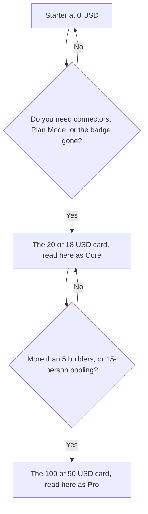

**Replit Agent has a free Starter plan, and the pricing page read on October 24, 2026 showed two paid dollar pairs: $20 per month or $18 billed annually, and $100 per month or $90 billed annually.** The higher card said "Everything in Core plus" and "up to 15 collaborators." Replit's docs, read the same day, still refuse to print a dollar amount and point you at that pricing page. This article attaches $20 / $18 to Core and $100 / $90 to Pro because those are the two self-serve prices and the second one matches Pro's 15-builder limit. If checkout labels them differently, checkout wins.

Starter remains $0 in the docs: daily Agent credits up to a monthly cap, monthly cloud credits, Lite build, and one published app that comes down after 30 days with a Made with Replit badge. The product story is [Replit Agent review](/blog/replit-agent-review-2026/). The builder comparison is [Lovable vs Bolt vs Replit](/blog/lovable-vs-bolt-vs-replit/).

An October 16, 2026 directory check could not load the pricing page, so it recorded no Core or Pro dollar figure. The October 24 read is the first dollar figure this site is willing to print, with the label caveat above. Prices exclude the tax the page says can apply by location.

## What the October 24 page showed

| What rendered | Monthly figure | Annual figure on the card | The words next to it |
|---|---|---|---|
| The lower paid card | $20 | $18 per month, billed annually | "$20 towards more powerful models," plus Free Mode lines: up to 30 hours of chat and up to 60 projects |
| The higher paid card | $100 | $90 per month, billed annually | "Everything in Core plus," "$100 towards most powerful models," up to 15 collaborators, database rollback up to 28 days |
| Enterprise language under that | No dollar amount in the text we received | Custom, via sales | SSO, SCIM, audit logs, single-tenant options, dedicated support |

Annual Core, on this reading, is $24 less per year than monthly ($240 versus $216). Annual Pro is $120 less per year ($1,200 versus $1,080). Those are multiplications of the figures on the card. They are not a discount percentage Replit printed in the text we captured.

The lower card's Free Mode lines describe an allowance. This article does not reassign "30 hours" or "60 projects" to Starter. They rendered on the paid card. Starter's docs describe a daily credit cap and a monthly cap, without those hour counts.

## What the docs still say, without prices

Read October 24, 2026 from Replit's billing docs:

| Capability | Starter | Core | Pro |
|---|---|---|---|
| Agent | Daily cap | Yes, including paid Power and Max modes | Yes |
| Published apps | 1, taken down after 30 days, with a badge | Unlimited, badge removable | Unlimited |
| Plan Mode, connectors, AI Integrations | No | Yes | Yes |
| Collaborators | None on the comparison table | Up to 5 | Up to 15, pooled, no per-user fee |
| Parallel background tasks | 0 | 1 | Up to 10 |
| Credit rollover | Not listed | Monthly credits | Unused credits roll over for two months |
| Database recovery | Not the Pro window | Standard window described as 7 days on the Pro page | Up to 28 days |

Full build, the more autonomous Agent mode, still requires Core or Pro on the Starter doc. Core's own page now talks about Free Mode inside an allowance and paid Agent modes called Power and Max. Use the names on the doc you have open. Both say the same buying line: Starter is the capped build, Core is the first plan with connectors and badge removal, Pro is the team plan.

Overage behavior from the October 16 directory note: on Core and Pro, usage beyond included credits can be charged, and charges accumulate until they cross an invoice threshold that starts at $50 and can rise to $250. The October 24 pricing text we received did not repeat that threshold. Treat it as a docs-era note and confirm it on the billing page before you rely on it. Credit packs exist in the Pro docs, with the current tiers on the pricing page.

## How to read this next to Bolt and Lovable

[Bolt.new](/tools/bolt-new/) prints a cleaner token card. Pro is $25 month to month or $18 billed annually, and Free includes 1 million tokens. That invoice is [Bolt.new pricing explained](/blog/bolt-new-pricing-explained-2026/). [Lovable](/tools/lovable/) Pro is $25 a month for 100 credits, with unlimited members. A prompt-to-UI builder in this set is [v0](/tools/v0/). The switch list is [Lovable alternatives](/blog/lovable-alternatives-2026/).

Replit is the one in this set that is also a cloud IDE. You pay, on this reading, $18 a month annually to leave the Starter badge and the single 30-day app, and $90 a month annually when the team approaches 15 builders and wants rollover. A Replit credit, a Bolt token, and a Lovable credit are different meters. Compare them by building the same small app on Starter and on Bolt's free plan, then look at the usage screen.

[Cursor](/tools/cursor/) Plus at $8 a month is the editor path once the code should live in a repository you control. The ladder is [Cursor pricing explained](/blog/cursor-pricing-explained-2026/).

## FAQ

### How much does Replit Core cost?

On the October 24, 2026 pricing page, the lower paid card showed $20 per month or $18 per month billed annually. This article reads that card as Core because the next card says "Everything in Core plus." Replit's Core doc does not print the dollar amount. Confirm the label at checkout.

### How much does Replit Pro cost?

The higher card showed $100 per month or $90 per month billed annually, with up to 15 collaborators. Pro's doc says up to 15 builders, no per-user fees, and credits that roll over for two months. The doc tells you to see the pricing page for tiers. A larger credit tier can cost more than the entry card. Price the tier you select.

### Is Replit Agent free?

Starter is free. It includes daily Agent credits, Lite build, and one published app for 30 days with a badge. Connectors, Plan Mode, Full build, and badge removal require a paid plan.

### Why did older pages on this site omit the price?

The pricing page did not load in the October 16, 2026 check. We do not fill a blocked page with a guessed number. The October 24 page loaded far enough to show the two dollar pairs above, and not far enough to show a neat three-column grid in the text we captured. The caveat in the first paragraph is the result.

## Last verified

October 24, 2026, from replit.com/pricing and from Replit's Starter, Core, and Pro docs. The $50 overage-threshold note is from the directory page checked October 16, 2026, and was not repeated in the October 24 pricing text. Published October 24, 2026.

**Sources:** [Replit pricing](https://replit.com/pricing), [Starter plan](https://docs.replit.com/billing/plans), [Replit Core](https://docs.replit.com/billing/plans/replit-core), [Replit Pro](https://docs.replit.com/billing/plans/replit-pro).

*Published by Andrew for [AI Tools Optimizer](https://aitoolsoptimizer.com).*

[Replit](/tools/replit/) is in the [coding directory](/tools/category/coding/). Directory pages may use affiliate links. A purchase through them may earn us a commission at no extra cost to you.
