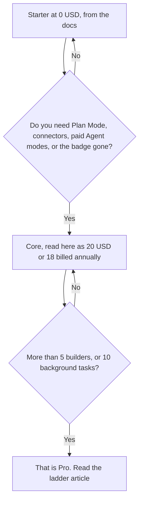

**Replit Core is the first paid membership above Starter. On replit.com/pricing fetched October 24, 2026, the lower paid card showed $20 a month, or $18 a month billed annually. The next card says "Everything in Core plus," which is why this page reads the $20 / $18 card as Core.** The Core doc fetched the same day does not print a dollar. It tells you to see the pricing page. If checkout labels the card differently, checkout wins.

This page is the Core decision: what that membership adds, and what it still does not include. The two-card ladder, including Pro and Enterprise, is [Replit pricing explained](/blog/replit-pricing-explained-2026/). Credits, Power, and Max are [Replit Agent pricing explained](/blog/replit-agent-pricing-explained-2026/).

Published October 24, 2026. The pricing page says prices are subject to tax depending on location. We did not score apps.

## The Core card next to the doc

| What | The October 24 record | What it is not |
|---|---|---|
| The lower paid card | $20 a month, or $18 a month billed annually. Up to 30 hours of chat on Free Mode, up to 60 projects on Free Mode, and $20 towards more powerful models | A figure printed inside the Core doc. The doc has no dollar |
| Plan Mode, connectors, paid Agent modes, AI Integrations | Listed on Core in the doc's comparison table. Starter's column is no | Included on the free Starter plan |
| Collaborators | Up to 5 on the Core column | Pro's 15 |
| Background tasks | 1 active task on Core | Pro's 10 |
| Published apps | Unlimited on Core, and the doc says you can remove the Made with Replit badge | Starter's one app, taken down after 30 days, with the badge |

A year of the lower card at the monthly rate is 12 × $20 = $240. At the annual per-month figure it is 12 × $18 = $216. The difference is $24. The pricing page's text on a same-day read, recorded in the ladder article, said yearly billing is up to 10% off. This fetch of the pricing page showed the two figures and did not repeat that sentence in the text we captured. Quote $18 only when you are paying annually.

The Core doc also lists monthly credits that apply to Agent, publishing, network transfer, database storage, and Replit AI Integrations. It does not print the credit count. The "$20 towards more powerful models" line is on the pricing card, not a second $20 on top of the subscription, in the way this page reads that phrase. Confirm the credit screen in the account before you budget past it.

## What Core still is not

**Pro.** The higher card is $100 a month, or $90 billed annually, with "Everything in Core plus," up to 15 collaborators, and database rollback up to 28 days. The doc's Pro column is 15 collaboration seats and 10 background tasks. Buying Core five times is not Pro. The ladder article is the place for that card.

**A local editor.** [Cursor](/tools/cursor/) Plus is $8 a month, or $80 a year, on the help page recorded October 24, 2026. That is the seat once the code should live in a repository you control. The ladder is [Cursor pricing explained](/blog/cursor-pricing-explained-2026/).

**Bolt's token card.** [Bolt.new](/tools/bolt-new/) Pro is $25 month to month or $18 billed annually, on its own article. A Bolt token and a Replit credit are different meters. The invoice is [Bolt.new pricing explained](/blog/bolt-new-pricing-explained-2026/).

Overage, from the October 16 directory note: on Core and Pro, usage beyond included credits can be charged, and charges can accumulate until they cross an invoice threshold that starts at $50 and can rise to $250. The October 24 pricing text we captured did not repeat that threshold. Confirm it on the billing page before you rely on it.

## What not to assume

Do not quote Core at $18 if you are paying monthly. Do not put a sixth builder on Core because the product feels collaborative. The doc says 5. Do not treat Free Mode's 30 hours as Starter's cap. Those hours rendered on the paid card. Do not skip the Agent article and then be surprised that Power and Max are paid modes on top of the membership.

## FAQ

### How much is Replit Core?

On the pricing page fetched October 24, 2026, the card this page reads as Core is $20 a month, or $18 a month billed annually. The Core doc does not print the dollar. Confirm the label at checkout.

### What do I get that Starter does not?

On the doc's table: paid Agent modes, intelligent model routing, all artifact types, Plan Mode, connectors, Replit AI Integrations, up to 5 collaborators, 1 background task, and unlimited published apps. Starter keeps a daily cap and one published app for 30 days with a badge.

### Does Core include 15 builders?

No. The doc lists 15 collaboration seats on Pro. Core lists 5. The pricing card that says "up to 15 collaborators" is the higher card, the one that says everything in Core plus.

### Is the $20 model credit a second charge?

The pricing card places "$20 towards more powerful models" on the lower paid card, beside the $20 subscription figure. This page does not add them into $40. Read the credit screen. The Agent article is the usage story.

## Last verified

October 24, 2026, from replit.com/pricing and from docs.replit.com/billing/plans/replit-core. The $50 overage-threshold note is from the directory page checked October 16, 2026, and was not repeated in the October 24 pricing text. Published October 24, 2026.

**Sources:** [Replit pricing](https://replit.com/pricing), [Replit Core](https://docs.replit.com/billing/plans/replit-core), [Replit billing docs](https://docs.replit.com/billing/plans).

*Published by Andrew for [AI Tools Optimizer](https://aitoolsoptimizer.com).*

[Replit](/tools/replit/) is in the [coding directory](/tools/category/coding/). Directory pages may use affiliate links. A purchase through them may earn us a commission at no extra cost to you.
