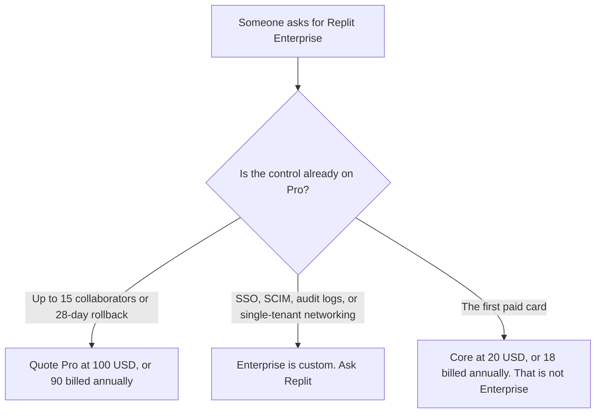

**Replit Enterprise is custom.** The pricing page read October 24, 2026 lists SSO, SCIM, audit logs, advanced privacy controls, single-tenant and private networking options, and dedicated support on that row. It does not list a dollar. Pro, the published team card under it, is $100 a month, or $90 a month billed annually, with up to 15 collaborators, up to 50 viewers, 10 parallel agents, and database rollback up to 28 days. The workspace ladder, Core and Pro, is [Replit pricing explained](/blog/replit-pricing-explained-2026/). This page is the custom row, and what not to invent when a security review asks for Enterprise.

The Agent credit story is [Replit Agent pricing explained](/blog/replit-agent-pricing-explained-2026/). The product page for the agent is [Replit Agent review](/blog/replit-agent-review-2026/). A prototype in an editor you control is [Cursor vs Replit for prototypes](/blog/cursor-vs-replit-for-prototypes-2026/).

The October 24 page said prices are subject to tax depending on location, and yearly billing is up to 10% off. That discount is the Core and Pro pairs in the base article. It is not an Enterprise percentage. Published October 24, 2026. We did not score apps. We did not receive an Enterprise quote.

## What the page separates

| Plan | Price on the October 24 page | What you may quote | What you may not call Enterprise |
|---|---|---|---|
| Core, for contrast | $20 a month, or $18 billed annually | Plan mode, AI integrations, unlimited workspaces, $20 towards more powerful models | A security review |
| Pro, for contrast | $100 a month, or $90 billed annually | 10 parallel agents, up to 15 collaborators, up to 50 viewers, database rollback up to 28 days | SSO |
| Enterprise | Custom | SSO, SCIM, audit logs, advanced privacy controls, single-tenant and private networking options, dedicated support | A dollar. The page does not have one |

A year of Pro at the monthly rate is 12 times $100, which is $1,200, against 12 times $90, which is $1,080. The difference is $120, which is 10%. That arithmetic is Pro. It does not produce an Enterprise price. Sixteen builders do not fit the 15-collaborator line. The sixteenth person is a reason to read the Enterprise quote, or to split the workspace. It is not a reason to assume Pro's cap is soft.

Starter did not appear on the plan cards in the text captured on October 24. The docs, as the Agent article records, still describe a free Starter. A free app with a badge is not an Enterprise feature, and it is not a substitute for SSO.

The October 16 directory recorded that Core and Pro overage can accumulate until it crosses an invoice threshold that starts at $50 and can rise to $250. The October 24 pricing text the base article captured did not repeat that threshold. Confirm it on the billing page before you rely on it. Enterprise invoicing, if the quote includes it, is a contract term. Do not copy the $50 threshold onto the custom row.

## What the custom row is for

**The security review.** [Replit](/tools/replit/) Pro is the seat for collaborators and rollback. SSO, SCIM, audit logs, and single-tenant or private networking options are the Enterprise words on the October 24 page. "Advanced privacy controls" is not a named control such as a region pin unless the quote says so. If the review needs a control the page does not name, the quote has to name it. This article will not.

**An editor, once the code should leave the hosted workspace.** [Cursor](/tools/cursor/) Plus is $8 a month, or $80 a year, on the October 24 help page. Cursor Enterprise is its own contact-sales row, in [Cursor Enterprise pricing explained](/blog/cursor-enterprise-pricing-explained-2026/). A Cursor quote is not a Replit quote.

**A different builder's published price.** [Bolt.new](/tools/bolt-new/) Pro is $25 month to month or $18 billed annually, on its own pricing article. The invoice is [Bolt.new pricing explained](/blog/bolt-new-pricing-explained-2026/). A Bolt token is not a Replit credit, and Bolt's Pro price is not Replit Enterprise.

**The sentence that lists the controls.** [Claude](/tools/claude/) Pro is $17 a month billed annually, or $20 monthly. The sentence is not the contract.

Agent modes and credit packs stay in the Agent article. "$100 towards most powerful models" on the Pro card is not a description of Enterprise usage. Read the Agent article before you treat a custom contract as an unlimited model pool.

## What not to assume

Do not print an Enterprise price. Do not say 15 collaborators require Enterprise. Pro lists them. Do not say 28-day database rollback requires Enterprise. Pro lists it. Do not apply the 10% annual discount to a contract that has no list price. Do not convert a non-USD checkout into the Core or Pro dollars, and do not turn those dollars into an Enterprise estimate.

## FAQ

### How much is Replit Enterprise?

The October 24 page says custom. There is no seat price. Pro at $100 a month, or $90 billed annually, is the last published team dollar. If a quote arrives, that quote is the price, and this page will not round it into a list.

### Does Pro include SSO?

SSO, SCIM, audit logs, advanced privacy controls, single-tenant and private networking options, and dedicated support are the Enterprise lines on that page. Pro is collaborators, viewers, parallel agents, and rollback. A company that fits in 15 builders and does not need those controls should quote Pro.

### What happens at 16 collaborators?

The Pro card says up to 15. The sixteenth is outside that line. Ask whether Enterprise is the seat, or whether the work splits. Do not assume the cap is a suggestion. Do not invent a per-seat Enterprise price to cover the extra person.

### Does this page replace the main Replit pricing article?

No. That article is Core, Pro, and the 10% annual pairs. This article is the custom row: which controls sit only there, and which Pro limits people mislabel as Enterprise.

## Last verified

October 24, 2026, from replit.com/pricing, matching the base pricing article. The $50 overage-threshold note is from the directory page checked October 16, 2026, and was not repeated in the October 24 pricing text. Published October 24, 2026. No Enterprise quote was received.

**Sources:** [Replit pricing](https://replit.com/pricing), [Replit billing docs](https://docs.replit.com/billing/plans).

*Published by Andrew for [AI Tools Optimizer](https://aitoolsoptimizer.com).*

[Replit](/tools/replit/) is in the [coding directory](/tools/category/coding/). Directory pages may use affiliate links. A purchase through them may earn us a commission at no extra cost to you.
