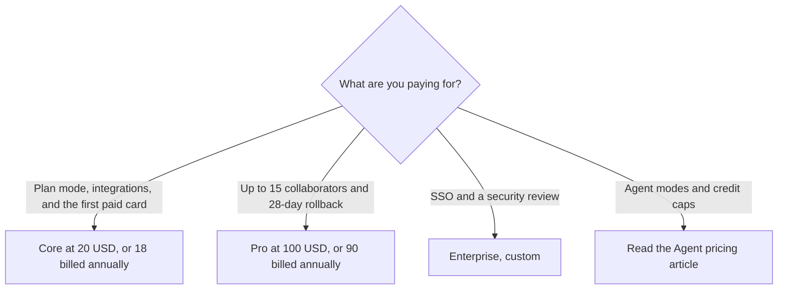

**Replit Core is $20 a month, or $18 a month billed annually. Replit Pro is $100 a month, or $90 a month billed annually. Enterprise is custom.** Those labels were on replit.com/pricing on October 24, 2026. The page said prices are subject to tax depending on location, and yearly billing is up to 10% off. This page is the workspace bill: plan mode, collaborators, and rollback. The Agent credit story is [Replit Agent pricing explained](/blog/replit-agent-pricing-explained-2026/).

The product page for the agent is [Replit Agent review](/blog/replit-agent-review-2026/). The builder comparison is [Lovable vs Bolt vs Replit](/blog/lovable-vs-bolt-vs-replit/). A prototype in an editor you control is [Cursor vs Replit for prototypes](/blog/cursor-vs-replit-for-prototypes-2026/).

An October 16, 2026 directory check could not load the pricing page, so it recorded no Core or Pro dollar. The October 24 page loaded with the plan names next to the dollars. Published October 24, 2026. We did not score apps.

## The cards on the October 24 page

| Plan | Monthly | Annual, per month | What the card listed |
|---|---|---|---|
| Core | $20 | $18 | AI integrations, up to 30 hours of chat on Free Mode, up to 60 projects on Free Mode, $20 towards more powerful models, Plan mode, unlimited workspaces |
| Pro | $100 | $90 | 10 parallel agents, premium support, everything in Core, more Free Mode usage, $100 towards most powerful models, up to 15 collaborators, up to 50 viewers, database rollback up to 28 days |
| Enterprise | Custom | Custom | SSO, SCIM, audit logs, advanced privacy controls, single-tenant and private networking options, dedicated support |

A year of Core at the monthly rate is 12 × $20 = $240, against 12 × $18 = $216. The difference is $24, which is 10%. A year of Pro at the monthly rate is 12 × $100 = $1,200, against 12 × $90 = $1,080. The difference is $120, also 10%. The page's "up to 10% off" matches those two pairs. It is not a third discount on top.

Starter did not appear on the plan cards in the text captured on October 24. The docs, as recorded on October 16 and in the Agent article, still describe a free Starter: daily Agent credits, a monthly cap, Lite build, and one published app. If you are deciding whether Starter's badge and 30-day app are enough, use the Agent article. This page prices the two paid cards the pricing page named.

## What this page will not re-explain

Agent modes, Power and Max, and the credit packs belong to the Agent article. Read it before you treat "$20 towards more powerful models" as a full description of usage. The October 16 directory also recorded that Core and Pro overage can accumulate until it crosses an invoice threshold that starts at $50 and can rise to $250. The October 24 pricing text we captured did not repeat that threshold. Confirm it on the billing page before you rely on it.

**Core** is the first labeled paid plan: Plan mode, AI integrations, and unlimited workspaces, with Free Mode limits printed on the card. **Pro** is the plan with 15 collaborators, 50 viewers, 10 parallel agents, and database rollback up to 28 days. **Enterprise** is the sales conversation. Do not quote a dollar for it.

[Cursor](/tools/cursor/) Plus at $8 a month, or $80 a year, is the editor once the code should live in a repository you control. The ladder is [Cursor pricing explained](/blog/cursor-pricing-explained-2026/). [Bolt.new](/tools/bolt-new/) Pro is $25 month to month or $18 billed annually, on its own pricing article. The invoice is [Bolt.new pricing explained](/blog/bolt-new-pricing-explained-2026/). A Bolt token, a [Lovable](/tools/lovable/) credit, and a Replit credit are different meters.

## What not to assume

Do not quote Core at $18 if you are paying monthly. $18 is the annual per-month figure. Do not put 16 builders on Pro and hope the 15-collaborator line is soft. Do not skip the Agent article and then be surprised by usage. The pricing page says Agent is powered by models and can make mistakes. A plan does not remove that.

## FAQ

### How much does Replit Core cost?

On October 24, 2026, the pricing page labeled Core at $20 a month or $18 a month billed annually. That is the figure to quote. The October 16 directory had no dollar because the page did not load.

### How much does Replit Pro cost?

The same page labeled Pro at $100 a month or $90 a month billed annually, with up to 15 collaborators and database rollback up to 28 days. A larger credit tier, if the billing page offers one, can cost more. Price the tier you select.

### Is Replit free?

The October 24 pricing cards we captured started at Core. Starter, at $0, is described in the docs and in the Agent pricing article, with a published-app limit. Confirm Starter is still offered in your account before you tell a team the tool is free.

### Why is there a second Replit pricing article?

That article is the Agent: credits, modes, and how the October 24 capture first attached dollars to plan names. This article is the workspace card, now that the page prints Core and Pro as labels. Use both. Do not merge them into one guessed credit price.

## Last verified

October 24, 2026, from replit.com/pricing. The $50 overage-threshold note is from the directory page checked October 16, 2026, and was not repeated in the October 24 pricing text. Published October 24, 2026.

**Sources:** [Replit pricing](https://replit.com/pricing), [Replit billing docs](https://docs.replit.com/billing/plans).

*Published by Andrew for [AI Tools Optimizer](https://aitoolsoptimizer.com).*

[Replit](/tools/replit/) is in the [coding directory](/tools/category/coding/). Directory pages may use affiliate links. A purchase through them may earn us a commission at no extra cost to you.
