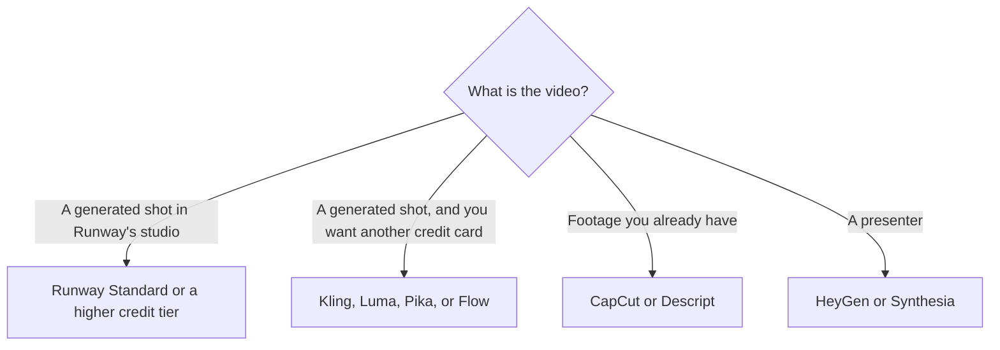

**Stay on Runway when you want its Gen-4.5 credits and the editing tools in that workspace. Leave when you want a different credit price, a Google Flow allowance you already pay for, a timeline editor, or a presenter.** Runway is a generation studio with a small free taste. It is a costly way to trim a webinar you already recorded.

[Runway](/tools/runway/) Standard is $12 a month billed annually, or $15 month to month, for 625 credits. The company equates that pool to about 52 seconds of Gen-4.5. The invoice is [Runway pricing explained](/blog/runway-pricing-explained-2026/). The product page is [Runway review](/blog/runway-review-2026/). The model comparison is [Runway vs Kling vs Veo](/blog/runway-vs-kling-vs-veo-2026/).

Prices are US list prices excluding tax from directory pages checked October 16, 2026. Published October 24, 2026. This guide does not rank clip quality.

## Leave for a job Runway is not priced to do

| The job became | Open this | Price that matters |
|---|---|---|
| More Gen-4.5-class seconds inside Runway | Stay, and move up a credit tier | Pro is $28/month annually ($35 monthly) for 2,250 credits. Max is $76 annually ($95 monthly) for 9,500 |
| A lower entry subscription for generated clips | [Kling](/tools/kling-ai/) | Standard is $6.99 the first month, then $8.80, for 660 credits. The card also showed a $10 figure |
| A commercial Luma plan with a large credit pool | [Luma](/tools/luma-ai/) | Plus is $30/month or $300/year for 10,000 credits |
| Every model in one app, priced only by credits | [Pika](/tools/pika/) | Starter is $10/month for 900 credits. Commercial use starts on Creator at $35 |
| Clips inside a Google AI plan you may already have | [Google Flow](/tools/google-flow/) | 50 credits a day on the free allowance. Google AI Plus is $4.99/month and adds 200 monthly Flow credits |
| Cutting footage you shot | [CapCut](/tools/capcut/) | Pro lists at $19.99/month or $179.99/year in the US |
| A person on camera who is an avatar | [HeyGen](/tools/heygen/) | Creator is $29/month |

The category roundup is [best AI video generators](/blog/best-ai-video-generators-2026/). Avatar training videos are [Synthesia vs HeyGen for training](/blog/synthesia-vs-heygen-for-training-2026/).

## The other generators, in dollars

Kling's free Basic plan does not include a monthly credit grant. Standard's ongoing price on the card we checked is $8.80 a month after a $6.99 first month, with 660 credits. Kling's own guide, recorded with that card, put VIDEO 3.0 at 4K around 30 credits per second. Do the seconds math on the model you will actually render. A cheaper subscription with a hungry model is a short month.

Luma Plus at $30 a month, or $300 a year, includes commercial use and 10,000 credits. That annual price is $25 a month if you divide $300 by 12. Pro is $90 a month or $900 a year. Buy Luma when you want that credit pool and the Luma models. Buy Runway when the shot has to be made in Runway's studio. The reviews are [Luma review](/blog/luma-ai-review-2026/) and [Kling review](/blog/kling-ai-review-2026/).

Pika's plans differ by credits and concurrency, and every plan can reach the models. Free has no monthly credits and no commercial license. Starter at $10 does not list the commercial license. Creator at $35 does. If the clip will ship in an ad, Creator is the first Pika card that says so. The review is [Pika review](/blog/pika-review-2026/).

Google Flow gives everyone 50 credits a day, and unused daily credits do not roll over. Veo 3.1 Lite is 10 credits a clip on the card we recorded, Fast is 20, and Quality is 100. Google AI Plus at $4.99 adds 200 monthly bonus credits on top of the daily grant. Flow is the alternative when you already pay Google and the clip budget is small. It is a weak alternative when you need Runway's editing workspace and a monthly pool you can spend in one afternoon. Non-subscribers may be blocked from generating video at peak hours, about 2 to 5 PM UTC, on the note recorded October 16, 2026.

## Editors and avatars are not Runway discounts

CapCut Pro is an editor with AI credits. Descript is the editor when the source is a recording and you want text-based cuts. Hobbyist is $16 per person per month billed annually. The invoice is [Descript pricing explained](/blog/descript-pricing-explained-2026/). Repurposing a webinar belongs there, in [how to repurpose a webinar with AI](/blog/how-to-repurpose-a-webinar-with-ai-2026/).

HeyGen Creator at $29 is a presenter plan. Synthesia Starter is $29 a month billed monthly, shown as $19 with yearly billing on the October 16 card. Buy an avatar when the shot is a person who is not in the room. Buy Runway when the shot is generated imagery or a generated scene.

## FAQ

### Is Kling cheaper than Runway?

The entry subscription is lower: Kling Standard continues at $8.80 a month after the first month, against Runway Standard at $12 annually or $15 monthly. Credits per second differ by model. Compare the seconds you need, using each vendor's own credit table, before you call it cheaper.

### Does Runway's free plan replace a paid alternative?

Free is 125 one-time credits. It is a test. It is not a monthly production pool. A tool with a refreshing free allowance, such as Flow's 50 credits a day, is the closer "free" alternative, with the daily cap and the peak-hour note attached.

### When should I stop shopping for generators?

When the source is a recording. Generators invent frames. Editors cut frames you captured. Mixing them is fine for a B-roll insert. Replacing the webinar with a generated recap is a different video, and it should be labeled as one.

### Which alternative includes commercial use at the lowest price?

Luma Plus includes commercial use at $30 a month or $300 a year. Pika's commercial license starts on Creator at $35, as recorded October 16. Runway's paid plans are the commercial path inside Runway. Confirm the license on the plan you check out, because free tiers in this set often exclude it.

## Last verified

October 16, 2026 for Runway, Kling, Luma, Pika, Google Flow, CapCut, HeyGen, Synthesia, and Descript prices. Published October 24, 2026.

**Sources:** [Runway pricing](https://runway.com/pricing), [Kling credit guide](https://kling.ai/blog/kling-video-3-0-credit-cost-guide), [Luma pricing](https://lumalabs.ai/pricing), [Pika pricing](https://pika.art/pricing).

*Published by Andrew for [AI Tools Optimizer](https://aitoolsoptimizer.com).*

[Runway](/tools/runway/) is in the [video directory](/tools/category/video/). Directory pages may use affiliate links. A purchase through them may earn us a commission at no extra cost to you.
