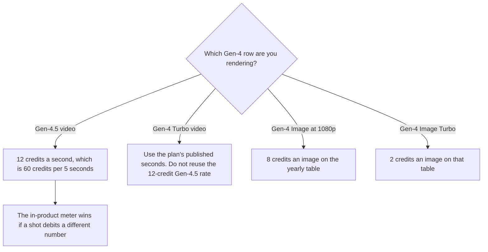

**Runway prices Gen-4.5 at 12 credits per second. The pricing FAQ says that in those words, and the table lists Gen-4.5 at 60 credits per 5 seconds.** Standard's 625 monthly credits are the page's "about 52 seconds" of Gen-4.5, about 104 seconds of Gen-4 Turbo, or 78 Gen-4 images at 1080p. Those equivalences are from runwayml.com/pricing, fetched October 24, 2026. The seat ladder, and which plan name to buy, is [Runway pricing explained](/blog/runway-pricing-explained-2026/).

The product review is [Runway review](/blog/runway-review-2026/). This page is the Gen-4 meter. Other models on the same page do not inherit it.

## What the page equates

| Plan | Annual monthly rate | Month to month | Credits | Gen-4 family, as the page printed it |
|---|---|---|---|---|
| Free | $0 | $0 | 125, once | A one-time deposit. The FAQ says those credits do not expire |
| Standard | $12 | $15 | 625 a month | About 52 seconds of Gen-4.5, about 104 seconds of Gen-4 Turbo, or 78 Gen-4 images at 1080p |
| Pro | $28 | $35 | 2,250 a month | About 187 seconds of Gen-4.5, about 375 seconds of Gen-4 Turbo, or 281 Gen-4 images at 1080p |
| Max | $76 | $95 | 9,500 | About 791 seconds of Gen-4.5, about 791 seconds of Gen-4, about 1,900 seconds of Gen-4 Turbo, or 1,187 Gen-4 images at 1080p |

The FAQ also says each model spends credits based on model, duration, and resolution. Gen-4 Image at 1080p is 8 credits an image on the yearly generation table. Gen-4 Image Turbo is 2 credits an image. A 5-second Gen-4.5 shot at 12 credits a second is 60 credits. Standard's 625 credits divided by 60 is about 10 of those shots before retakes, which matches the page's "about 52 seconds" (52 / 5 = 10.4). If your shot is not 5 seconds, multiply seconds by 12 for Gen-4.5 only.

The page listed Gen-4 (not Turbo, not 4.5) seconds on the Max row, about 791 seconds, the same count it listed for Gen-4.5 on Max. It did not print a separate Gen-4 second count for Standard or Pro in the block we used. Do not invent one. Use Gen-4 Turbo's published seconds when that is the model, or read the meter.

Standard and Pro monthly credits do not roll over. They reset within 24 hours of the billing date. Max rolls up to one month of unused credits. Extra credits you purchase never expire, and the minimum purchase is 1,000 credits. The yearly credit totals on the page were 7,500 for Standard, 27,000 for Pro, and 114,000 for Max. Those are the annual pools, not a second monthly grant.

## What not to copy onto Gen-4

Aleph 2.0 was 140 credits per 5 seconds on the same table. Seedance 2.0 Pro at 1080p was 160 credits per 4 seconds. Those are not Gen-4.5's 60 credits per 5 seconds. The older pricing article told you to read the debit for third-party models. The October 24 page now prints several of those rates. Use the row. Do not scale them from 52 seconds.

Kling, Luma, and Pika are different products. [Kling](/tools/kling-ai/) is not a Runway credit. [Luma](/tools/luma-ai/) is not a Gen-4 second. [Pika](/tools/pika/) Starter is $10 a month for 900 credits on the October 16 directory card. Do not convert those credits into Gen-4.5 seconds. The category tour is [best AI video generators](/blog/best-ai-video-generators-2026/).

Team, Enterprise, and the API were separate on the October 16 directory card. The October 24 consumer page we fetched did not add a new API rate. Price an API integration from its own quote. Do not divide 625 by 52 and call that an API contract.

## Three shot lists

**One 5-second Gen-4.5 take, plus two retakes.** Three shots are 15 seconds, or 180 credits at 12 a second, before tax and before any other model. That fits inside Standard's 625. Free's 125 credits are about 10 seconds of Gen-4.5 at that rate (125 / 12 is about 10.4). Free is one short test, not a calendar.

**A minute of Gen-4.5.** Sixty seconds at 12 credits is 720 credits. That is more than Standard's 625 and a slice of Pro's 2,250. The page's Pro equivalence is about 187 seconds of Gen-4.5. A minute fits in Pro. It does not fit in Standard unless you shorten the shot or switch model.

**The same board on Gen-4 Turbo.** Standard lists about 104 seconds of Gen-4 Turbo for the same 625 credits. A minute of Turbo fits that published figure. A minute of Gen-4.5 does not. Write the model name on the shot list. The plan article is where you decide Standard versus Pro versus Max after the seconds are known.

## What not to assume

Do not call every Runway video "12 credits a second." That sentence on the FAQ is Gen-4.5. Do not turn 78 images into 78 seconds. Do not assume Standard credits roll over. Do not price Max's 791 seconds of Gen-4 as if Standard published the same ratio. The meter on the shot wins.

## FAQ

### How many credits is one second of Gen-4.5?

Twelve, on the October 24 FAQ, which matches 60 credits per 5 seconds in the table. A retake spends the seconds again. Other models on the page use other rates.

### How many Gen-4.5 seconds are on Standard?

About 52, from 625 credits, on that page. Pro lists about 187 seconds. Max lists about 791 seconds. Those are the page's figures, not a count of finished videos.

### How is this different from the Runway pricing article?

That article is which plan to buy, and it scaled some Pro seconds from Standard's ratio because a refetch had failed. This article is the Gen-4 family meter from the October 24 page, which now prints Pro's 187 seconds, Turbo seconds, and the 8-credit Gen-4 image. Use that page's row if the two articles ever diverge. The in-product debit still wins.

### Do Gen-4 credits roll over?

Standard and Pro monthly credits do not, on the FAQ we fetched. Max rolls up to one month of unused credits. Purchased extra credits do not expire. Free's 125 credits are a one-time deposit the FAQ says does not expire.

## Last verified

October 24, 2026, from runwayml.com/pricing. Pika's $10 figure is the October 16 directory card. Published October 24, 2026. Re-read the model row before a shoot. Third-party models do not use the Gen-4.5 rate.

**Sources:** [Runway pricing](https://runwayml.com/pricing), [Runway](https://runway.com).

*Published by Andrew for [AI Tools Optimizer](https://aitoolsoptimizer.com).*

[Runway](/tools/runway/) is in the [video directory](/tools/category/video/). Directory pages may use affiliate links. A purchase through them may earn us a commission at no extra cost to you.
