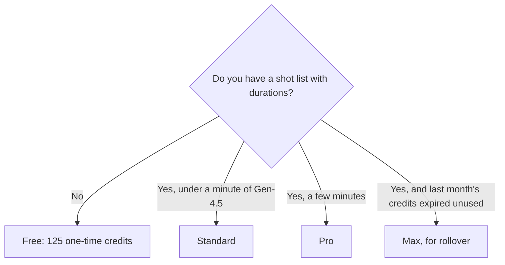

**Runway pricing is a one-time free taste, then a monthly credit pool that Runway itself converts into seconds of specific models.** Standard is not "unlimited video." It is 625 credits, which Runway equates to about 52 seconds of Gen-4.5. Buy the plan whose seconds match the shot list, not the plan whose name sounds professional.

Prices are US list prices excluding tax, from Runway's pricing page as checked October 16, 2026. This page is published October 24, 2026. A live refetch that day did not return the pricing page, so the table keeps the October 16 figures. The product review is [Runway review](/blog/runway-review-2026/). How it sits next to other generators is [Runway vs Kling vs Veo](/blog/runway-vs-kling-vs-veo-2026/).

## Plans and the seconds Runway publishes

| Plan | Annual monthly rate | Monthly billing | Credits | The equivalence Runway publishes |
|---|---|---|---|---|
| Free | $0 | $0 | 125, once. They do not refresh as a monthly grant | A selection of models and 5 GB storage. Not a production pool |
| Standard | $12 | $15 | 625 a month | About 52 seconds of Gen-4.5, about 104 seconds of Gen-4 Turbo, or about 78 Gen-4 images at 1080p |
| Pro | $28 | $35 | 2,250 a month | About 187 seconds of Gen-4.5, using the same ratio as Standard's 52 seconds per 625 credits |
| Max | $76 | $95 | 9,500 a month | Scale the same ratio only as a sketch. Confirm the in-product meter. Unused credits roll over for one month |
| Team and Enterprise | Custom | Custom | Custom | Admin and volume. Not estimated here |
| API | Separate | Separate | Separate | A product integration, not a seat |

Yearly billing is the "two months free" shape: the annual monthly rate is lower than the month-to-month rate. A first month on monthly billing is the right experiment. A year is what you buy after the shot length is known.

The 187-second Pro figure is Standard's published 52 seconds scaled by 2,250 / 625. Runway's own page stated the Standard equivalences and the Pro credit count. If the in-app meter disagrees, the meter wins. Other models, including third-party models Runway hosts, do not inherit the Gen-4.5 ratio.

## What a credit is not

A credit is not a second, until a model says so. Gen-4.5 is the expensive in-house model in the equivalence above. Gen-4 Turbo is the one Runway prices at roughly twice the seconds for the same 625 credits. Images are a third ratio: about 78 Gen-4 images at 1080p on Standard.

Third-party models on the platform, such as Seedance, Kling, and others Runway listed, spend credits too. Their rates are not the Gen-4.5 rate. Generate one second, read the debit, and multiply by the shot. That is the only budget that survives a model change.

Pro is also where the feature list changes, not just the pool: a custom voice clone, Runway MCP, unlimited 4K upscaling, and 100 GB of storage, against Standard's smaller pool. If you needed the upscale and not the seconds, Pro can still be the right plan on a short film that uses little generation. Read the feature row before you buy Max for a checkbox that was already on Pro.

Max adds early access, more parallel generations, and one-month rollover. Rollover is the reason to choose Max when your production schedule is lumpy. It is a poor reason if you generate a steady 50 seconds a month. That schedule fits Standard, and the unused Max credits are a habit, not a plan.

## Three productions

**A social ad, one 5-second Gen-4.5 shot, plus retakes.** One take is a small slice of Standard's 52 seconds. Three retakes are still inside Standard if you do not also explore for an hour. Free's 125 credits are a single test, and they do not come back next month. Do not build a calendar on Free.

**A short with three 10-second Gen-4.5 shots.** That is 30 seconds before retakes, which is most of Standard and a small part of Pro's roughly 187 seconds. If the retakes are the work, Pro is the pool. If one of those shots can be Gen-4 Turbo, Standard's 104 Turbo seconds may hold the schedule at $12.

**An agency testing five models on the same board.** Credits will disappear faster than the Gen-4.5 math suggests, because you are paying for exploration. Cap the tests. Pro is the default agency experiment. Max is the plan when rollover and parallel jobs are on the brief. A [Kling](/tools/kling-ai/) subscription or [Luma](/tools/luma-ai/) plan can be cheaper for a team that only wants that one model. Kling Standard lists $8.80/month after a $6.99 first month. Luma Plus lists $30/month. They are not Runway, and they do not include Runway's editor. The category tour is [best AI video generators](/blog/best-ai-video-generators-2026/).

## Cheaper tools people confuse with this bill

- [CapCut](/tools/capcut/) Pro lists at $19.99/month for editing and a different AI-credit system. It does not include 52 seconds of Gen-4.5.
- [Google Flow](/tools/google-flow/) includes a free daily credit grant, with Google AI Plus at $4.99/month. Different meter, different models.
- [Pika](/tools/pika/) Starter is $10/month for 900 credits. Do not convert those credits into Runway seconds.

Use Runway when the shot has to be made in Runway's suite. Use an editor when the shot already exists.

## FAQ

### How much does Runway cost?

Standard is $12/month billed annually or $15 month to month. Pro is $28 or $35. Max is $76 or $95. Free is 125 one-time credits. Team, Enterprise, and the API are separate.

### How many videos do I get?

Runway publishes seconds and image counts, not "videos." Standard's 625 credits are about 52 seconds of Gen-4.5. A 5-second shot is the unit to divide by. Retakes spend the seconds again.

### Do Runway credits roll over?

On Max, for one month. The Standard and Pro summaries we used do not include that rollover. Pro and above can buy more credits.

### Is the annual plan worth it?

The annual rate is the lower monthly number, framed as two months free. Stay on monthly billing until you have finished one real piece and the credit debit matched the shot list. Then annual is a discount on a plan you already use, not a guess.

## Last verified

October 16, 2026. Published October 24, 2026. The pricing page did not refresh successfully that day. Re-read the in-product credit cost for the model you will actually render. Third-party models inside Runway do not use the Gen-4.5 second ratio.

**Sources:** [Runway pricing](https://runway.com/pricing), [Runway](https://runway.com).

[Runway](/tools/runway/) is in the [video directory](/tools/category/video/). Directory pages may use affiliate links. A purchase through them may earn us a commission at no extra cost to you.
