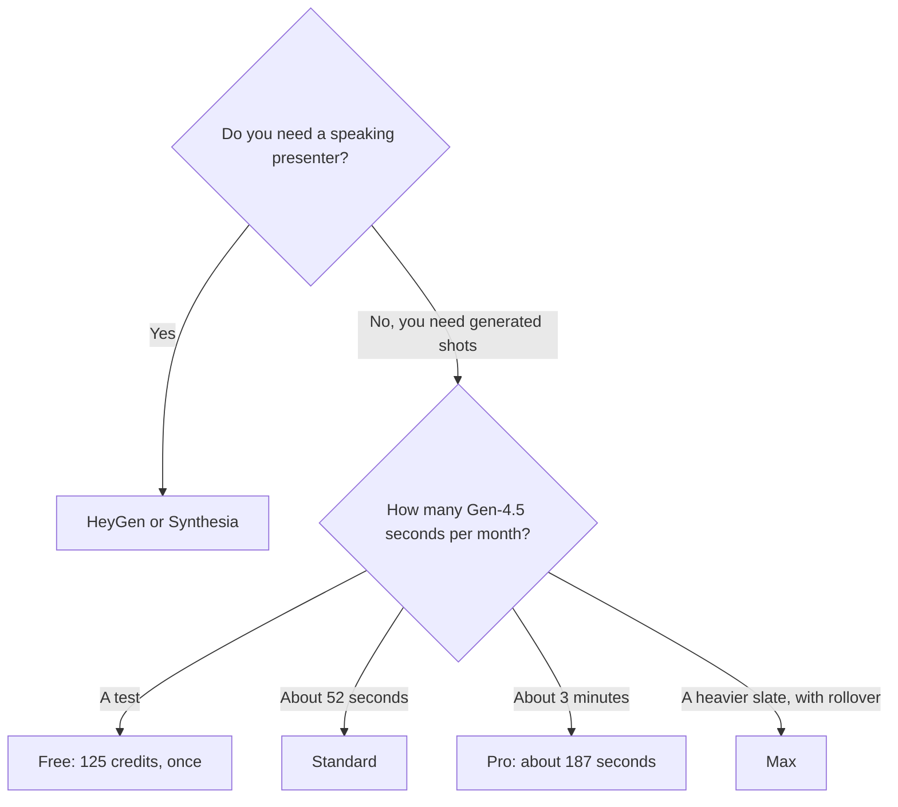

**[Runway](/tools/runway/) is a studio for generated video, images, and audio.** Free is 125 credits, once. Standard is $12 a month billed annually, or $15 month to month, with 625 credits. Pro is $28 annually or $35 monthly, with 2,250 credits. Max is $76 annually or $95 monthly, with 9,500 credits. Runway says Standard's 625 credits are about 52 seconds of Gen-4.5, 104 seconds of Gen-4 Turbo, or 78 Gen-4 images at 1080p. Pro's 2,250 credits are about 187 seconds of Gen-4.5.

Prices are US dollars from Runway's pricing page, recorded October 16, 2026. Yearly billing is described as 2 months free. Standard's yearly saving against 12 months at $15 is $36, which matches that description. Tax and local currency can differ. We did not score Gen-4.5 against other models, and we did not time a film.

The wider set is [best AI video generators](/blog/best-ai-video-generators-2026/). Kling's own membership, with its intro-price quirk, is the [Kling review](/blog/kling-ai-review-2026/). A presenter who speaks a script is [HeyGen vs Synthesia](/blog/heygen-vs-synthesia-2026/), not this product.

## Seconds, from Runway's rate

| Plan | Annual, per month | Monthly | Credits | What Runway equates that to |
|---|---|---|---|---|
| Free | $0 | $0 | 125, one time | A short test. 5 GB storage. A selection of models |
| Standard | $12 | $15 | 625 each month | About 52 seconds of Gen-4.5, 104 seconds of Gen-4 Turbo, or 78 Gen-4 images at 1080p |
| Pro | $28 | $35 | 2,250 | About 187 seconds of Gen-4.5. Custom voice clone, Runway MCP, unlimited 4K upscaling, 100 GB, credit top-ups |
| Max | $76 | $95 | 9,500 | Unused credits roll over for 1 month. 20 parallel generations, early access, 3 Brand Kits, up to 3 voice clones |
| Team / Enterprise | Contact sales | — | Custom | Shared production. API is separate |

The credit math is [Runway pricing explained](/blog/runway-pricing-explained-2026/).

A "52 second" plan can be one shot or several shorter ones. It is not a finished commercial. Retakes spend the same rate again. Third-party models inside Runway, including models Runway has listed such as Seedance, Kling, Nano Banana Pro, and Wan, can spend credits at their own rates. The Gen-4.5 equivalence is the planning number for Gen-4.5, not a promise about every model in the picker.

## What else is in the suite

Paid plans include the model list and an agentic collaborator that helps plan the work. Pro adds one custom voice clone, MCP, and unlimited 4K upscaling plus Topaz upscaling. Max adds a second and third voice clone, Brand Kits, more parallel jobs, and the one-month credit rollover. Pro and above can buy more credits.

Max has also carried limited-time inclusions, such as unlimited Wan in a tool mode during the check on October 16, 2026. Treat a "unlimited this month" banner as temporary.

Runway also describes General World Models, including GWM-1, for simulation work. That is a different buyer from a social team making B-roll. If you are the social team, ignore the world-model paragraph and stay on the credit table.

[Kling AI](/tools/kling-ai/) can be used inside Runway and as its own membership. Those are separate meters. A few Kling shots inside a Runway edit can be cheaper than a Kling Ultra seat, or the reverse, depending on resolution. Price both with one storyboard. [Luma](/tools/luma-ai/) Plus is $30 a month or $300 a year. [Pika](/tools/pika/) Starter is $10 a month for 900 credits, and the commercial license starts on Creator at $35.

## Fit score

| Need | Free | Standard | Pro | Max |
|---|---|---|---|---|
| Learn the interface | Yes | Yes | Yes | Yes |
| A monthly Gen-4.5 budget around a minute | No | About 52 seconds | About 187 seconds | Larger pool |
| Credits that survive the month | No | No | No | 1 month of rollover |
| 4K upscaling without a per-clip cap | No | No | Unlimited, as listed | Included |
| A custom voice | No | No | 1 | Up to 3 |
| An avatar that reads a training script | Poor fit | Poor fit | Poor fit | Poor fit |

Equivalences are Runway's. They are not a benchmark we filmed.

## A storyboard before you subscribe

1. Write six shots with durations. Add the seconds.
2. Spend the free 125 credits on the hardest shot, on Gen-4.5 if it is available there.
3. If the look is unusable for the project, stop. A bigger plan buys more seconds of the same model family.
4. If the look works, map the monthly seconds onto Standard, Pro, or Max using the table.
5. Put avatar scripts on [HeyGen](/tools/heygen/) and timeline finishing on [CapCut](/tools/capcut/) or [Descript](/tools/descript/).

## FAQ

### Is Runway free?

Yes, as 125 one-time credits, a selection of models, and 5 GB of storage. It does not refresh as a monthly free tier in the pricing we recorded.

### How much does Runway cost?

Standard is $12 a month billed annually or $15 monthly. Pro is $28 or $35. Max is $76 or $95.

### How much video is 625 credits?

About 52 seconds of Gen-4.5, or about 104 seconds of Gen-4 Turbo, using Runway's published equivalence. Other models differ.

### Do credits roll over?

On Max, unused credits roll over for one month. Standard and Pro do not get that line in the pricing we used. Pro and above can buy top-ups.

## Last verified

October 16, 2026.

**Sources:** [Runway pricing](https://runway.com/pricing), [Runway](https://runway.com).

[Runway](/tools/runway/) is in the [video directory](/tools/category/video/). Directory pages may use affiliate links. A purchase through them can earn us a commission at no extra cost to you.
