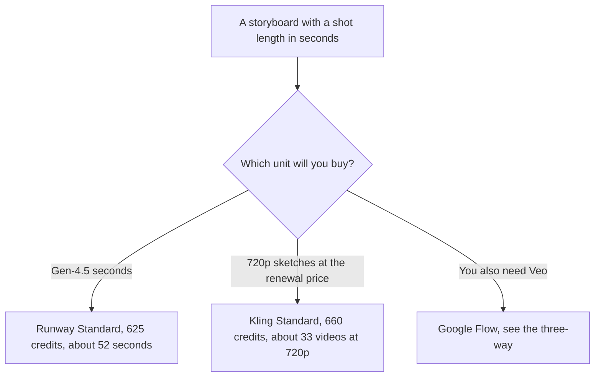

**Use Runway when the ad is priced in Gen-4.5 seconds and you want the Standard plan's 625 credits, about 52 seconds at that rate. Use Kling when the renewal price and a 720p sketch fit the volume you will actually render.** The three-way with Google's Veo path is [Runway vs Kling vs Veo](/blog/runway-vs-kling-vs-veo-2026/). This page is the two-studio choice for a paid social spot. We did not score motion or prompt adherence.

Prices are US list prices from directory pages checked October 16, 2026. Published October 24, 2026. The directory does not record a commercial-rights clause for either product. Check the terms you will sign before an ad goes live. We did not invent a license.

## The ad meter

| | [Runway](/tools/runway/) | [Kling AI](/tools/kling-ai/) |
|---|---|---|
| Free | 125 credits, once, and 5 GB storage | Basic, free, with no monthly credits |
| Entry paid | Standard $12 a month billed annually, or $15 monthly. 625 credits | Standard: $6.99 the first month, then $8.80. 660 credits. A $10 figure was also shown |
| What the vendor equates that to | About 52 seconds of Gen-4.5, or 104 seconds of Gen-4 Turbo | About 33 videos at 720p, on the guide recorded in the directory |
| The next tier | Pro $28 a month annually, or $35 monthly. 2,250 credits, about 187 seconds of Gen-4.5 | Pro: $25.99 the first month, then $32.56. 3,000 credits, about 150 videos at 720p. A $37 figure was also shown |
| Above that | Max $76 annually, or $95 monthly, 9,500 credits | Premier 8,000 credits ($64.99 then $80.96). Ultra 26,000 ($127.99 then $159.99) |
| A rate that changes the budget | Yearly billing is described as two months free | Kling VIDEO 3.0 at 4K is about 30 credits a second, per Kling's guide |

Runway Standard on the annual card is 12 × $12 = $144 a year, against 12 × $15 = $180 month to month. Pro annual is 12 × $28 = $336. If you only need the 52 seconds of Gen-4.5 that Standard equates to 625 credits, Pro's extra seconds are inventory you may not ship. The explainer is [Runway pricing explained](/blog/runway-pricing-explained-2026/). The product page is [Runway review](/blog/runway-review-2026/). The directory lists agencies creating ads at scale as a use case. That is a use case, not a rights grant.

Kling's renewal price is the number to budget. Standard at $8.80 after the first month is 12 × $8.80 = $105.60 if every month renews at $8.80, and the first month was $6.99, so a first year at those stickers is $6.99 + (11 × $8.80) = $103.79. Pro's renewal at $32.56 is the tier the directory ties to about 150 videos at 720p. A 4K second at 30 credits is a different product from a 720p sketch. Ten seconds of 4K is about 300 credits, which is most of a Standard month. The product page is [Kling AI review](/blog/kling-ai-review-2026/).

## What an ad team should decide first

**Shot length.** Write the seconds on the storyboard before you pick a plan. Runway's own equivalence is the honest way to read 625 credits. Kling's 720p video count is the honest way to read 660 credits. Mixing "52 seconds" with "33 videos" in one spreadsheet without the labels will make the cheaper plan look universal.

**The other studios.** [Luma AI](/tools/luma-ai/) Plus is $30 a month for 10,000 credits. The full ladder is [Luma AI pricing explained](/blog/luma-ai-pricing-explained-2026/). [Google Flow](/tools/google-flow/) is the Veo path, with 50 credits a day on Free. The three-way covers it. [HeyGen](/tools/heygen/) is an avatar tool, Creator at $29 a month, and it is the wrong default for a generated b-roll spot. The avatar pair is [HeyGen vs Synthesia for sales](/blog/heygen-vs-synthesia-for-sales-2026/). The shelf is [best AI video generators](/blog/best-ai-video-generators-2026/).

**A person who can say the claim.** The model can draft a shot. It cannot invent a product result, a price, or a customer. The script is [how to create a demo script with AI](/blog/how-to-create-a-demo-script-with-ai-2026/) when the ad is a product demo, and the spoken claim still needs a source. The check is [how to fact-check AI writing](/blog/how-to-fact-check-ai-writing-2026/).

**Rights.** We did not record a license paragraph for Runway or Kling on October 16, 2026. Before you publish an ad, read the plan's current terms for commercial use, training, and whether outputs are private. Do not treat this article as that reading.

## FAQ

### Is Kling Standard enough for a month of ads?

It is 660 credits and, on the recorded guide, about 33 videos at 720p. If your storyboard is ten finished spots with several takes, you will revise upward. 4K at about 30 credits a second will empty Standard on a single short spot. Price the resolution you will deliver.

### Is Runway Pro the agency plan?

Pro is 2,250 credits, about 187 seconds of Gen-4.5, plus a custom voice clone and Runway MCP, on the card. Team and Enterprise exist and this page does not quote a custom dollar. Buy Pro when Standard's 52 seconds of Gen-4.5 is the constraint you hit, not because the word agency appeared in a use-case list.

### Which looks more like a real commercial?

We did not run that test. Render the same storyboard on the free or entry credit grant and keep the take you can explain. A taste ranking from a demo reel is not a plan.

### Can I mix them?

Yes. Kling for the volume of 720p explorations, Runway for the seconds you will finish, if both terms allow the ad. Two subscriptions are only cheaper than one when each one is doing the job its meter measures.

## Last verified

October 16, 2026 for Runway, Kling, Luma, Google Flow, and HeyGen prices named above. No commercial-license clause was recorded for Runway or Kling. Published October 24, 2026.

**Sources:** [Runway](https://runway.com), [Kling AI](https://kling.ai), [Luma AI](https://lumalabs.ai).

*Published by Andrew for [AI Tools Optimizer](https://aitoolsoptimizer.com).*

[Runway](/tools/runway/) is in the [video directory](/tools/category/video/). Directory pages may use affiliate links. A purchase through them may earn us a commission at no extra cost to you.
