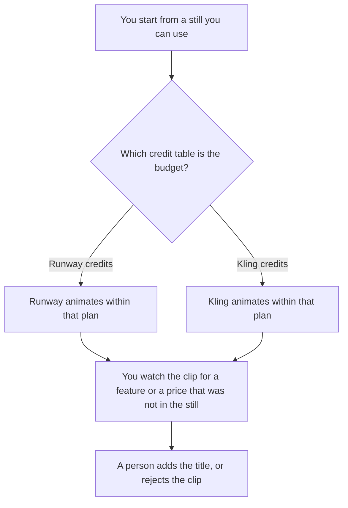

**Use Runway when the teaser is one clip on a credit plan you can put on a monthly budget. Use Kling when you are animating a product still and the membership's credit table is the bill you already checked.** The model may move the picture you supplied. It may not invent a feature, a price on screen, or a customer using the product. We did not score motion.

The still, if the words have to be readable, is [Midjourney vs Ideogram for thumbnails](/blog/midjourney-vs-ideogram-for-thumbnails-2026/). A policy video with a person on camera is a different job. This page is a short product teaser from a still you can defend.

Prices are US list prices from directory pages checked October 16, 2026. Kling's first-month figures on that card are introductory discounts, not the renewal price. Published October 24, 2026. We did not render a scored reel.

## Which plan matches the teaser

| The clip in front of you | Start here | First paid step | The limit |
|---|---|---|---|
| A budgeted monthly credit pool | [Runway](/tools/runway/) | Standard is $12 a month billed annually, or $15 monthly, with 625 credits | Free is 125 one-time credits, not a monthly refill |
| A short clip from a still, on Kling's table | [Kling AI](/tools/kling-ai/) | Standard is $6.99 the first month, then $8.80, with 660 credits | Basic is free and includes no monthly credits, on that card |
| A title card after the render | [Canva](/tools/canva/) | Quote the card on the day you buy | The render is an input. The claim on the title is yours |
| The still, if you generate it | [Midjourney](/tools/midjourney/) | Basic is $10 a month, or $96 a year | You still need rights to any product photo you did not make |

Runway Pro is $28 a month billed annually or $35 monthly, with 2,250 credits, on the October 16 card. Max is $76 or $95, with 9,500 credits. The card said yearly billing was presented as two months free, and that a limited-time Max inclusion was on the page that day. Confirm the credit table before you promise a length. The invoice is [Runway pricing explained](/blog/runway-pricing-explained-2026/).

Kling Pro renews at $32.56 with 3,000 credits, Premier at $80.96 with 8,000, and Ultra at $159.99 with 26,000, on that card. The first-month prices are lower. The card's approximate output for Standard is 660 images or 33 videos at 720p. Treat that as the card's approximation, and read the cost on the run before you render. The invoice is [Kling AI pricing explained](/blog/kling-ai-pricing-explained-2026/).

## What the teaser is allowed to show

The product you photographed or rendered, the motion you described, and the title a person added from approved copy. A clip that grows a button the product does not have is a false demo. A price that appears because the prompt said "premium" is a false offer. Cut it.

**Runway Standard** is the budgeted path for a short teaser. Draft on a cheaper generation if the product lets you, then spend credits on the cut you will publish. The October 16 card's workflow notes are not a promise that every model is on every tier. Read the plan.

**Kling Standard** is the still-to-clip path when 660 credits covers the tests you will actually run. Basic will not, on that card, because it includes no monthly credits. Quote the renewal price in the budget, not only the first month.

**Canva** is the title pass if the words should not be generated inside the video. **Midjourney Basic** is only the still, and only if you are allowed to generate that product image.

A prompt that holds the line:

"Animate this still with the camera move I described. Do not add text, a price, a logo, or a feature that is not in the still."

## What not to delegate

Do not ask which teaser will convert. Do not upload a customer's photo. Do not publish a clip you have not watched at full size. The watermark question, if the tool embeds one, stays on the watermark page. This article does not claim either product's watermark behavior.

## FAQ

### Which one makes a better teaser?

We did not measure that. Runway fits a monthly credit budget with a published Standard seat. Kling fits a short clip when you have checked the renewal price and the credit cost of the render. The teaser is ready when it shows only what the still and the approved title show.

### Do I need both?

No. Pick the credit table you will track. Two renders of the same still are how a feature appears in one cut and not the other. Ship one.

### How long should the teaser be?

As long as the surface requires, inside the credits you have. This page does not recommend a duration. A longer render that you cannot afford to redo is a bad test. Render a short draft first.

### Who may publish it?

The person who owns the product claim. A finished-looking clip is a draft until they have watched it and confirmed the title.

## Last verified

October 16, 2026 for Runway, Kling, and Midjourney directory cards. Published October 24, 2026.

**Sources:** [Runway pricing](https://runway.com), [Kling AI](https://kling.ai), [Midjourney](https://www.midjourney.com), [Canva](https://www.canva.com).

*Published by Andrew for [AI Tools Optimizer](https://aitoolsoptimizer.com).*

[Runway](/tools/runway/) is in the [video directory](/tools/category/video/). Directory pages may use affiliate links. A purchase through them may earn us a commission at no extra cost to you.
