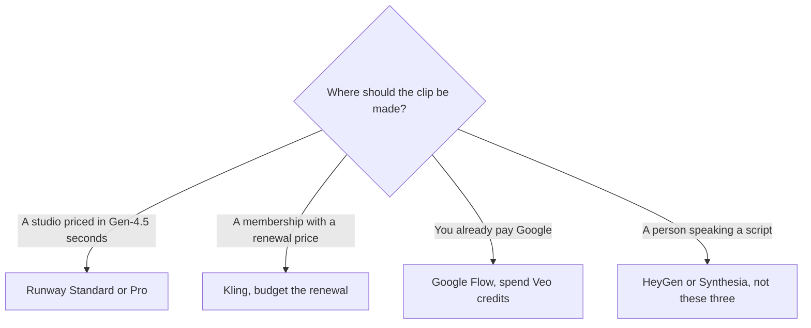

**Pay for Runway when you want a studio priced in Gen-4.5 seconds. Pay for Kling when the renewal price and the 720p sketch fit the volume. Pay for Google Flow when you want Veo 3.1 and you already live in a Google AI plan.** The three meters are not the same unit. A "cheaper" plan can buy fewer finished seconds after you convert with each vendor's own rate.

Veo in this directory is [Google Flow](/tools/google-flow/), which generates with Veo 3.1, Gemini Omni Flash, and other Google models. There is no separate Veo 3 subscription in our tool list. The chat product beside Flow is [Google Gemini](/tools/gemini/), not a fourth video meter. Prices below are US list prices checked October 16, 2026. We did not score motion or prompt adherence. Fit labels describe the published meter.

Individual plan notes are the [Runway review](/blog/runway-review-2026/) and the [Kling review](/blog/kling-ai-review-2026/). The wider shelf, including avatars, is [best AI video generators](/blog/best-ai-video-generators-2026/).

## The meters, side by side

| | Runway | Kling AI | Google Flow (Veo 3.1) |
|---|---|---|---|
| Free | 125 credits, once | Basic, no monthly credits | 50 credits every day |
| Entry paid | Standard $12/month annual, or $15 monthly. 625 credits | Standard $6.99 first month, then $8.80. 660 credits | Google AI Plus $4.99/month adds 200 credits on top of the daily 50 |
| What the vendor equates that to | About 52 seconds of Gen-4.5, or 104 seconds of Gen-4 Turbo | About 33 videos at 720p, or 22 seconds of 4K at the guide's 30 credits/second | Veo 3.1 Lite is 10 credits a clip, Fast is 20, Quality is 100 |
| Next tier | Pro $28/month annual, 2,250 credits, about 187 seconds of Gen-4.5 | Pro renews at $32.56, 3,000 credits | Google AI Pro $19.99/month, 1,000 monthly credits |
| Commercial posture | Read the plan you buy. We are not restating a license we did not quote | Same | Same, plus SynthID on Veo outputs |
| Watermark we can cite | Not stated on the pricing facts we stored | Not stated | Invisible SynthID on Veo. Visible watermark control is a Pro and Ultra feature, with country exceptions |

## One storyboard, three bills

Use a concrete slate: eight 5-second shots, which is 40 seconds, plus two retakes. That is 60 seconds of generation if every retake is a full regenerate. Your real retake rate will differ. The point is to convert with published rates, then throw the comparison away if your export settings do not match the rate.

**Runway.** Standard's 625 credits are about 52 seconds of Gen-4.5, so 60 seconds does not fit in Standard. Pro's 2,250 credits are about 187 seconds of Gen-4.5, which covers this slate with room. Pro is $28/month billed annually or $35 month to month. Gen-4 Turbo is cheaper on Runway's own card (104 seconds inside Standard's 625 credits). If Turbo is acceptable, Standard may cover 60 seconds and Pro is unnecessary. Third-party models inside Runway, including Kling models Runway has listed, spend credits at their own rates. The Gen-4.5 line is only for Gen-4.5.

**Kling.** The 4K reference on Kling's VIDEO 3.0 guide is about 30 credits per second. Sixty seconds at that rate is 1,800 credits. Standard's 660 credits are not enough. Pro's 3,000 credits are enough, and Pro renews at $32.56 after a $25.99 first month. The list price shown is $37. A year of renewals is $32.56 × 12 = $390.72, plus a cheaper first month if the intro still applies. Kling's other sketch, about 150 videos at 720p on Pro, is a different export. If you actually deliver 720p social clips, Pro's "150 videos" line is the one to test, and Standard's "33 videos" might be the whole month. Do not mix the 4K seconds with the 720p video count in one budget.

**Google Flow.** A Veo 3.1 Quality clip is 100 credits. Eight clips are 800 credits, before retakes. Two extra Quality generations add 200, for 1,000 credits. That is exactly Google AI Pro's monthly bonus, with nothing left, and it ignores the 50 credits you also get each day. Daily credits do not roll over, and neither do the monthly ones. If you generate on the days you work, the daily 50 can absorb a retake. If you render the whole slate in one afternoon, Pro's 1,000 is the number that matters.

Veo 3.1 Lite is 10 credits and Fast is 20, for non-Ultra subscribers. Eight Lite clips are 80 credits, which fits inside a few days of the free 50, or inside Plus's 200 monthly credits plus the daily grant. Lite is not Quality. Price the tier you will actually download.

Google AI Plus is $4.99/month for 200 monthly Flow credits. Ultra is $99.99 or $199.99/month, with 10,000 or 25,000 monthly credits, and Ultra subscribers get Veo 3.1 Lite clips at 0 credits on the rate card we stored. Non-subscribers may be unable to generate video during peak hours, about 2 to 5 PM UTC. Free is a real daily test. It is a poor way to deliver a Friday deadline in that window.

## Which bill is smaller depends on the export

| Your export | Likely smaller published entry | Why |
|---|---|---|
| About a minute of Gen-4.5 | Runway Pro at $28/month annual | Standard's 52-second equivalence does not cover it |
| A handful of 720p Kling clips | Kling Standard at $8.80 renewal | The 33-video sketch is the vendor's own 720p line for 660 credits |
| A minute of 4K Kling VIDEO 3.0 | Kling Pro at $32.56 renewal | 30 credits/second times 60 seconds is 1,800 credits |
| A few Veo tests | Flow free, 50 credits/day | Lite clips are 10 credits. Quality clips are 100 and will not fit a single day |
| Veo Quality on a slate | Google AI Pro at $19.99 | 1,000 monthly credits is ten Quality clips, plus the daily 50 |
| You already pay for Google AI Pro | Flow, not a second subscription | The credits are a feature of the plan you have. See [which subscription is worth paying for](/blog/which-ai-subscription-is-worth-paying-for/) |

A presenter who speaks a script is not in this table. That is [HeyGen](/tools/heygen/), compared in [HeyGen vs Synthesia](/blog/heygen-vs-synthesia-2026/). [Pika](/tools/pika/) Starter is $10/month and is the free-account tool that states it has no watermark, with no commercial license on Free. [Luma](/tools/luma-ai/) Plus is $30/month. Both are alternatives when none of the three meters fit, not tie-breakers inside this comparison.

## What else you are buying

Runway Pro adds a custom voice clone, MCP, unlimited 4K upscaling, and 100 GB. Max at $76/month annual adds one month of credit rollover. Standard does not roll credits over in the table we used.

Kling's intro price is the trap. The first month is cheaper than the renewal. A yearly budget that uses $6.99 or $25.99 will be wrong in month two. Image generation spends the same Kling credit balance.

Flow's daily credits reset. A missed day is wasted. Family sharing of credits is documented for Google One family groups. Subscribers in supported regions can buy more AI credits. Google AI Plus is listed in a large set of countries, and some features are limited by country. If Flow is missing in your account, the $4.99 plan does not fix a region lock.

Invisible SynthID on Veo outputs is documented by Google. Eligible Pro and Ultra users can turn off a visible watermark, except in India, South Korea, and Vietnam, where Google applies a visible watermark automatically. Details and the free-export picture are in [free AI video generators with no watermark](/blog/best-free-ai-video-generators-no-watermark-2026/).

## How to choose with one prompt

1. Write one prompt and one duration you will actually post.
2. Generate it once in Flow on the free daily credits, if video generation is available in your region that hour.
3. If you need a second studio, use the smallest Kling or Runway plan that covers the measured length on that vendor's rate, using the renewal price.
4. Keep the studio whose retake still fits the monthly pool. Cancel the other before the renewal.

## FAQ

### Is Veo 3 the same as Google Flow?

In this directory, Veo is available through Google Flow, and the current model named on Flow's help material we checked is Veo 3.1, in Lite, Fast, and Quality. You do not buy a separate Veo 3 app. You spend Flow credits, including 50 free credits a day.

### Is Kling cheaper than Runway?

At the entry renewal, Kling Standard is $8.80/month and Runway Standard is $12/month on annual billing. The allowances are not the same unit. Kling's 660 credits and Runway's 625 credits buy different amounts of different models. Convert your own duration before you call one cheaper.

### Can I use Kling inside Runway?

Runway has listed Kling among models that spend Runway credits at their own rates. A Kling membership is a separate meter. Price the storyboard in one place, not in both, unless you already know which shots need which model.

## Last verified

October 16, 2026 for Runway, Kling, and Google AI plan prices, and for Flow's credit rates. Recheck [Runway pricing](https://runway.com/pricing), [Kling pricing](https://kling.ai/pricing), [Flow credits](https://support.google.com/flow/answer/16526234), and [Google AI subscriptions](https://gemini.google/subscriptions/) before you buy a year.

Directory pages for [Runway](/tools/runway/), [Kling](/tools/kling-ai/), and [Google Flow](/tools/google-flow/) may include affiliate links. A purchase through them may earn us a commission at no extra cost to you.
