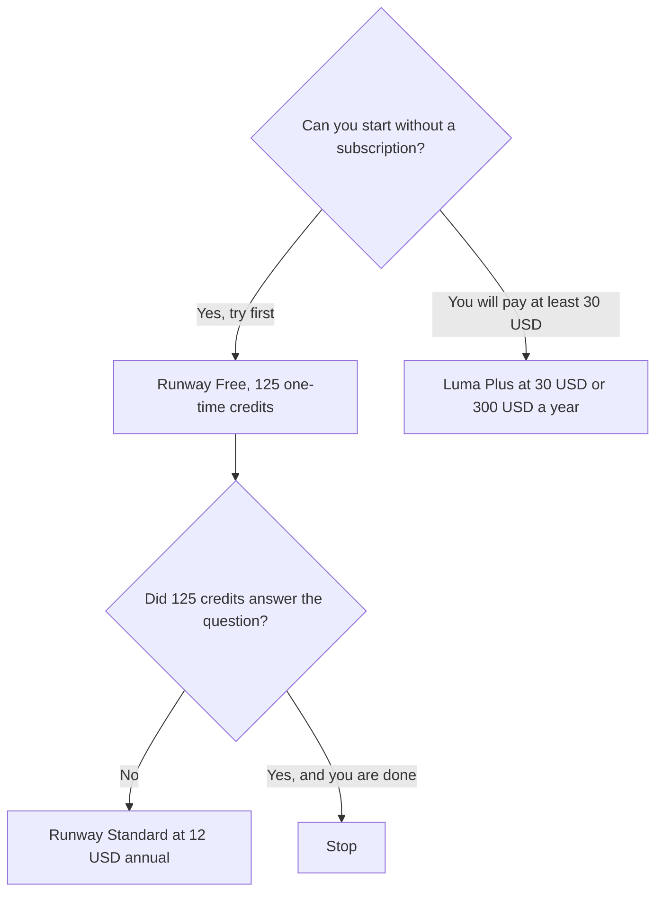

**Choose Runway when you want a free credit taste and a video plan that starts at $12 a month on annual billing. Choose Luma when you will start at $30, you want the credit pool on Plus, and a free plan is not on your checklist.** Their credits are not the same unit. Do not divide one price by the other and call it a winner.

The invoices are [Runway pricing explained](/blog/runway-pricing-explained-2026/) and [Luma AI pricing explained](/blog/luma-ai-pricing-explained-2026/). The product pages are [Runway review](/blog/runway-review-2026/) and [Luma AI review](/blog/luma-ai-review-2026/). The wider shelf is [best AI video generators](/blog/best-ai-video-generators-2026/).

Prices are US list prices excluding tax from directory pages checked October 16, 2026. Published October 24, 2026. We did not score clips.

## Where the clip should start

| Your week | Start here | First paid step | Do not assume |
|---|---|---|---|
| You want to try a video model before a subscription | [Runway](/tools/runway/) Free | 125 one-time credits, then Standard at $12 a month billed annually ($15 monthly) for 625 credits | That the free credits refresh |
| You will pay, and you want Luma's pool | [Luma AI](/tools/luma-ai/) Plus | $30 a month or $300 a year for 10,000 credits | A free plan. The directory does not list one |
| You need a larger Runway pool, voice clone, and 4K upscale | Runway Pro | $28 a month annually, or $35 monthly, for 2,250 credits | That Luma credits map to these credits |
| You are generating a lot and can show the burn | Runway Max, or Luma Pro | Runway Max is $76 annually or $95 monthly for 9,500 credits. Luma Pro is $90 or $900 a year for 40,000 credits | That the bigger sticker is the better clip |
| You want a cheap experiment on another meter | [Kling AI](/tools/kling-ai/) or [Google Flow](/tools/google-flow/) | Kling Standard is $6.99 the first month, then $8.80. Flow Free is 50 credits a day | That this page compared their quality |

## What the cards actually say

**Runway.** Free is 125 credits once, with model selection and 5 GB. Standard is $12 a month billed annually or $15 month to month, with 625 credits. The directory says yearly billing gives two months free, and Standard saves $36 a year against paying $15 each month. Pro is $28 or $35, with 2,250 credits, voice clone, MCP, and 4K upscaling. Max is $76 or $95, with 9,500 credits, one month of rollover, and higher parallelism. Team and Enterprise are sales conversations. During the October 16 check, Max also included unlimited Wan 3.0 in Tool Mode for a limited time. Do not budget a limited-time unlimited as the renewal.

**Luma.** Plus is $30 a month or $300 a year, with 10,000 credits and commercial use. Pro is $90 or $900 a year, with 40,000 credits and 4 times Luma Agents usage. Ultra is $300 or $3,000 a year, with 150,000 credits. Team and Enterprise are contact-sales, and Team is where the directory puts shared usage analytics and SSO. There is no free row on the pricing table we recorded. A guest collaborator is not a free generation plan.

A third video tool with its own credits is [Pika](/tools/pika/), from $10 a month for 900 credits on Starter. The Kling and Veo framing of Runway is [Runway vs Kling vs Veo](/blog/runway-vs-kling-vs-veo-2026/). Google Flow's daily free credits are a different door if the clip only needs a test.

## How to choose

Spend Runway's 125 credits on the exact shot you need: the length, the motion, the product. If you never get a usable frame, do not buy Standard to "unlock quality" you have not seen. If the frame is right and the credits are gone, Standard at $12 annual is the smallest subscription on this page.

Open Luma Plus when Runway's credit size is the problem you can name, or when you already know you want that product's workflow. $300 a year is $30 × 10, which matches the annual card. Runway Standard annual is $12 × 12 = $144 if you take the directory's "per month, billed annually" the way it is printed, and the card also says yearly billing gives two months free. Use the checkout total. Do not treat 10,000 Luma credits as "more than 625 Runway credits" in a spreadsheet. The units are not comparable. Generate one shot in each paid plan you are willing to try, and keep the tool whose failures you can see.

Image-first work is a different category. [Midjourney vs Leonardo](/blog/midjourney-vs-leonardo-2026/) is the still-image decision.

## FAQ

### Is Luma more expensive than Runway?

Plus at $30 is more than Standard at $12 on the monthly-equivalent stickers, and Luma has no free plan on the card. A heavy Runway Max month at $95 can cost more than Luma Plus. Compare the plan you will actually be on after the first month, not the logo.

### Do unused credits roll over?

Runway Max lists one month of rollover. The directory does not say Standard or Luma Plus roll over. Assume they do not until the checkout or the help center says they do.

### Which one is better for ads?

This page did not measure that. An ad also needs a usage right you can explain to a client. Read commercial-use terms on the plan you buy. Luma Plus lists commercial use. Confirm Runway's terms on the plan you select. This page is not a license opinion.

### Can a team share one login?

Do not. Luma Team is the shared line, and it is a sales conversation on the card. Runway Team is the same shape. A shared password loses the audit trail and usually breaks the terms.

## Last verified

October 16, 2026 for Runway, Luma, Kling, Pika, and Google Flow prices named above. Published October 24, 2026.

**Sources:** [Runway pricing](https://runway.com), [Luma pricing](https://lumalabs.ai/pricing), [Kling](https://kling.ai).

*Published by Andrew for [AI Tools Optimizer](https://aitoolsoptimizer.com).*

[Runway](/tools/runway/) is in the [video directory](/tools/category/video/). Directory pages may use affiliate links. A purchase through them may earn us a commission at no extra cost to you.
