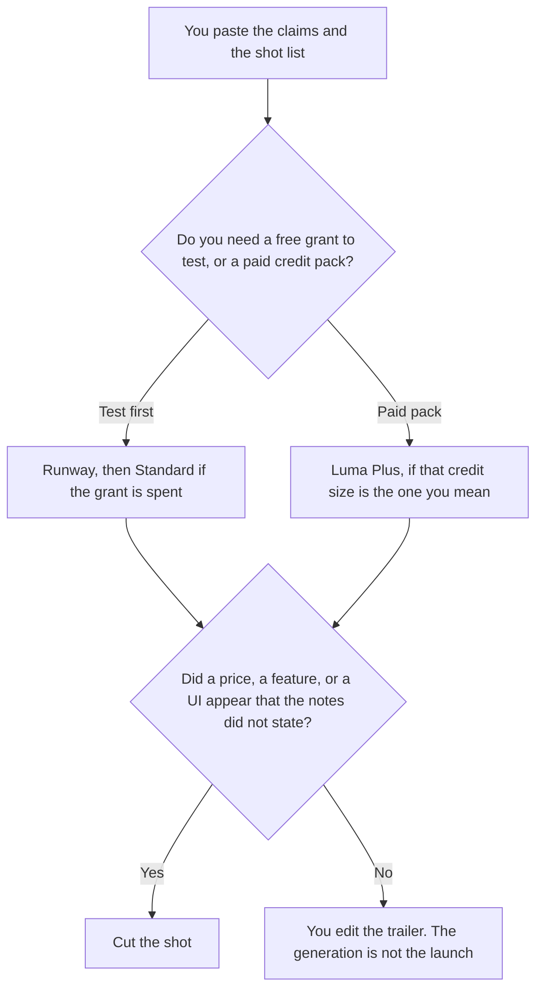

**Use Runway when you want to start a launch trailer from a small credit grant and a lower first paid seat. Use Luma when you are buying a larger credit pack on a plan the October 16 card does not offer for free.** A trailer is a short film you still edit. A model may generate a shot you described. It may not invent a product claim, a price, or a UI that your launch notes did not include. A shorter teaser against a different tool is [Runway vs Kling for product teasers](/blog/runway-vs-kling-for-product-teasers-2026/).

Runway and Luma prices are from directory pages checked October 16, 2026. Claude's prices are from claude.com/pricing on October 24, 2026. Notion's price is from the October 16 card. Published October 24, 2026. We did not score video. We did not time a render.

## Which trailer seat matches the job

| What you need | Start here | First paid step | The limit |
|---|---|---|---|
| A first test with a one-time grant | [Runway](/tools/runway/) | Standard is $12 a month billed annually, or $15 monthly | Free is 125 credits, once, on the October 16 card |
| A paid pack and no free tier on the card | [Luma AI](/tools/luma-ai/) | Plus is $30 a month, or $300 a year, with 10,000 credits | The card lists no free plan |
| The shot list and the claims | [Claude](/tools/claude/) | Pro is $17 a month billed annually, or $20 monthly | No claim that was not in the notes |
| The page that records the approved shots | [Notion AI](/tools/notion-ai/) | Business is $20 a seat a month | The page is not the film |

Credit systems are not the same unit. Runway's October 16 card gives Standard 625 credits a month. Luma's Plus card gives 10,000 credits. Do not divide those numbers into each other and call the result a better deal. A shot you cannot describe is not cheaper on either plan. Team and Enterprise prices on both cards are "contact," so this article does not invent them.

## What each seat keeps

**Runway Free** is 125 one-time credits and 5 GB, on the October 16 card. Standard is the first paid step: $12 a month billed annually, or $15 monthly, with 625 credits, and the card says yearly billing is two months free on that example. Pro is $28 a month billed annually, or $35 monthly, with 2,250 credits. The invoice is [Runway pricing explained](/blog/runway-pricing-explained-2026/).

**Luma Plus** is $30 a month or $300 a year, with 10,000 credits, commercial use, and guest collaborators, on the October 16 card. Pro is $90 a month or $900 a year, with 40,000 credits. Ultra is $300 a month or $3,000 a year. The card says the yearly figures save up to 20 percent in the tips, and the Plus yearly price is the $300 line. There is no free plan listed. The invoice is [Luma AI pricing explained](/blog/luma-ai-pricing-explained-2026/).

**Claude Pro** holds the shot list: what the product does, what the trailer must not say, and the order of shots. The review is [Claude review](/blog/claude-review-2026/).

**Notion Business** stores the approved claims the trailer is allowed to show. If a shot needs a sentence that is not on that page, the shot waits. The invoice is [Notion AI pricing explained](/blog/notion-ai-pricing-explained-2026/).

A prompt that holds the line:

"Generate only the shot I described. Use the product claims I pasted. If a claim is missing, do not imply it with on-screen text. Do not add a price."

## What not to delegate

Do not let a model write the launch headline because the clip needed words. Do not upload an unreleased UI into a plan whose license you have not read. Do not call a stitched preview the trailer the company will post. A person edits, and a person approves.

## FAQ

### Which one makes a better trailer?

We did not measure that. Runway is the seat with a free grant and a $12 first paid step on the October 16 card. Luma Plus is the $30 or $300-a-year pack, and that card does not list a free plan. The trailer is usable when every claim matches the notes.

### Are the credits comparable?

Treat them as different units. Quote the plan's own credit number next to its dollar price. A larger credit integer is not a discount until the vendor tells you what a shot costs on that plan, and these cards do not give one shared rate.

### What if I only need a teaser?

A teaser is the shorter piece on the Kling comparison linked above. A launch trailer is the film you are willing to put under the product name. The same claim rule applies to both. The runtime does not relax it.

### Who may publish the file?

The launch owner. A finished render is not a publish. The page that says which claims were approved is the source, and it lives with the people who own the launch.

## Last verified

October 16, 2026 for Runway, Luma, and Notion. October 24, 2026 for Claude. Published October 24, 2026.

**Sources:** [Runway](https://runway.com), [Luma pricing](https://lumalabs.ai/pricing), [Claude pricing](https://claude.com/pricing), [Notion pricing](https://www.notion.com/pricing).

*Published by Andrew for [AI Tools Optimizer](https://aitoolsoptimizer.com).*

[Runway](/tools/runway/) is in the [video directory](/tools/category/video/). Directory pages may use affiliate links. A purchase through them may earn us a commission at no extra cost to you.
