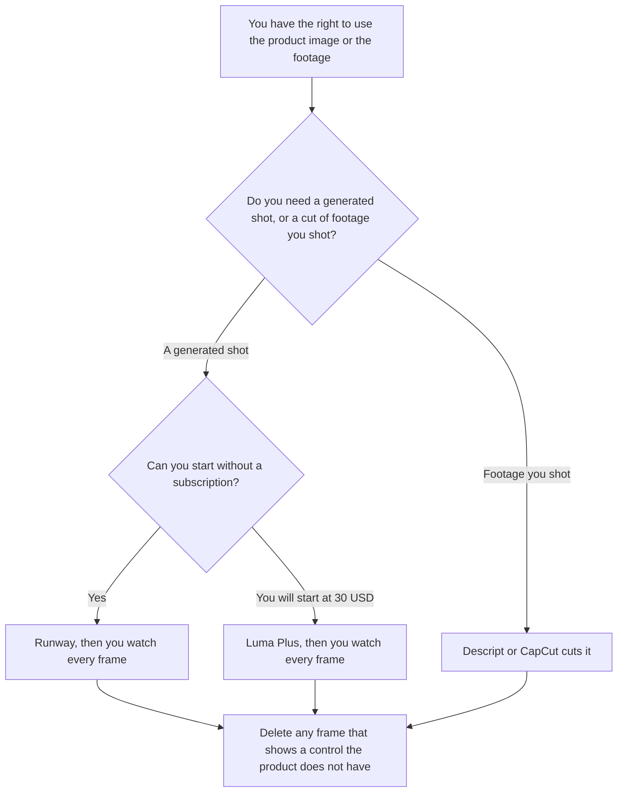

**Use Runway when the demo can start from 125 one-time credits and a plan at $12 a month on annual billing. Use Luma when you will start at $30, you want Plus's 10,000 credits, and a free plan is not on your checklist.** A product demo here is a short sequence you can narrate: the product, the step, the result. It is not a looping ad, and it is not a score of which clip looks more real.

The general pair is [Runway vs Luma](/blog/runway-vs-luma-2026/). A looping clip from a product photo is [Runway vs Luma for product loops](/blog/runway-vs-luma-for-product-loops-2026/). The invoices are [Runway pricing explained](/blog/runway-pricing-explained-2026/) and [Luma AI pricing explained](/blog/luma-ai-pricing-explained-2026/).

Prices below are US list prices excluding tax. Runway and Luma plan prices were on their pricing pages on October 24, 2026, and they match the directory cards checked October 16, 2026. Published October 24, 2026. We did not score demos. Their credits are different units.

## Which pool matches the demo

| The demo you actually have | Start here | First paid step | Do not assume |
|---|---|---|---|
| You want to try a shot before a subscription | [Runway](/tools/runway/) Free | 125 one-time credits, then Standard at $12 a month billed annually, or $15 monthly, for 625 credits | That the free credits refresh |
| You will pay Luma's entry pool | [Luma AI](/tools/luma-ai/) Plus | $30 a month or $300 a year for 10,000 credits, commercial use included | A free plan. The October 24 page did not list one |
| The demo is several Runway shots plus retakes | Runway Pro | $28 a month annually, or $35 monthly, for 2,250 credits | That Luma credits equal these credits |
| You are generating a lot of Luma shots | Luma Pro | $90 a month or $900 a year for 40,000 credits | That Ultra at $300 is required for one demo |
| You already have footage and only need a cut | [Descript](/tools/descript/) or [CapCut](/tools/capcut/) | Descript Hobbyist is $16 a person a month billed annually. CapCut Pro is $19.99 a month or $179.99 a year | That a generator is the editor |

Runway's October 24 page says Standard's 625 credits are about 52 seconds of Gen-4.5, about 104 seconds of Gen-4 Turbo, or about 78 Gen-4 images at 1080p. That is Runway's equivalence, not a Luma one. Luma's October 24 page prices Ray 3.2 text-to-video and image-to-video at 100 credits for 5 seconds at 720p, and 300 credits for 10 seconds at 720p. Plus includes 10,000 credits. A 10-second 720p shot is 300 of those credits before a retake. Do not divide 10,000 by 625 and call Luma cheaper.

## What the demo may show

The product you have the right to show, the step you can perform, and the result you have seen. A generated frame that invents a button, a price, or a customer logo comes out. If you cannot point at the real screen, the shot stays a storyboard.

**Runway Standard at $12** is the paid path when the free 125 credits were the experiment and the demo is short. The review is [Runway review](/blog/runway-review-2026/).

**Luma Plus at $30** is the paid path when commercial use and that credit pool are the reason, and you do not need a free taste. The review is [Luma AI review](/blog/luma-ai-review-2026/).

**Descript or CapCut** is the path when the demo is a recording of the real product. A generated clip is the wrong tool for a click you can film. The Descript invoice is [Descript pricing explained](/blog/descript-pricing-explained-2026/).

The wider shelf is [best AI video generators](/blog/best-ai-video-generators-2026/).

## What not to delegate

Do not generate a customer's face into the demo. Do not put a price on screen that the pricing page does not show today. Do not ship a frame you have not watched. The person who approves the demo still clicks the real product.

## FAQ

### How is a demo different from a product loop?

A loop is a short repeating clip, often for an ad. A demo has an order: what the product does, in steps a person could follow. The loop page is the other comparison. Use it when the deliverable is a loop. Use this page when someone will narrate the steps.

### Can I mix Runway and Luma in one demo?

You can, if you can stand two meters and you watch both. The credits do not transfer. A retake on the second tool is a new bill. Most demos should pick one generator and an editor.

### Does Luma Plus include commercial use?

The October 24 pricing page says commercial use is included on Plus. Runway's plan names are on its own page. Read the license for the plan you buy before a demo goes on a site you do not own.

### What if the product UI changes next week?

The demo is stale. Regenerate or recut from the current screen. A fingerprint of the file you published, if you keep one, tells you which export shipped. It does not update the pixels.

## Last verified

October 24, 2026 for Runway and Luma plan prices and the credit examples named above. October 16, 2026 for Descript Hobbyist and CapCut Pro, which match those vendors' pricing explainers. Published October 24, 2026.

**Sources:** [Runway pricing](https://runwayml.com/pricing), [Luma pricing](https://lumalabs.ai/pricing), [Descript pricing](https://www.descript.com/pricing), [CapCut pricing](https://www.capcut.com/pricing).

*Published by Andrew for [AI Tools Optimizer](https://aitoolsoptimizer.com).*

[Runway](/tools/runway/) is in the [video directory](/tools/category/video/). Directory pages may use affiliate links. A purchase through them may earn us a commission at no extra cost to you.
