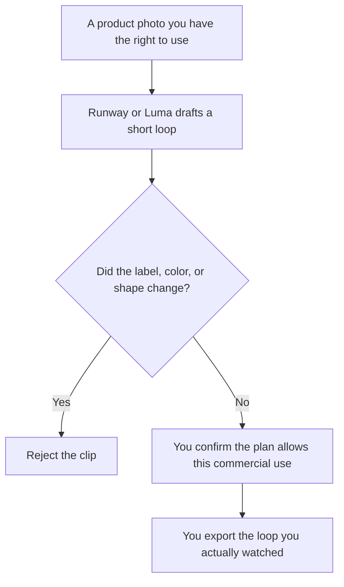

**Use Runway or Luma to draft a short looping clip from a product photo you have the right to use. Then you watch every frame before it runs as an ad.** Their credits are different units. A lower monthly price is not a cheaper second of video. We did not score which loop looks more like the product. The general pair is [Runway vs Luma](/blog/runway-vs-luma-2026/).

The invoices are [Runway pricing explained](/blog/runway-pricing-explained-2026/) and [Luma AI pricing explained](/blog/luma-ai-pricing-explained-2026/). The still before the motion is [how to generate product photos with AI](/blog/how-to-generate-product-photos-with-ai-2026/).

Prices are US list prices excluding tax from directory pages checked October 16, 2026. Published October 24, 2026. A clip that changes the product, the label, or the claim is a different product. You are responsible for what the ad shows.

## Which meter matches a loop

| The loop you need | Start here | First paid step | The limit |
|---|---|---|---|
| A test clip, and you have not paid anyone yet | [Runway](/tools/runway/) Free, 125 one-time credits | Standard is $12 a month billed annually, or $15 monthly, with 625 credits | Free credits do not refill, on the card |
| You will make loops often enough to want a pool | Runway Pro is $28 a month annually, or $35 monthly, with 2,250 credits | Top-ups exist on Pro. Read the rate before you click | 100 GB on that row |
| You accept no free plan and want Luma's Plus pool | [Luma](/tools/luma-ai/) Plus at $30 a month, or $300 a year, with 10,000 credits | There is no free plan on the directory card | Credits are Luma's unit, not Runway's |
| Heavier Luma use | Luma Pro is $90 a month, or $900 a year, with 40,000 credits | Ultra is $300 a month, or $3,000 a year | Team and Enterprise are contact-sales |
| The still and the end card live in a layout tool | [Canva](/tools/canva/) Pro at $18 a month, or $180 a year | Canva is the frame. It is not the reason to skip watching the clip | |

Runway Max is $76 a month annually, or $95 monthly, with 9,500 credits. A single product loop does not require Max. Luma's card lists commercial use on Plus. Read the current terms for the plan you buy. This page does not quote a license it has not printed.

## How to spend the first credits

**Runway** lets you spend 125 credits before a subscription. That is the right first loop if you are unsure the shot is worth a subscription. Standard at $12 annual is the first refill: 625 credits a month. The directory says all models and an agentic collaborator are on that row. It does not say those credits equal a specific number of seconds. Do not divide $12 by 625 and call it a price per loop. The review is [Runway review](/blog/runway-review-2026/).

**Luma** starts at Plus. $30 a month or $300 a year buys 10,000 credits and, on the card, commercial use and guest collaborators. Pro at $90 multiplies Luma Agents usage by four, on the card. If you only need one loop and you can live with Runway's free credits, pay Luma after you know you want that tool. The wider shelf is [best AI video generators](/blog/best-ai-video-generators-2026/).

**A cheaper video seat, if the loop is an ad and the budget is the point.** [Kling AI](/tools/kling-ai/) Standard is $6.99 the first month, then $8.80 a month, on the directory card. That comparison is [Runway vs Kling for ads](/blog/runway-vs-kling-for-ads-2026/). It is a third product. It does not make Runway credits and Luma credits comparable.

A prompt that holds the line:

"Animate this product photo as a three-second loop. Keep the label text, colors, and shape unchanged. No extra products. No people. No claims on screen. If you cannot keep the label, stop."

Then you watch it frame by frame. A melted logo is a failed clip. The storyboard habit before you generate motion is [how to storyboard with AI](/blog/how-to-storyboard-with-ai-2026/).

## What not to delegate

Do not upload a photo you do not have rights to. Do not accept a loop that invents a certification badge, a "before and after," or a result the product does not deliver. Do not buy Max or Ultra to fix a bad still. Fix the still. Motion makes a wrong label more expensive.

The person who approves the export is [what human-in-the-loop AI is](/blog/what-is-human-in-the-loop-ai-2026/).

## FAQ

### Which one makes a better product loop?

We did not score clips. Pick Runway if you want a free credit taste and a $12 annual entry. Pick Luma if you will start at $30 and the Plus pool is the product you want. Watch the label either way.

### Are the credits the same?

No. Runway's 625 and Luma's 10,000 are not a ratio you can shop. Each vendor meters its own generations. Compare the plan you can afford to the number of loops you will actually review.

### Is a free plan enough to ship an ad?

Runway's free credits are one-time. Enough to see a draft. A campaign that needs revisions belongs on a paid row, and on a plan whose commercial terms you have read. Luma's card does not list a free plan.

### What if the product has to show a screen recording instead?

Use the recording. A generated loop of a UI you did not capture will invent buttons. That is a different video, and it is the wrong tool for a changelog.

## Last verified

October 16, 2026 for Runway, Luma, Kling, and Canva. Published October 24, 2026.

**Sources:** [Runway pricing](https://runway.com/pricing), [Luma pricing](https://lumalabs.ai/pricing), [Canva pricing](https://www.canva.com/pricing/).

*Published by Andrew for [AI Tools Optimizer](https://aitoolsoptimizer.com).*

[Runway](/tools/runway/) is in the [video directory](/tools/category/video/). Directory pages may use affiliate links. A purchase through them may earn us a commission at no extra cost to you.
