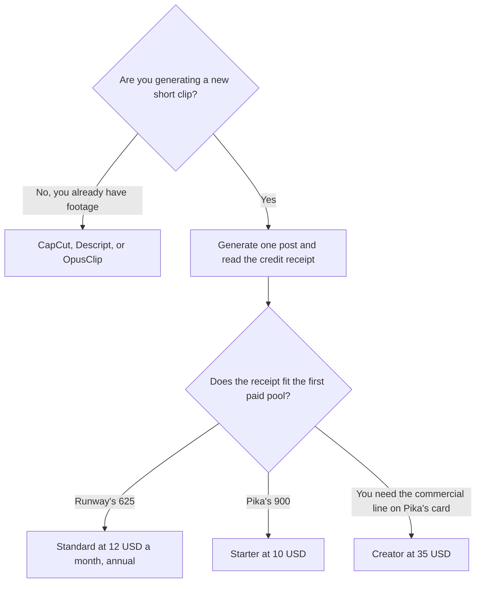

**Use Runway or Pika when you are generating a short social clip from a prompt or a still, then pick the one whose credit receipt fits the number of clips you will actually post.** Runway Standard is $12 a month billed annually ($15 monthly) with 625 credits. Pika Starter is $10 a month with 900 credits. Those stickers are close. The meter is not, and neither sticker is a promise about how a clip will look. Generate one real post, read the receipt, and only then annualize.

The general Runway invoice is [Runway pricing explained](/blog/runway-pricing-explained-2026/). The Pika invoice is [Pika pricing explained](/blog/pika-pricing-explained-2026/). A longer generated spot, against a different pair, is [Runway vs Kling for ads](/blog/runway-vs-kling-for-ads-2026/). Clipping a video you already shot is a different job.

Prices are US list prices excluding tax from directory pages checked October 16, 2026. Published October 24, 2026. We did not score clip quality. Pika's card showed lower discounted prices for Creator and Fancy at that check. Quote checkout.

## A social clip is a short generation

| | [Runway](/tools/runway/) | [Pika](/tools/pika/) |
|---|---|---|
| Try it | Free, 125 one-time credits, 5 GB | Free account. Credits come from packs. The card lists no watermark and all models |
| First paid step | Standard, $12 a month billed annually or $15 monthly, 625 credits, all models | Starter, $10 a month, 900 credits, 2 parallel videos |
| The step that names commercial use | Not a separate "commercial" line on the Standard row we used. Read the live terms | Creator, $35 a month, 3,150 credits, and the card lists a commercial license |
| A heavier month | Pro, $28 a month billed annually or $35 monthly, 2,250 credits, voice clone, 4K upscaling | Fancy, $95 a month, 8,550 credits, priority queue |
| Annual math | Yearly billing is recorded as 2 months free. Standard at $12 × 12 is the annual pace on the card | Yearly saves up to 20% on the card. Starter's $10 line is the monthly figure we recorded |
| A poor use | A 30-minute episode | A podcast edit |

Runway Standard at the annual rate is 12 × $12 = $144 a year if that is how the seat bills. The card also says yearly billing gives 2 months free, with Standard saving $36 a year against monthly. Use the live toggle. Pika Starter at $10 is $120 over twelve months if you stay monthly. Do not assume those months produce the same number of posts. One receipt decides that.

## When generation is the wrong invoice

**You are cutting a video you already have.** [CapCut](/tools/capcut/) Pro is $19.99 a month, or $179.99 a year. Templates and a timeline are the point. The review is [CapCut review](/blog/capcut-review-2026/).

**You are pulling shorts out of a long recording.** [OpusClip](/tools/opusclip/) Starter is $15 a month, monthly only, with 150 credits. Free is 60 credits, and those clips stop being exportable after 3 days. That is clipping, not generation. The invoice is [OpusClip pricing explained](/blog/opusclip-pricing-explained-2026/).

**You are editing by the transcript.** [Descript](/tools/descript/) Hobbyist is $16 a person a month billed annually. The invoice is [Descript pricing explained](/blog/descript-pricing-explained-2026/).

**You are posting words, not pictures.** A caption workflow is [how to create social posts from a blog with AI](/blog/how-to-create-social-posts-from-a-blog-with-ai-2026/). The creator shelf is [best AI tools for YouTubers](/blog/best-ai-tools-for-youtubers-2026/).

Run one clip that matches the post you will publish: the same length, the same aspect ratio, the same still or prompt. If that clip spends a large share of the monthly pool, the first paid tier is a test, not a plan. Move up only after the second week of receipts. Pika's commercial-license line is on Creator, not on the $10 Starter row we recorded. If a brand will publish the clip, read that line before you stay on Starter.

A prompt that holds the line, for the shot list only:

"Give me a 6-second social shot list for this product sentence. One action per shot. No on-screen claims about price, awards, or results. I will generate the frames myself and reject anything that adds a logo I did not provide."

The person who posts is [what human-in-the-loop AI is](/blog/what-is-human-in-the-loop-ai-2026/).

## FAQ

### Which one looks better on TikTok or Reels?

We did not score that. Aspect ratio and the first frame matter more than the logo on the invoice. Generate the same prompt in the free or trial path once, if your account still has credits, and keep the tool whose clip you would post.

### Do credits mean minutes?

The directory does not print a minutes-per-credit rate for either tool on the summaries we used. This page does not invent one. Read the receipt on a real clip.

### Is the free plan enough to post?

Runway's free credits are one-time, 125. Pika's free account uses packs for credits. A free file can be a test. A posting calendar needs the pool you measured. Pika's card says the free account has no watermark. Confirm that on the export you will publish.

### Should I buy the annual plan on day one?

No. Annualize after the receipt fits for a month you would actually post. Runway's yearly toggle is the recorded discount. Pika's yearly line is "up to 20%," and the Creator and Fancy stickers were discounted at the October 16 check. Checkout beats this page.

## Last verified

October 16, 2026 for Runway, Pika, CapCut, OpusClip, and Descript. Pika Creator and Fancy showed discounts at that check. Published October 24, 2026.

**Sources:** [Runway pricing](https://runway.com/pricing), [Pika pricing](https://pika.art/pricing), [CapCut pricing](https://www.capcut.com/pricing).

*Published by Andrew for [AI Tools Optimizer](https://aitoolsoptimizer.com).*

[Runway](/tools/runway/) is in the [video directory](/tools/category/video/). Directory pages may use affiliate links. A purchase through them may earn us a commission at no extra cost to you.
