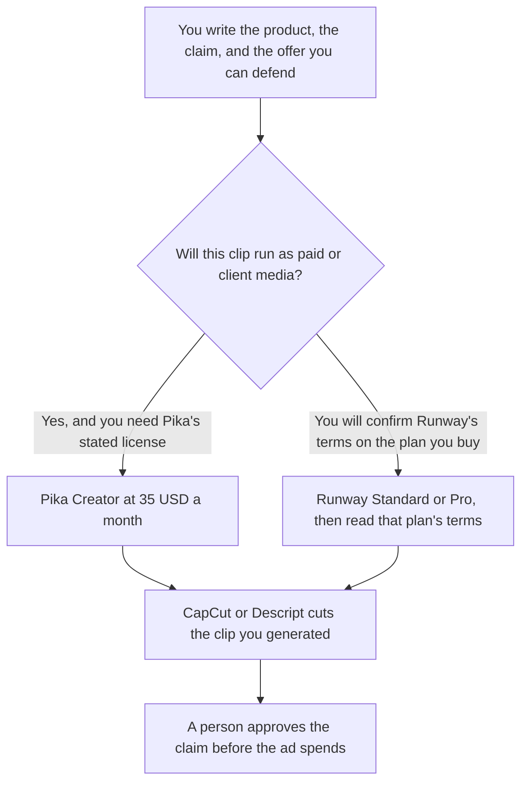

**Use Pika Creator when the ad will run as paid media and you need the commercial license the Pika card attaches to that plan. Use Runway when you are generating the clip and you have confirmed, on the plan you will buy, that the terms cover that media buy.** A UGC-style ad is a short generated clip meant to look like a person showing a product. It is not a social experiment you post on a free account. The license and the credit receipt come before the look.

A clip for an organic feed, where the license question is different, is [Runway vs Pika for social video](/blog/runway-vs-pika-for-social-2026/). A longer generated spot against another pair is [Runway vs Kling for ads](/blog/runway-vs-kling-for-ads-2026/). The invoices are [Runway pricing explained](/blog/runway-pricing-explained-2026/) and [Pika pricing explained](/blog/pika-pricing-explained-2026/).

Prices are US list prices excluding tax from directory pages checked October 16, 2026. Published October 24, 2026. We did not score how "real" a clip looks. We did not run an ad. Pika's card notes yearly billing can save up to 20%. It does not print the discounted Creator price in the table this article uses. Quote checkout.

## The ad is a generation plus a license

| | [Runway](/tools/runway/) | [Pika](/tools/pika/) |
|---|---|---|
| Entry paid plan | Standard is $12 a month billed annually, or $15 monthly, with 625 credits | Starter is $10 a month with 900 credits |
| The plan that states a commercial license | The October 16 card does not print a commercial-license row | Creator is $35 a month, 3,150 credits, and the card says the commercial license starts there |
| Free | 125 one-time credits | No monthly credits. Packs only. The card says Free has no commercial license |
| What you still edit | A timeline tool, if the cut is not the generation | The same. Generation is not the media buy |
| What this page will not claim | That Standard includes a license the card does not state | That Starter is enough for a client ad |

Runway Pro is $28 a month billed annually, or $35 monthly, with 2,250 credits. Pika Fancy is $95 a month with 8,550 credits and a priority queue. Those rows are volume. They are not a quality ranking. Generate one real ad, read the credit receipt, and only then annualize.

## What the clip is allowed to say

The product, the offer, and the claim come from the brief a person signed. The model may not invent a testimonial, a before-and-after, or a price. A UGC look does not make a fictional customer a real one. If the brand needs a face that is an avatar on a script, that is a different product: [HeyGen vs Synthesia for sales](/blog/heygen-vs-synthesia-for-sales-2026/) is the presenter path, and it is not this comparison.

**Pika Creator at $35** is the row this page can point to for a commercial license, because the directory card says so. Starter at $10 is the row for trying the tool. The card's wording is that the commercial license is not on Free. Do not put a client ad on Free or Starter and hope the license is implied. The review is [Pika review](/blog/pika-review-2026/).

**Runway Standard at $12 billed annually** is the entry paid row for credits and model access. Before a media buy, read the terms on that plan. This article will not fill in a license the October 16 card left off the table. The review is [Runway review](/blog/runway-review-2026/).

**The cut.** [CapCut](/tools/capcut/) Pro is $19.99 a month, or $179.99 a year, when you need to trim, caption, and resize a clip you already generated. [Descript](/tools/descript/) Hobbyist is $16 a person a month billed annually when the edit is text-based. Neither license replaces the generator's license. The short-form edit pair is [Descript vs CapCut for shorts](/blog/descript-vs-capcut-for-shorts-2026/).

A prompt that holds the line:

"Generate a 5-second product clip from the shot list I pasted. Do not add a person saying a quote I did not write. Do not show a price, a star rating, or a before-and-after. If the shot list is missing a frame, leave that frame out."

## What not to assume

Do not treat a watermark-free export as a commercial license. Pika's card says Free has no watermark and still says the commercial license starts at Creator. Do not compare a Runway credit to a Pika credit as if they buy the same second of video. Run one clip on each plan you might buy, and keep the receipt.

Higgsfield's directory card describes an Ads Studio and does not verify a dollar price. This page does not invent one. The plan types are [Higgsfield pricing explained](/blog/higgsfield-pricing-explained-2026/).

## FAQ

### Can we run UGC ads on Pika Starter?

The October 16 card puts the commercial license on Creator, at $35 a month, and says it is not included on Free. Starter is listed at $10 with 900 credits and is not the row that states the license. For a paid or client placement, start at Creator unless a current Pika page you open says otherwise.

### Does Runway Standard include commercial use?

The card we used does not say. Confirm it on the plan you will pay for before the ad spends. A missing row is not a yes.

### Which one looks more like real UGC?

We did not score that. Look is a test you run on your product, on the plan whose license covers the buy. A prettier clip you cannot license is not the cheaper ad.

### Should the generator also cut the ad?

Generate the shot. Cut it in the editor you already use. A generator that also invents the offer, the caption, and the audience is doing three jobs you did not approve.

## Last verified

October 16, 2026 for Runway, Pika, CapCut, and Descript. Published October 24, 2026.

**Sources:** [Runway pricing](https://runway.com/pricing), [Pika pricing](https://pika.art/pricing), [CapCut pricing](https://www.capcut.com/pricing), [Descript pricing](https://www.descript.com/pricing).

*Published by Andrew for [AI Tools Optimizer](https://aitoolsoptimizer.com).*

[Runway](/tools/runway/) is in the [video directory](/tools/category/video/). Directory pages may use affiliate links. A purchase through them may earn us a commission at no extra cost to you.
