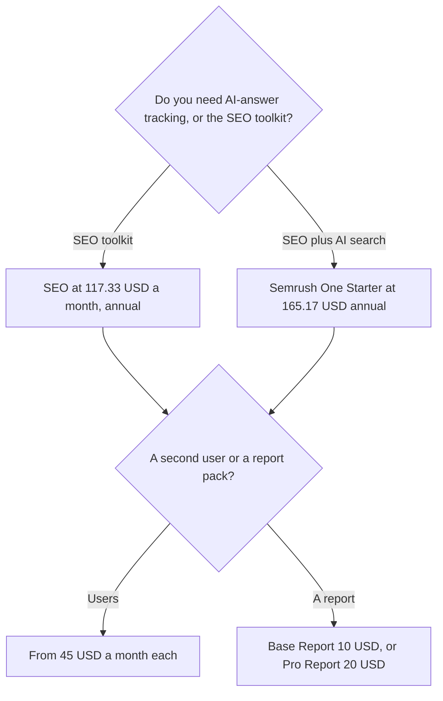

**Semrush's core SEO plan is $139 a month, or $117.33 a month billed annually.** That is the freelancer and small-business toolkit on the card. Semrush One, which adds AI search visibility, starts higher. Add-ons for users and reports sit on top. The free account is real and small: one demo project and 10 reports a day, with no card required.

The product page is [Semrush review](/blog/semrush-review-2026/). The on-page neighbor is [Surfer SEO pricing explained](/blog/surfer-seo-pricing-explained-2026/). The brief-and-publish neighbor is [Frase pricing explained](/blog/frase-pricing-explained-2026/).

Prices are US dollars before tax, from Semrush's pricing page as recorded in the directory on October 16, 2026. Published October 24, 2026. We did not score rankings.

## The plans on the card

| Plan | Monthly | Billed annually | What the card says it is for |
|---|---|---|---|
| Free | $0 | $0 | 1 demo project, 10 reports a day |
| SEO | $139 a month | $117.33 a month | Freelancers and small businesses |
| Semrush One Starter | $199 a month | $165.17 a month | SEO plus AI search, for small teams and agencies |
| Semrush One Pro+ | $299 a month | $248.17 a month | Growing teams. Unlimited daily prompt tracking |
| Enterprise | Custom | Custom | A sales conversation. No dollar on this card |

Annual billing saves up to 17% on the card. A year of SEO at the annual rate is 12 × $117.33 = $1,407.96. A year of month-to-month SEO is 12 × $139 = $1,668. The gap is $260.04. Quote the cycle you will leave on.

A year of Semrush One Starter at $165.17 is 12 × $165.17 = $1,982.04. Pro+ at $248.17 is 12 × $248.17 = $2,978.04. Those are the AI-search bundles, not a coupon on the SEO plan.

## What is not inside the SEO line

**Extra users** start at $45 a month. A second login is not included because you paid $117.33. Two extra users are 2 × $45 = $90 a month, on top of the plan.

**Reports.** Base Report is $10 a month. Pro Report is $20 a month. Lead Generation is $90 a month. Other toolkits, including local, content, social, and advertising, are priced separately. This page does not invent those toolkit stickers. If a salesperson quotes one, write it next to the SEO line before you compare Semrush to a content tool.

**A free trial** exists on paid plans, on the card. The free account is the ongoing $0 tier, and it is capped at 10 reports a day. It is enough to see the interface. It is not a client retainer.

Semrush One is the bundle that tracks how a brand shows up in AI answers, with prompt-level tracking. Pro+ is the tier with unlimited daily prompts. Starter is the tier under it. Do not describe the $117.33 SEO plan as "includes AI visibility" unless the invoice says Semrush One.

## The neighbors

[Surfer SEO](/tools/surfer-seo/) Standard is $99 a month billed yearly, for documents and on-page guidance, not for Semrush's competitive database. The comparison of jobs is [Surfer SEO vs Frase](/blog/surfer-seo-vs-frase-2026/). [Frase](/tools/frase/) Starter is $39 a month billed yearly. Buy Frase or Surfer when the job is a brief and a draft. Buy Semrush when the job is the keyword and competitor dataset.

[Writesonic](/tools/writesonic/) Starter is $79 a month billed annually. That is a writing subscription. It does not replace the SEO plan. [Perplexity](/tools/perplexity/) Pro at $17 a month billed annually is a cited answer, not a rank tracker. The cost against a chat seat is [Perplexity Pro vs ChatGPT Plus cost](/blog/perplexity-pro-vs-chatgpt-plus-cost-2026/).

The wider shelf is [best AI SEO tools](/blog/best-ai-seo-tools-2026/). A brief you still have to write is [how to use AI for SEO briefs](/blog/how-to-use-ai-for-seo-briefs-2026/).

## Who should pay

Pay for the SEO plan when you will use keyword and competitor reports every week and one user is enough. Move to Semrush One when AI-answer tracking is a line someone will read. Add users at $45 only for people who log in. Stay on Free when 10 reports a day answers the question you actually have.

Five extra users on top of annual SEO are 5 × $45 = $225 a month, plus $117.33. That is $342.33 a month before any report add-on. An agency that needs a login per client should price users before it prices the toolkit.

## FAQ

### Is $117.33 the whole Semrush bill?

It is the annual monthly rate for the SEO plan. Users, reports, Lead Generation, and other toolkits are extra. Semrush One is a different plan at $165.17 or $248.17 a month on annual billing.

### Does annual billing always save 17%?

The card says up to 17%. The SEO pair is $139 versus $117.33. Divide the two if you want the exact percent for that plan. Do not apply 17% to an add-on the card prices as a flat monthly fee.

### Is the content toolkit included?

The directory says other toolkits are priced separately. Do not assume the SEO plan includes a full content suite. Surfer and Frase are the tools this site prices for on-page work.

### Can I share one login?

The card sells additional users from $45 a month. A shared password is not that product. It also makes the seat impossible to attribute. The labeling habit, for any software line, is [what AI cost attribution is](/blog/what-is-ai-cost-attribution-2026/).

## Last verified

October 16, 2026 for Semrush, Surfer, Frase, Writesonic, and Perplexity prices named above. Separate Semrush toolkit prices beyond the add-ons listed here were not on the card this page quotes. Published October 24, 2026.

**Sources:** [Semrush pricing](https://www.semrush.com/pricing/), [Surfer pricing](https://get.surferseo.com/surfer-pricing), [Frase pricing](https://www.frase.io/pricing).

*Published by Andrew for [AI Tools Optimizer](https://aitoolsoptimizer.com).*

[Semrush](/tools/semrush/) is in the [marketing and SEO directory](/tools/category/marketing-seo/). Directory pages may use affiliate links. A purchase through them may earn us a commission at no extra cost to you.
