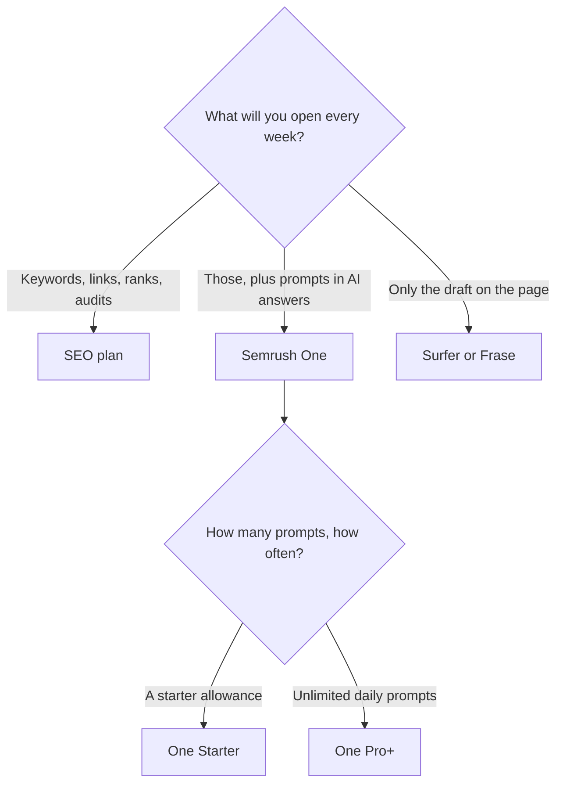

**[Semrush](/tools/semrush/) is a dataset for search and, on Semrush One, for AI answers.** The free account is $0: 1 demo project and 10 reports a day, no card. The SEO plan is $139 a month, or $117.33 a month billed annually. Semrush One Starter, which bundles SEO and AI search, is $199 a month or $165.17 billed annually. Semrush One Pro+ is $299 a month or $248.17 billed annually, with unlimited daily prompt tracking.

Prices are US dollars from Semrush's pricing page, recorded October 16, 2026. Annual billing saves up to 17%. Extra users start at $45 a month. A report add-on starts at $10, a Pro report at $20, and lead generation at $90. Local, content, social, and advertising toolkits are priced on their own. Tax and currency at checkout can differ. We do not have traffic numbers for Semrush, and this review does not claim a ranking lift.

The map of neighboring tools is [best AI SEO tools](/blog/best-ai-seo-tools-2026/). If the job is the article in front of you, read the [Surfer SEO review](/blog/surfer-seo-review-2026/) before you buy a full dataset. Writing systems are in [best AI writing assistants](/blog/best-ai-writing-assistants/).

## Which subscription you are actually opening

| Plan | Monthly | Annual, per month | Annual, 12 times that rate | Built for |
|---|---|---|---|---|
| Free | $0 | $0 | $0 | 1 demo project, 10 reports a day |
| SEO | $139 | $117.33 | $1,407.96 | Keyword, backlink, rank, and audit work for a freelancer or a small site |
| Semrush One Starter | $199 | $165.17 | $1,982.04 | That SEO toolkit plus AI-search visibility |
| Semrush One Pro+ | $299 | $248.17 | $2,978.04 | The same idea, with unlimited daily prompts |

The invoice is [Semrush pricing explained](/blog/semrush-pricing-explained-2026/).

The yearly column is 12 × the per-month annual rate Semrush lists. It is not a quote. A free trial on paid plans can change the first invoice.

An extra user at $45 a month is $540 a year on top of the toolkit. Two extra users cost more than a year of [Surfer](/tools/surfer-seo/) Standard, which is $99 a month billed yearly. Buy the user seat when someone else must log in. Do not buy it to feel like a team.

## What the data is for

The SEO toolkit covers keyword research, backlinks, rank tracking, and site audits. Semrush One adds prompt-level visibility and AI market share against competitors, so you can see whether a brand shows up in AI answers for prompts you choose. Content tools can suggest topics and score a draft. That score is a writing aid inside the suite. It is not a prediction that a page will rank, and it is not a prediction that ChatGPT will cite you.

Semrush also says its data can be pulled into AI assistants. That is a workflow feature. The underlying numbers still come from the subscription you pay for.

Small sites can learn the shape of the product on the free account: one project, ten reports a day. That is enough to answer "does this keyword have volume?" a few times. It is not enough to run an agency week.

## Fit score

| Need | Free | SEO annual | One Starter | One Pro+ |
|---|---|---|---|---|
| A handful of reports | Yes, 10 a day | Yes | Yes | Yes |
| Ongoing rank and backlink work | Too narrow | Strong | Strong | Strong |
| Prompt tracking in AI answers | No | Not the bundle | Yes | Yes, unlimited daily prompts |
| Extra people in the account | No | Add-on from $45/user | Add-on | Add-on |
| Write and optimize one article | Poor fit as a writing desk | Possible, and expensive for that alone | Possible | Possible |

Labels describe the published bundle. They are not performance scores.

## A purchase order that stays small

1. Spend the free reports on a domain you know. If the numbers are the ones you will use in a client call, the dataset is the product.
2. If you will not open rank tracking or backlinks, stop and price Surfer or [Frase](/tools/frase/). Frase Starter is $39 a month billed yearly.
3. If AI-answer visibility is a real report you must send, price One Starter against the SEO plan plus a separate tracker. One Starter annual is $1,982.04 at the list rate. SEO annual is $1,407.96. The gap is $574.08 a year for the AI-search bundle.
4. Add users only for people who will log in. $45 × 12 = $540 per extra user per year.
5. Keep a writing assistant, if you need one, in the [writing guide](/blog/best-ai-writing-assistants/). [Jasper](/tools/jasper/) Pro is $59 per seat per month yearly. It does not replace this dataset.

## FAQ

### Is Semrush free?

Yes. One demo project and 10 reports a day, with no card, on the plan we recorded.

### How much does Semrush cost?

The SEO plan is $139 a month or $117.33 a month billed annually. Semrush One Starter is $199 or $165.17. Pro+ is $299 or $248.17. Add-ons are extra.

### What is Semrush One?

SEO plus AI-search visibility: prompts, AI answers, and share of those answers versus competitors. Pro+ lists unlimited daily prompt tracking.

### Does Semrush make a page rank?

No tool in this review does. Semrush measures and researches. The page still has to deserve the citation.

## Last verified

October 16, 2026.

**Sources:** [Semrush pricing](https://www.semrush.com/pricing/), [Semrush](https://www.semrush.com).

[Semrush](/tools/semrush/) is in the [marketing and SEO directory](/tools/category/marketing-seo/). Directory pages may use affiliate links. A purchase through them can earn us a commission at no extra cost to you.
