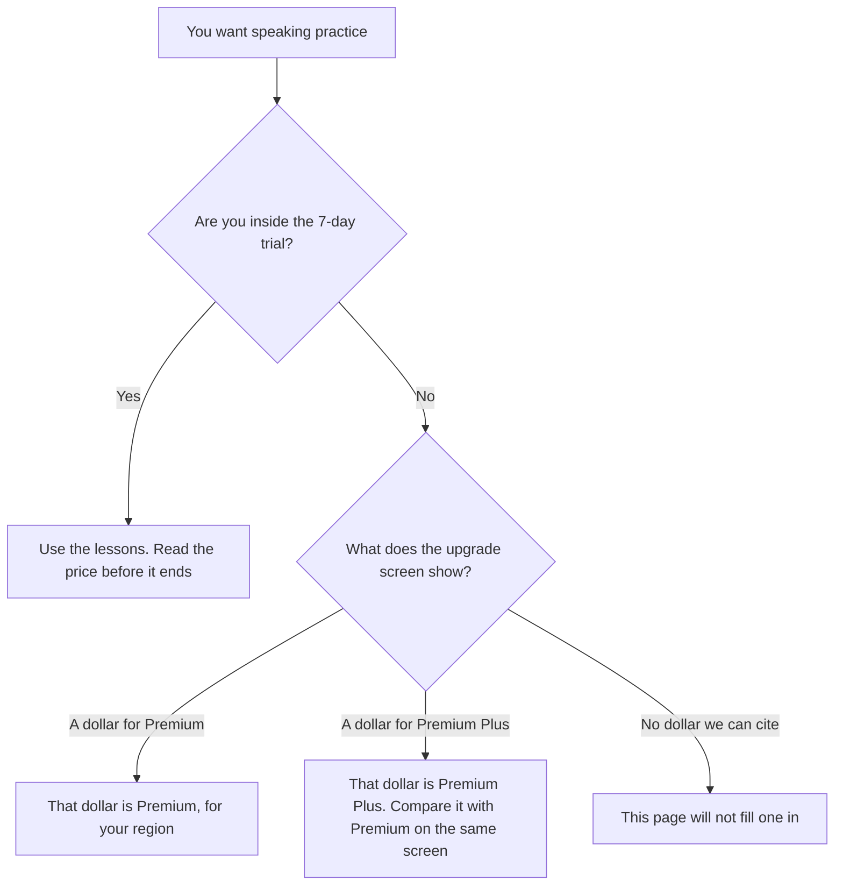

**Speak does not publish a fixed US dollar for Premium or Premium Plus on the pages the directory could read.** The directory, checked October 16, 2026, records a 7-day free trial and then a paid subscription. Premium is the core speaking product. Premium Plus adds unlimited personalized lessons, custom review from your mistakes, Made for You lessons, and the full Speak Tutor. A live fetch of speak.com/pricing on October 24, 2026 returned HTTP 401. This page does not invent a monthly price. The dollar in the app, for your region and today's promotion, is the price.

The product page is [Speak](/tools/speak/). A language app that also refuses a single public sticker is [Duolingo Max pricing explained](/blog/duolingo-max-pricing-explained-2026/). A flashcard plan with the same "no dollar on the page" problem is [Quizlet pricing explained](/blog/quizlet-pricing-explained-2026/). A general chat seat, which is not a curriculum, is [ChatGPT review](/blog/chatgpt-review-2026/).

Published October 24, 2026. We did not score speaking ability. Speak's directory page says prices vary by plan, region, and promotion.

## What the directory could actually list

| Plan | Price | What the October 16 record says you get |
|---|---|---|
| Free trial | $0 for 7 days | Core features, including AI conversation practice. There is no ongoing free plan |
| Speak Premium | See the app | The core language-learning experience |
| Speak Premium Plus | See the app | Premium, plus unlimited personalized lessons, custom review, Made for You lessons, and the full Speak Tutor |

The languages on the directory card, for English speakers, are Spanish, French, Korean, Japanese, Italian, and Simplified Chinese. A language that is not on that list is not a reason to guess a price. It is a reason to pick a different product.

Speak's directory page also records a formal partnership with OpenAI and backing from the OpenAI Startup Fund. That is a corporate fact on the card. It is not a discount, and it does not make Speak's price equal ChatGPT's price.

## What a published dollar looks like instead

**ChatGPT Plus** is $20 a month. You can practice a conversation by typing or talking, if the product you have allows it. Plus does not include Speak's lesson sequence, the pronunciation feedback the directory describes, or the Premium Plus tutor. Quote $20 for ChatGPT. Quote the in-app number for Speak. Do not average them.

**Duolingo** does not publish one USD sticker for Max either, and the Duolingo article is the place to read the Super versus Max story. **Quizlet** names Plus and Plus Unlimited and does not print a dollar on the help page that article covers. None of those gaps is permission to copy a price from a blog that is not the vendor.

If a family member's screen shows a different dollar, that can be region, platform, or a promotion. The directory says the most accurate price is in the app. Two screenshots from two countries are two prices. This site publishes in USD and does not convert a local currency into a dollar Speak did not print.

## What not to assume

Do not write "$9.99" or any other familiar language-app price into a budget for Speak. We do not have that number from Speak. Do not treat the 7-day trial as a free plan. The directory says a paid subscription is required after it. Do not buy Premium Plus because the word unlimited appeared, until the same screen shows what Premium already includes for the language you are learning. Do not expect a grammar textbook. The directory's own con is less grammar and reading depth than a speaking-first app.

## FAQ

### How much does Speak cost?

The October 16 directory does not record a US dollar for Premium or Premium Plus. It records a 7-day free trial and says the in-app price is the accurate one, varying by plan, region, and promotion. A fetch of the pricing URL on October 24 returned HTTP 401.

### What is the difference between Premium and Premium Plus?

On that record, Premium is the core experience. Premium Plus adds unlimited personalized lessons, custom review built from your mistakes, Made for You lessons, and the full Speak Tutor. The dollar difference is whatever the app shows you for those two names.

### Is there a free plan?

There is a 7-day trial of core features, including AI conversation practice. After the trial, the directory says a paid subscription is required. Budget the renewal before the trial ends, using the number on the screen.

### Can I use ChatGPT instead?

You can practice with ChatGPT Plus at $20 a month. That is a different product. It is not Speak's lesson path, and $20 is not Speak's price. If you only needed a conversation partner and you will correct yourself, Plus is a legible bill. If you wanted Speak's tutor, open Speak's screen.

## Last verified

October 16, 2026, from the Speak directory page, which cites speak.com and speak.com/pricing. A live fetch of the pricing URL on October 24, 2026 returned HTTP 401. Published October 24, 2026.

**Sources:** [Speak](https://www.speak.com), [Speak pricing](https://www.speak.com/pricing).

*Published by Andrew for [AI Tools Optimizer](https://aitoolsoptimizer.com).*

[Speak](/tools/speak/) is in the [education directory](/tools/category/education/). Directory pages may use affiliate links. A purchase through them may earn us a commission at no extra cost to you.
