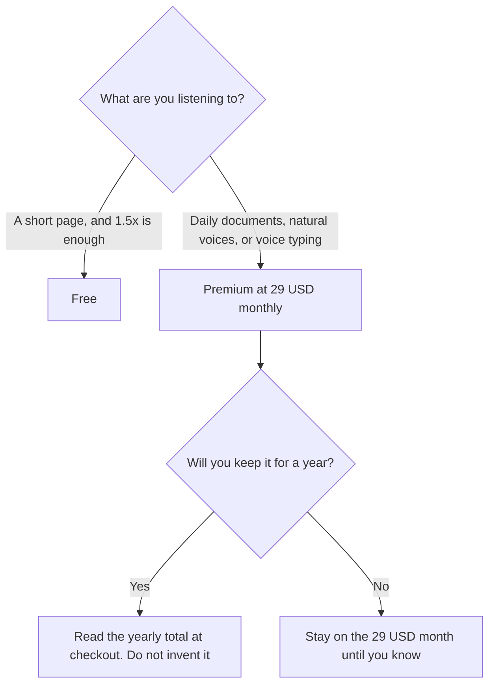

**Speechify Premium is $29 a month when billed monthly. The free plan listens at up to 1.5x speed with 10 voices the directory describes as robotic, and it includes text-to-speech features only.** Speechify says yearly billing saves 60 percent versus monthly. The directory does not print the yearly dollar, so this page does not calculate one and call it the price. Premium is the seat for 1,000+ voices in 60+ languages, speeds up to 4.5x, voice typing, summaries, and the Voice AI Assistant, on that card.

The product page is [Speechify review](/blog/speechify-review-2026/). A voice tool for generated speech you will put in a video is [ElevenLabs pricing explained](/blog/elevenlabs-pricing-explained-2026/). Dictation across desktop apps is [Wispr Flow](/tools/wispr-flow/), at $12 a month billed annually, or $144 a year. Meeting notes are a different product: [Otter vs tl;dv for meeting notes](/blog/otter-vs-tl-dv-for-meeting-notes-2026/).

Prices are US list prices from Speechify's pricing page as recorded in the directory on October 16, 2026. A live fetch of that page returned HTTP 401 on October 24, 2026, so this page stays on the directory record. Published October 24, 2026. We did not score listening comprehension or voice quality.

## The plans

| Plan | Price recorded | What the card includes |
|---|---|---|
| Free | $0 | Up to 1.5x, 10 voices, text-to-speech only |
| Premium, monthly | $29 a month | 1,000+ voices, 60+ languages, up to 4.5x, voice typing, summaries, AI podcasts, Voice AI Assistant |
| Premium, yearly | Speechify says it saves 60 percent | The directory does not print the yearly charge |

Twelve months at the recorded monthly rate is 12 × $29 = $348. That is the cost of staying on monthly billing for a year. It is not the yearly plan. A 60 percent savings is Speechify's statement. Until checkout shows a dollar, this page will not print $11.60 or any other derived monthly equivalent as if Speechify had published it.

## What you are choosing besides the dollar

**Free** is a way to learn the controls. The directory is explicit that the free voices are the robotic set and that the speed cap is 1.5x. If the reason you want Speechify is a natural voice for a long PDF, Free is the wrong quote.

**Premium** is the feature plan: high-quality voices, more languages, 4.5x on supported apps, voice typing in tools such as Google Docs, Gmail, Slack, Outlook, and Cursor on desktop, PDF summaries, podcasts generated from documents, and questions to the Voice AI Assistant. Those features share one $29 monthly price on the card. You do not buy voice typing separately in this directory record.

**Voiceover and dictation** are neighboring jobs. [ElevenLabs](/tools/elevenlabs/) Starter is $6 a month and Creator is $22, for generated audio with a different license. The free ElevenLabs plan has no commercial license on the directory card. [Wispr Flow](/tools/wispr-flow/) Pro is the dictation seat at $12 a month billed annually if you only needed typing. [Descript](/tools/descript/) Hobbyist is $16 a person a month billed annually if the job is editing a recording, not listening to a PDF. The clip split is [Descript vs CapCut for podcast clips](/blog/descript-vs-capcut-for-podcast-clips-2026/).

## What not to assume

Do not quote a yearly Speechify price you computed from 60 percent. Do not treat a summary of a PDF as a source. The document is the source. The summary is a draft you can listen to. Do not put a client's confidential file into a consumer account your policy forbids, even when the voice is good. Do not buy Premium for meeting transcription. That job is a notetaker.

## FAQ

### Is Speechify free?

Yes. Free includes text-to-speech at up to 1.5x with 10 voices. The paid voices, the higher speed, voice typing, summaries, and the assistant are Premium.

### How much is the yearly plan?

Speechify's pricing page, as recorded on October 16, 2026, says yearly billing saves 60 percent and does not print the yearly dollar in the directory. Check speechify.com/pricing while signed in, and use that total. This article will not derive it.

### Can Speechify type for me?

Voice typing on Premium turns speech into text in the desktop apps the directory names, including Google Docs, Gmail, Slack, Outlook, and Cursor. It is included in the $29 monthly plan on that card. It is not a separate SKU here.

### Is this the same as ElevenLabs?

No. Speechify is built around listening to your own reading and dictating. ElevenLabs is a voice-generation subscription with its own credit meter, starting at $6 on the directory card. A podcast clip you edit is Descript or CapCut. Pick the job, then the seat.

## Last verified

October 16, 2026, from Speechify's pricing page as recorded in the directory. ElevenLabs, Wispr Flow, and Descript figures are from the same directory date. Published October 24, 2026. A live fetch returned HTTP 401.

**Sources:** [Speechify pricing](https://speechify.com/pricing/), [Speechify](https://speechify.com), [ElevenLabs pricing](https://elevenlabs.io/pricing).

*Published by Andrew for [AI Tools Optimizer](https://aitoolsoptimizer.com).*

[Speechify](/tools/speechify/) is in the [audio, voice, and music directory](/tools/category/audio-voice-music/). Directory pages may use affiliate links. A purchase through them may earn us a commission at no extra cost to you.
