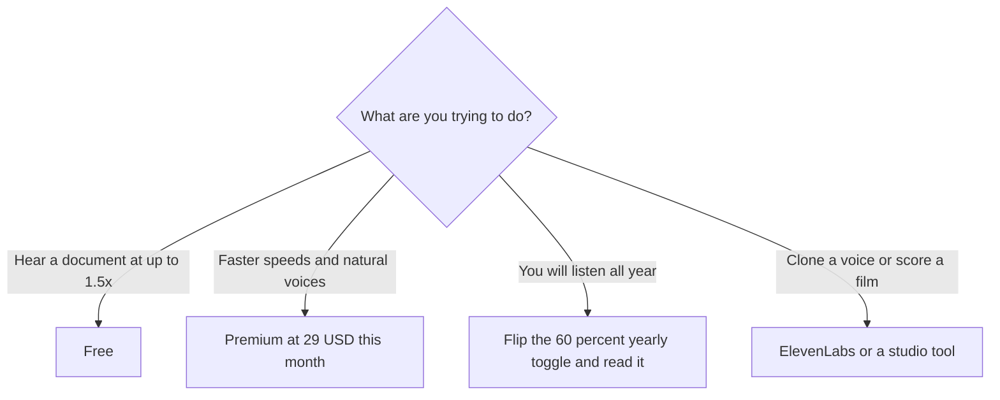

**[Speechify](/tools/speechify/) reads text aloud.** It is a listening product: documents, articles, and files, at a speed you choose, in a voice you pick. On October 24, 2026 the pricing page, on the monthly control, listed Premium at **$29 a month**. The yearly control is labeled **save 60%**. Free is a real plan: speeds **up to 1.5×**, **10 voices** the page itself describes as robotic, and text-to-speech features only. Premium's card leads with **1,000+ voices** and **60+** in the language line that follows.

We did not run a listening test or a dyslexia-usability study. Speechify's audience includes students and people who prefer audio because reading is hard. That is a product claim to take seriously, and it is not a claim we measured. This review is which plan matches listening versus voice production. Those are different bills.

## Monthly price, yearly label

| Plan | What we could read | Listening |
|---|---|---|
| Free | $0 | Up to 1.5×, 10 voices described as robotic, text-to-speech features only |
| Premium | $29/month on the monthly toggle | 1,000+ natural voices, 60+ on the language or dialect line, the popular card |
| Yearly | Toggle labeled save 60% | The discounted per-month figure is on that toggle. We are not printing a calculated $11.60 as if it were the charge |

Sixty percent off $29 is $11.60. Speechify may round, bundle a platform, or exclude a tax. Open the yearly control and read the total for the year. If you listen every day, the yearly price is the one that matters, and it should be copied from checkout. If you need Speechify for one dense month of reading, $29 once is the honest buy and the 60% label is irrelevant.

The page also announced voice typing. That is a dictation feature sitting on a product that built its name on playback. Price the plan for the feature you will use. A dictation habit and a listening habit can share an app and still be two jobs. [Wispr Flow](/tools/wispr-flow/) is the directory's dictation-first tool. Do not assume Premium's $29 includes unlimited voice typing at the same priority as listening until the feature list on your platform says so.

## Listening is not a voice studio

[ElevenLabs](/tools/elevenlabs/) prices voice generation and cloning. The [ElevenLabs pricing explainer](/blog/elevenlabs-pricing-explained-2026/) and the [voice generator roundup](/blog/best-ai-voice-generators/) are about making audio other people will hear as a produced asset. Speechify is about making a PDF audible for you. [Murf](/tools/murf-ai/) sits closer to voiceover production. [Descript](/tools/descript/) sits closer to editing a recording. Students turning readings into audio should also see [turn a PDF into a podcast](/blog/turn-a-pdf-into-a-podcast-with-ai/), which is a production workflow, not the same as pressing play in Speechify.

Apps exist for iOS, Android, Chrome, Edge, web, Mac, and Windows. A plan that works on your phone and not on the desktop extension is a support question, not a second subscription. Check the platform list on the pricing page for the device you actually read on. Commuter listening on a phone and textbook listening on a laptop are both Speechify, and a missing extension is how a $29 plan feels broken.

Free at 1.5× is a real constraint. People who listen to study material often want 2× or faster. That speed jump is a reason Premium exists, alongside the voice library. If 1.5× and a synthetic voice are tolerable, free is not a demo. It is the product. Premium is for the hours where the voice and the speed are why you will finish the document.

Import is the other practical test. A pricing card cannot tell you whether your course pack, a scanned PDF, or a Google Doc comes through intact. Free is enough to find out. Drop in the longest file you actually have to finish, listen for five minutes, and note the failures: a heading read as a URL, a footnote read inline, a table read as nonsense. Premium will not repair a bad import by sounding more natural. If the import fails, the $29 does not fix the file. If the import works and the voice is the thing you cannot stand, Premium is the specific upgrade. That sequence is cheaper than a yearly plan bought from an advertisement.

Teams sometimes buy Speechify as a perk next to a writing assistant. The perk is only real if people listen. A seat nobody opens is the pattern in [which AI subscription is worth paying for](/blog/which-ai-subscription-is-worth-paying-for/). One shared approach that works is to keep free for anyone curious and pay Premium only for the people who already hit 1.5× every day. You do not need a site license to learn that.

## Who should pay

**Use free** for occasional articles and for deciding whether listening sticks. **Pay $29 for a month** when a course load, a stack of contracts, or a research packet justifies natural voices and speeds past 1.5×. **Take yearly** only after that month, and only at the price the yearly toggle actually charges. **Skip Speechify** when the job is a narrated video, an audiobook for sale, or a cloned voice. You would be paying a reader app to do a studio's job. **Skip a second listening app** if a platform you already have, including a built-in screen reader, covers the same documents. Speechify's library is the upgrade. It is not the only way to hear a webpage.

Accessibility budgets should prefer a month of proof. A tool that helps someone read is worth $29 if they use it, and worth $0 if the voice or the importer fails on their files. The trial of free is there. Use the actual PDF, not a sample sentence.

## FAQ

### How much does Speechify Premium cost?

$29 a month on the monthly pricing card checked October 24, 2026. The yearly control is labeled save 60%. Read that control for the yearly charge. We did not print a derived yearly price.

### Is Speechify free?

Yes. Free includes text to speech up to 1.5× and 10 voices the page calls robotic. Premium is the natural-voice library and the rest of the listening features.

### Is this the same as ElevenLabs?

No. Speechify is for listening to text. ElevenLabs is priced for generating and cloning voices. Some people use both. Most people need one.

### Does Premium include every app?

Speechify lists iPhone, Android, Chrome, Edge, web, Mac, and Windows. Confirm the one you will use before you pay, especially if voice typing is the feature you saw advertised.

### Should a student take the yearly plan immediately?

Take a month at $29 during a heavy reading week. Move to yearly if the habit survives the month and the yearly total, read off the toggle, is the better bill.

## Last verified

October 24, 2026, from Speechify's pricing page, monthly toggle. Voice counts and the 60% yearly label are the vendor's. Recheck the yearly total at checkout. A percentage on a toggle is not a receipt.

**Sources:** [Speechify pricing](https://speechify.com/pricing/), [Speechify](https://speechify.com).

[Speechify](/tools/speechify/) is in the [audio directory](/tools/category/audio-voice-music/). Directory pages may use affiliate links. A purchase through them may earn us a commission at no extra cost to you.
