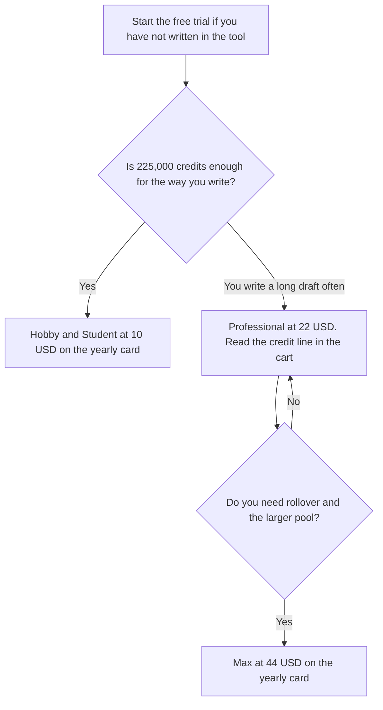

**On the yearly cards at sudowrite.com/pricing on October 24, 2026, Hobby & Student was $10 a month for 225,000 credits, Professional was $22 a month, and Max was $44 a month for 2,000,000 credits with unused credits rolling over for 12 months.** Professional's card rendered both 1,000,000 and 450,000 next to the words "credits per month." This page does not pick one. The cart is the allowance. There is a free trial, and the page says no credit card is required to start it.

The product page is [Sudowrite review](/blog/sudowrite-review-2026/). A general chat seat, which is not a fiction studio, is [Claude review](/blog/claude-review-2026/). A marketing seat with a different meter is [Jasper pricing explained](/blog/jasper-pricing-explained-2026/).

The October 16, 2026 directory recorded the same yearly prices and a single credit column: Hobby 225,000 at $10 annually or $19 monthly, Professional 1,000,000 at $22 annually or $29 monthly, and Max 2,000,000 at $44 annually or $59 monthly. The October 24 HTML did not include $19, $29, or $59. The page said yearly is up to 50% off. Published October 24, 2026. We did not score prose.

## What the two checks recorded

| Plan | October 24 yearly card | Credits that were unambiguous that day | October 16 directory, monthly price and credits |
|---|---|---|---|
| Hobby & Student | $10 a month | 225,000 a month | $19 a month, 225,000 credits |
| Professional | $22 a month | 1,000,000 and 450,000 both rendered | $29 a month, 1,000,000 credits |
| Max | $44 a month | 2,000,000 a month, rollover for 12 months | $59 a month, 2,000,000 rollover credits |

A year of Hobby at $10 a month is $120 if that rate holds. A year of Max at $44 is $528. Those are 12 times the yearly-card monthly figures. They are not a second discount. The October 16 monthly stickers, if they still appear when you toggle Monthly, change the year: 12 × $19 = $228 for Hobby, 12 × $29 = $348 for Professional, and 12 × $59 = $708 for Max. Use the toggle you are actually on. Do not average the two checks.

The 1,000,000 on Professional was styled as a rotated callout. The 450,000 used the same presentation as Hobby's 225,000. Either figure may be the allowance, a previous allowance, or a yearly-versus-monthly difference the HTML did not label. Quote the number next to "credits per month" in your own cart.

## What the plans are for

**Hobby & Student** is the card for someone writing for practice or for school, at 225,000 credits. The page described it that way. It is not a student-ID price this capture separated from the $10.

**Professional** is the middle card, marked most popular on the page, for longer work. The credit disagreement is why this article refuses a single Professional total. Features the page listed on paid plans include Write, Rewrite, Describe, and Expand, style match, and Sudowrite's own models plus other models. Developmental edits were listed from Professional upward. Confirm the feature row in the cart. A feature name on a marketing block is not a credit.

**Max** is the card with 2,000,000 credits and rollover for 12 months, for someone publishing more than one project a year, which is the page's own description.

Sudowrite's FAQ on that page says it claims no rights over what you put in or what it generates. That is their statement. Your publisher or your school can still have a policy. Read that policy before you submit the work.

[Claude](/tools/claude/) Pro is $20 a month, or $17 billed annually, if you only needed a chat to outline. [ChatGPT](/tools/chatgpt/) Plus is $20. Neither is a Story Bible. [Jasper](/tools/jasper/) Pro is $59 a seat a month billed yearly. Jasper is a marketing seat. Do not buy it to get Sudowrite's credit pool.

## What not to assume

Do not quote Professional at 1,000,000 credits if your cart says 450,000, or the reverse. Do not tell a student the $10 card is an extra discount on top of Hobby. Do not treat the free trial as a free plan. The directory says there is no free plan, and the October 24 page offered a trial. Do not paste a manuscript into a tool your contract forbids.

## FAQ

### How much does Sudowrite cost?

On the October 24, 2026 yearly cards: Hobby & Student $10 a month, Professional $22 a month, and Max $44 a month. The October 16 directory also recorded monthly prices of $19, $29, and $59. Those monthly dollars were not in the HTML captured on October 24. Check the toggle.

### How many credits are on Professional?

The October 16 directory says 1,000,000. The October 24 card showed 1,000,000 and 450,000. Use the figure in the cart next to the credit label. This site will not guess which one the toggle selected.

### Is there a free plan?

The directory says no, with a free trial. The October 24 page said you can start a trial with no credit card, and that canceling keeps your projects while AI features require a paid plan. That is their FAQ. A trial is not a standing free tier.

### Do credits roll over?

The October 24 page said unused credits roll over for 12 months on Max. It did not say that on the Hobby card in the text we captured. Do not assume Hobby rolls over because Max does.

## Last verified

October 24, 2026, from sudowrite.com/pricing, compared with the directory record of October 16, 2026. Published October 24, 2026.

**Sources:** [Sudowrite pricing](https://sudowrite.com/pricing), [Sudowrite](https://sudowrite.com).

*Published by Andrew for [AI Tools Optimizer](https://aitoolsoptimizer.com).*

[Sudowrite](/tools/sudowrite/) is in the [writing directory](/tools/category/writing/). Directory pages may use affiliate links. A purchase through them may earn us a commission at no extra cost to you.
