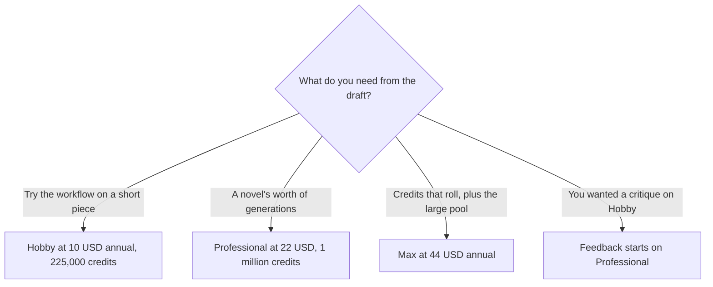

**[Sudowrite](/tools/sudowrite/) is a writing app built for fiction.** Story Bible, draft tools, rewrite, and feedback are aimed at chapters and characters, not at a marketing blog. On October 24, 2026 Sudowrite's plan documentation listed three paid tiers and a trial. **Hobby & Student** is **225,000 credits** at **$10 a month billed annually or $19 month to month**. **Professional** is **1,000,000 credits** at **$22 or $29**. **Max** is **2,000,000 rollover credits** at **$44 or $59**. There is no permanent free plan on that page.

We did not workshop a novel or score prose. [Best AI writing assistants](/blog/best-ai-writing-assistants/) and [ChatGPT vs Claude for writing](/blog/chatgpt-vs-claude-for-writing-2026/) cover general writing seats. Sudowrite is the specialist. The bill is credits, and the rollover rule is what separates Max from a bigger Hobby plan.

## The three plans

| Plan | Credits | Annual rate | Monthly rate | Rollover |
|---|---|---|---|---|
| Hobby & Student | 225,000 | $10/month | $19/month | The docs describe these credits in contrast with Max's rollover credits |
| Professional | 1,000,000 | $22/month | $29/month | Same contrast: Max is the plan named for rollover |
| Max | 2,000,000 | $44/month | $59/month | Rollover credits, as named on the plan |

Feedback, the critique feature, is exclusive to Professional and Max. Hobby includes the rest of the writing surface and a smaller pool. If you are buying Sudowrite to be told what is wrong with a chapter, Hobby is the wrong card even though it is the cheapest. If you are buying it to draft and you will judge the pages yourself, Hobby's 225,000 credits are the experiment.

Annual Hobby is $120 a year. Monthly Hobby is $228 a year if you stay twelve months. The gap is $108, which is almost another annual plan. Take monthly until a chapter convinces you, then switch. Annual Professional is $264 a year against $348 monthly. Annual Max is $528 against $708. The discount is for writers who already know the tool fits a book, not for someone on chapter one of their first try.

## What the credits are for

Sudowrite's docs tell you to look up how many credits each feature uses, and they say you can track usage. That page is more useful than any average we could invent. A brainstorm and a full-chapter rewrite will not debit the same amount. During the trial, run the features you actually want: a Story Bible pass, a scene, a rewrite, and, if you are considering Professional, one Feedback pass. Divide the debit into the monthly grant.

Hobby's 225,000 credits are a little under a quarter of Professional's million. The price is a little under half on the annual rates ($10 versus $22). Professional is the better credit price if you will use the million. It is the worse price if you generate in bursts and watch credits expire. Max is the plan that says the credits roll. If your writing month is uneven, a book in revisions one month and silence the next, rollover is the feature. If you write a steady amount, Professional's larger non-rollover pool may still be the better fit, and you should confirm on the current doc whether unused Professional credits expire at the period's end. The plan page we read names rollover on Max specifically. Assume the other pools do not roll until the doc says they do.

Story Bible is the reason this is not "ChatGPT with a theme." It keeps characters, plot, and style beside the draft so a later chapter can be prompted in that context. A general chatbot can do a version of that if you maintain the context yourself. Sudowrite charges for maintaining it as a product. Pay for that if you will keep the bible updated. A bible you abandon is a chatbot subscription with extra steps. [Claude](/tools/claude/) and [ChatGPT](/tools/chatgpt/) remain the generalists. [Grammarly](/tools/grammarly/) is the proofreading seat, not the novelist. [QuillBot](/tools/quillbot/) rewrites sentences. Stacking Sudowrite and a general chatbot is reasonable when one holds the manuscript and the other answers a research question. Stacking them to generate the same chapter twice is how the voice of the book falls apart.

Publishers and contests differ on AI disclosure. Sudowrite will not settle your contract. If a market forbids generated prose, the tool is a brainstorming surface at most, and you should know that before you spend the credits. Students using it for fiction classes should read the syllabus the same way. [Best AI tools for students](/blog/best-ai-tools-for-students-2026/) is the wider list. A creative-writing ban and a grammar-tool allowance are not the same rule.

## Who should pay

**Use the trial** on a scene you care about. **Buy Hobby annual at $10** when the workflow sticks and Feedback is not the feature you wanted. **Buy Professional** when the credit history says 225,000 is a short month, or when you want Feedback. **Buy Max** when uneven months make expiring credits the expensive bug, and when 2 million is a number you can actually approach. **Skip Sudowrite** for blog posts, ads, and support macros. The product is aimed at stories. A marketing writer will get more from a marketing seat and will still not get Story Bible's value.

## FAQ

### How much does Sudowrite cost?

Hobby & Student is $10 a month billed annually or $19 monthly, for 225,000 credits. Professional is $22 or $29 for 1,000,000 credits. Max is $44 or $59 for 2,000,000 rollover credits. Checked October 24, 2026 in Sudowrite's plan docs.

### Is there a free plan?

The docs describe a trial, not a standing free tier. Use the trial to measure credit burn. Do not outline a year of a novel on a pool you have not sized.

### Which plan includes Feedback?

Professional and Max. Hobby does not include that critique feature.

### Do credits roll over?

Max is the plan described as rollover credits. The other plans are described by their monthly credit amounts without that word. Confirm expiry on the doc before you buy Hobby as a "bank."

### Can I use it for nonfiction?

You can paste any prose into a text tool. The features, the Story Bible, and the pricing are built for fiction writers. Nonfiction teams usually want a different assistant.

## Last verified

October 24, 2026, from Sudowrite's "what plans are available" documentation. Feature credit costs live on a separate help page and change when features change. Recheck the debit for Story Bible and Feedback if those are why you are choosing a tier.

**Sources:** [Sudowrite plans](https://docs.sudowrite.com/plans--account/wBnmhtSyMcWtk2BLzifGkz/what-plans-are-available/mwfVvj2rGcKYs1BQy4Pdcb), [Sudowrite](https://sudowrite.com).

[Sudowrite](/tools/sudowrite/) is in the [writing directory](/tools/category/writing/). Directory pages may use affiliate links. A purchase through them may earn us a commission at no extra cost to you.
