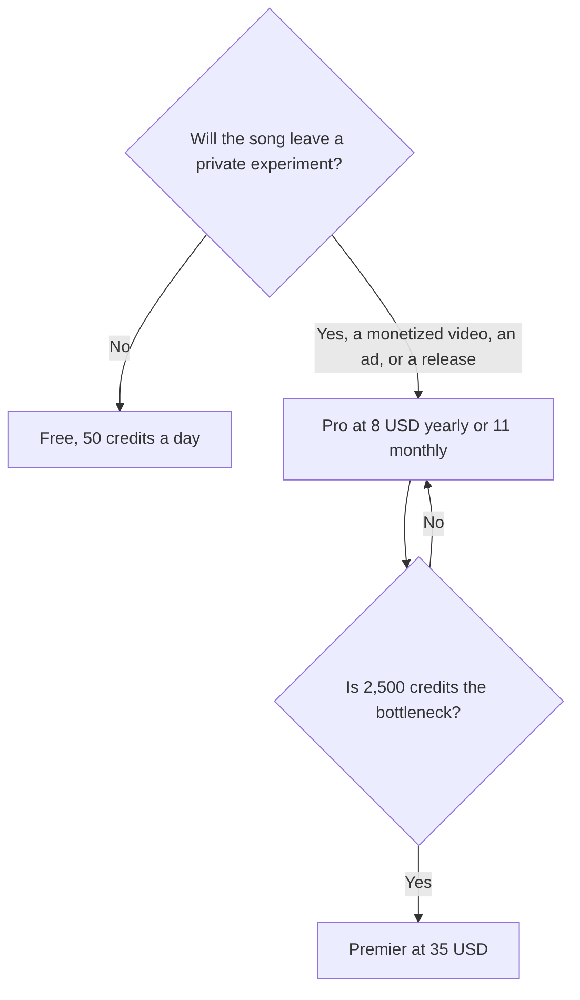

**Suno pricing turns on commercial rights and downloads, not on whether a song can be generated.** Free is 50 credits a day, with no monthly song downloads and no commercial rights. Pro is $11 a month, shown as $8 a month with yearly billing, for 2,500 credits, 20 downloads a month, and commercial rights. Premier is $35 a month billed monthly, for 10,000 credits and the unlocked feature set.

Those figures are from Suno's pricing page, checked October 16, 2026, and written up in the [Suno review](/blog/suno-review-2026/). Yearly billing saves up to 20%. Taxes are calculated at checkout. A refetch for this article returned 401, so this explainer does not update the October 16 numbers. Published October 24, 2026. We did not rank songs.

## The three lines

| Plan | Price | Credits | What you cannot do on the cheaper line |
|---|---|---|---|
| Free | $0 | 50 a day | No monthly downloads, no commercial rights, no add-on credit purchases. Upload cap 8 minutes. Free models |
| Pro | $11/month, or $8/month yearly | 2,500 a month | This is the first line with commercial rights, 20 downloads, two stem types, your voice, and custom models |
| Premier | $35/month billed monthly | 10,000 a month | The larger pool and every feature unlocked |

Pro and Premier can buy additional credits and downloads. Free cannot. Monthly Pro at $11 is the test month. Yearly Pro at $8 is the plan if you will publish. A year of Pro at the $8 rate is $96. A year of monthly Pro is $132. Premier's yearly cell was not a separate number on the check we used. The page said yearly billing saves up to 20%. Read the toggle. Do not multiply $35 by 0.8 and call it official.

## What the credits are not

This directory does not have one credits-per-song number stable enough to quote as a guarantee. Free's 50 credits a day are for hearing whether a genre lands. Pro's 2,500 are the pool you measure on your own songs. Premier's 10,000 are the larger pool. Generate more than one version before you open an editor. Editing a song you would not keep spends the session.

Pro is also paying for tools around the song, on the pricing page and product description recorded with the review:

- Suno Studio, a browser DAW for arranging and mixing.
- Your voice, on Pro and Premier: a few seconds of audio that sings lyrics you wrote. That is not spoken voiceover.
- Custom models trained on your recordings.
- Stems. Pro includes two stem-separation types.
- Remix and restyle, so a second pass can change a section.

Spoken narration is [ElevenLabs](/tools/elevenlabs/). Starter is $6 a month and includes a commercial license for ElevenLabs' own features, on the October 16 card. That does not make ElevenLabs a song studio, and it does not make Suno Free safe to publish. The voice bill is [ElevenLabs pricing explained](/blog/elevenlabs-pricing-explained-2026/). A recorded podcast is [Descript](/tools/descript/), from $16 a person billed annually. The edit bill is [Descript pricing explained](/blog/descript-pricing-explained-2026/).

## Udio, if the edit matters more than the rights line

[Udio](/tools/udio/) is the other music generator in the directory. Free is 100 credits a month, capped at 10 a day. Standard is $10 a month, or $8 billed annually ($96 a year), for 2,400 credits. Pro is $30, or $24 annually ($288), for 6,000 credits. Add-on credits are 100 for $3 or 1,000 for $25. Prices can display in USD, GBP, or EUR.

Udio's directory note is section-level editing. **A commercial-rights sentence as clear as Suno's Pro line was not confirmed on that check.** Read Udio's terms before you publish. Do not assume Standard's $10 includes the same rights Suno prints on Pro. The voice shelf around both is [best AI voice generators](/blog/best-ai-voice-generators/).

| You need | Suno | Udio |
|---|---|---|
| A full song from a prompt | The product | The product |
| A published commercial-rights line we could quote | Pro and Premier | Not confirmed. Read the terms |
| A free daily habit | 50 credits a day, non-commercial | 10 a day inside a 100-credit month |
| Spoken voiceover | No. Use ElevenLabs | No |

A YouTube bed and a streaming release are both commercial in the ordinary sense. If Suno's terms split those uses, the pricing page is the start of the reading, not the end. Keep the receipt for the plan you were on when you generated the track. A channel workflow that uses the track is [how to start a faceless YouTube channel](/blog/start-faceless-youtube-channel-with-ai/). Suno belongs on that workflow only on Pro or Premier.

## FAQ

### Is Suno free?

Yes. Fifty credits a day. No commercial rights and no monthly song downloads. Publishing a Free generation in a monetized video is outside the plan we read.

### How much is Suno Pro?

$11 a month, or $8 a month with yearly billing, for 2,500 credits, on the October 16 check. Premier is $35 a month billed monthly for 10,000 credits. Confirm the toggle.

### Can I use Suno on YouTube?

Only on a plan with commercial rights. That is Pro or Premier. Free is the wrong plan for a monetized channel. This article is not a license. Read the rights line at checkout the day you subscribe.

### Does Premier include yearly billing?

The page said yearly billing saves up to 20%. The Premier price we can quote is the $35 monthly list. If a yearly Premier cell is on the toggle, that cell wins over a percentage we apply ourselves.

## Last verified

October 16, 2026, from Suno's pricing page, Udio's pricing page, and the ElevenLabs and Descript directory cards. A later fetch of Suno's pricing page for this article returned 401. Published October 24, 2026.

**Sources:** [Suno pricing](https://suno.com/pricing), [Udio pricing](https://www.udio.com/pricing), [ElevenLabs pricing](https://elevenlabs.io/pricing).

*Published by Andrew for [AI Tools Optimizer](https://aitoolsoptimizer.com).*

[Suno](/tools/suno/) is in the [audio directory](/tools/category/audio-voice-music/). Directory pages may use affiliate links. A purchase through them may earn us a commission at no extra cost to you.
