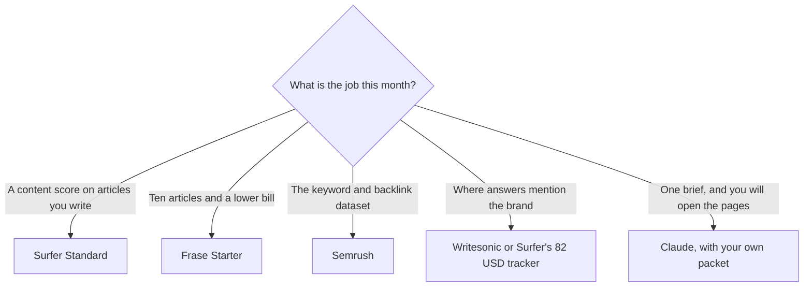

**Leave Surfer when you need a cheaper article desk, a keyword and backlink dataset, or an AI-mention tracker without 360 documents.** Stay when a writer already lives in the content editor and 25 prompts tracked weekly are enough. Surfer's score is a checklist. It is not a ranking.

The product page is [Surfer SEO review](/blog/surfer-seo-review-2026/). The two-desk comparison is [Surfer vs Frase](/blog/surfer-seo-vs-frase-2026/). The category map is [best AI SEO tools](/blog/best-ai-seo-tools-2026/).

Prices are US list prices excluding tax from directory pages checked October 16, 2026. There was no free Surfer plan on that card. Published October 24, 2026. We did not measure rankings.

## The reason you are leaving

| The constraint | Open this | Price that matters |
|---|---|---|
| Optimize articles, 360 documents, a weekly prompt sample | Stay on [Surfer](/tools/surfer-seo/) Standard | $99 a month billed yearly. The card lists that as saving $240 a year versus Surfer's own monthly price |
| Daily prompt refresh and internal links at scale | Surfer Pro | $182 a month billed yearly |
| AI mentions without the editor | Surfer AI Search Analytics | $82 a month billed yearly, 50 prompts, 5 Brand Spaces |
| Research, a draft, and a lower yearly entry for one site | [Frase](/tools/frase/) | Starter $39 a month billed yearly, or $49 month to month. One seat, one site, 10 articles and 50 audit pages |
| Keywords, backlinks, and a site audit | [Semrush](/tools/semrush/) | SEO plan $117.33 a month billed yearly, or $139 monthly. Free is one project and 10 reports a day |
| Prompt tracking across answer engines, plus AI articles | [Writesonic](/tools/writesonic/) | Starter $79 a month billed annually |
| A brief from pages you opened, formatted in chat | [Claude](/tools/claude/) | Pro $20 a month, or $17 billed annually |
| On-brand campaign copy with a saved voice | [Jasper](/tools/jasper/) | Pro $59 a seat a month billed yearly, or $69 monthly |

## What Standard is charging you for

Standard at $99 times 12 is $1,188 a year before Surfer's "save $240" language. That saving is against Surfer's monthly rate, not a coupon against Semrush. Pro at $182 times 12 is $2,184. The step up is daily tracking, one-click internal linking, and content ideas. Buy it when those three are the bottleneck. Skip it when the bottleneck is "we do not have a source for the facts."

Frase Starter at $39 yearly is the alternative when one site and ten articles a month match the team. Professional is $103 yearly or $129 monthly on the October 16 card. Frase will propose questions. You still open the pages. The brief shape is [how to use AI for SEO briefs](/blog/how-to-use-ai-for-seo-briefs-2026/). The review is [Frase review](/blog/frase-review-2026/).

Semrush is the dataset. Semrush One, with AI-search tracking, starts at $165.17 a month on annual billing on that card. Buy the SEO plan when the brief needs the data. Buy One when the chart of AI answers is part of the job and you want it in the same suite. The review is [Semrush review](/blog/semrush-review-2026/).

Writesonic Starter at $79 is a tracking product that also offers AI articles, with one project on the card we used. A second site is another plan. Use it when the report is "are we cited," and keep the editor you already trust.

Claude is the formatter. Paste three URLs, the questions you kept, and the facts you will allow. The outline is done when every section maps to that packet. The writing steps are [how to write a blog post with Claude](/blog/how-to-write-a-blog-post-with-claude-2026/). A Surfer document is optional on top of a brief that already has sources.

Jasper is the brand vault, not the rank tracker. The switch guide is [Jasper alternatives](/blog/jasper-alternatives-2026/). A content team choosing among these seats is [best AI tools for content teams](/blog/best-ai-tools-for-content-teams-2026/). Marketers who also buy ads and decks should start from [best AI tools for marketers](/blog/best-ai-tools-for-marketers-2026/).

## FAQ

### Is Frase enough to replace Surfer?

For a single site producing about ten articles a month, Starter is the plan to test. You lose Surfer's document allowance and its prompt tracker. You gain a lower yearly entry. Run the same article through both trials if you can, and keep the editor your writer will actually open.

### Do I need Semrush and Surfer?

You need Semrush when the dataset is the job, and Surfer when the draft is the job. Many teams eventually pay for both. Start with the one that matches the hole in this month's process. A brief can be written with neither if you open the pages yourself.

### Is the $82 Surfer plan an editor?

No. AI Search Analytics is the tracker. Standard is the editor. Buying the $82 plan and expecting 360 documents will disappoint you in the first session.

### Will a higher content score rank the page?

A higher score means the draft matched the checklist more closely. Rankings depend on the page, the sources, and the search engine. We did not measure that, and a vendor score is not a promise.

## Last verified

October 16, 2026 for Surfer, Frase, Semrush, Writesonic, Claude, and Jasper prices in the directory. Published October 24, 2026.

**Sources:** [Surfer pricing](https://get.surferseo.com/surfer-pricing), [Frase pricing](https://www.frase.io/pricing), [Semrush pricing](https://www.semrush.com/pricing/).

*Published by Andrew for [AI Tools Optimizer](https://aitoolsoptimizer.com).*

[Surfer SEO](/tools/surfer-seo/) and [Frase](/tools/frase/) are in the [marketing directory](/tools/category/marketing-seo/). Directory pages may use affiliate links. A purchase through them may earn us a commission at no extra cost to you.
