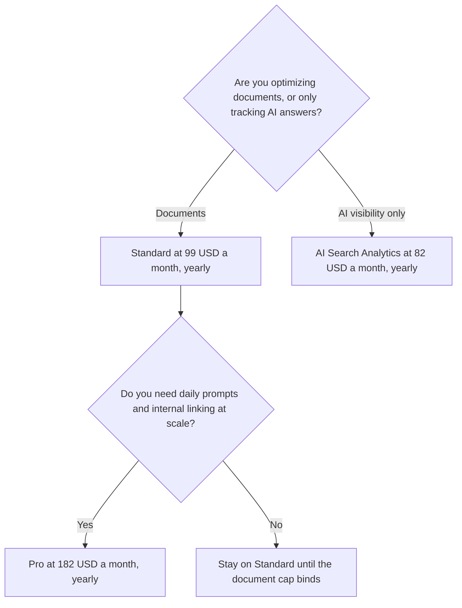

**Surfer's Standard plan is $99 a month when you pay yearly.** That rate includes 360 documents to create or optimize and 25 AI prompts tracked weekly. Pro is $182 a month billed yearly and adds daily prompt tracking plus internal linking at scale. AI Search Analytics, at $82 a month billed yearly, is a visibility plan, not a cheaper Standard.

The product page is [Surfer SEO review](/blog/surfer-seo-review-2026/). The head-to-head with the other content tool is [Surfer SEO vs Frase](/blog/surfer-seo-vs-frase-2026/). The dataset suite is [Semrush pricing explained](/blog/semrush-pricing-explained-2026/).

Prices are US dollars before tax, from Surfer's pricing page as recorded in the directory on October 16, 2026. The card prints yearly rates and a yearly saving. It says monthly billing costs more and does not give a monthly sticker this page will invent. Published October 24, 2026. We did not score content grades.

## The yearly rates

| Plan | Price billed yearly | Yearly saving on the card | What you are counting |
|---|---|---|---|
| AI Search Analytics | $82 a month | $156 | 50 AI prompts daily, mention gap, sentiment, 5 Brand Spaces |
| Standard | $99 a month | $240 | 360 documents, 25 AI prompts weekly, 1-click optimization, collaboration, plagiarism checker, rank-drop detection |
| Pro | $182 a month | $444 | Standard, plus 50 AI prompts daily, 1-click internal linking, content ideas and coverage gaps |

A year of Standard at the printed yearly rate is 12 × $99 = $1,188. The card says that billing cycle saves $240 a year versus monthly. This page does not reverse that saving into a monthly sticker. If you need the month-to-month number, read the live page and write it down.

A year of Pro is 12 × $182 = $2,184, with $444 saved versus monthly on the card. A year of AI Search Analytics is 12 × $82 = $984, with $156 saved. There is no permanent free plan on the card.

## What each plan is for

**Standard** is the content team default on this site: a large document allowance, weekly AI prompt tracking, optimization, and a plagiarism check. Three hundred sixty documents is 30 a month if you spread them evenly. A team that publishes four articles a week will not hit that cap. A team that optimizes every old URL in a quarter might.

**Pro** is the step when internal linking and daily AI prompt tracking are the work, not a demo. The jump from $99 to $182 is $83 a month on yearly billing, or $996 a year. Pay it when those features are on someone's weekly checklist. Do not pay it for a rounder content score.

**AI Search Analytics** tracks brand visibility across ChatGPT, Gemini, and AI Overviews, with 50 prompts and 5 Brand Spaces on the card. It is the plan you buy when you are not in the editor. It is not "Standard, but cheaper." If you need both the editor and the tracker, budget both lines. $99 + $82 = $181 a month on yearly rates, which is a dollar under Pro and a different bundle. Confirm on the live page whether Pro already covers the tracking you wanted before you stack the $82 plan on Standard.

## The neighbors

[Frase](/tools/frase/) Starter is $39 a month billed yearly, or $49 month to month, for one seat and one site. That is the lower entry if the job is articles and audits rather than Surfer's editor. The full ladder is [Frase pricing explained](/blog/frase-pricing-explained-2026/).

[Semrush](/tools/semrush/) SEO is $139 a month, or $117.33 billed annually, and it is the competitive dataset. Surfer does not replace it. Semrush does not replace the Content Editor. Teams that need both should say so in the budget instead of hoping one login covers the other.

[Writesonic](/tools/writesonic/) Starter is $79 a month billed annually. [ChatGPT](/tools/chatgpt/) Plus is $20. Either can draft. Neither tracks 25 prompts in Surfer's product. The draft still needs a brief: [how to build a content brief with AI](/blog/how-to-build-a-content-brief-with-ai-2026/). The shelf is [best AI SEO tools](/blog/best-ai-seo-tools-2026/). Surfer alternatives, if the yearly rate is the blocker, are [Surfer SEO alternatives](/blog/surfer-seo-alternatives-2026/).

## Who should pay

Pay for Standard when a writer opens the editor every week and 360 documents cover the year. Pay for Pro when internal linking and daily AI prompts are assigned work. Pay for AI Search Analytics when the question is "did we show up in the answer," and you might not need the editor. Skip all three when a brief and a human editor are the bottleneck. A content score does not publish the page.

## FAQ

### Is there a free Surfer plan?

The directory card says no. Budget a yearly plan or do not budget Surfer. A trial, if the live page offers one, is not a price this card printed as a tier.

### Why is AI Search Analytics cheaper than Standard?

It is a different product: visibility tracking, not 360 documents. Cheaper does not mean a discount on the editor. Stack them only after you read what Pro already includes.

### How many documents is 360?

360 in the period the card attaches to that plan. This page will not split it into a weekly quota the vendor did not print. If your calendar is four posts a week, you are inside the cap. If you are bulk-optimizing a legacy blog, count the URLs first.

### Does Standard include Semrush data?

No. Surfer guides a document. Semrush is the suite for keyword and competitor reports. The SEO plan there starts at $117.33 a month billed annually.

## Last verified

October 16, 2026 for Surfer, Frase, Semrush, Writesonic, and ChatGPT prices named above. Surfer's month-to-month dollar amounts were not printed as a table this page can quote. Published October 24, 2026.

**Sources:** [Surfer pricing](https://get.surferseo.com/surfer-pricing), [Frase pricing](https://www.frase.io/pricing), [Semrush pricing](https://www.semrush.com/pricing/).

*Published by Andrew for [AI Tools Optimizer](https://aitoolsoptimizer.com).*

[Surfer SEO](/tools/surfer-seo/) is in the [marketing and SEO directory](/tools/category/marketing-seo/). Directory pages may use affiliate links. A purchase through them may earn us a commission at no extra cost to you.
